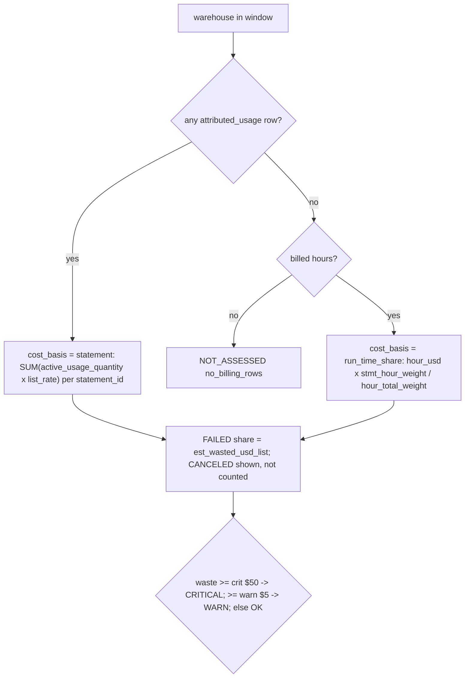

# Per-statement cost: attributed usage, else hour split

A SQL statement's dollars are its own `billing.attributed_usage` DBUs at list price when the warehouse has any attribution in the window; otherwise each billed hour's dollars are split across the statements running in it by task time, overlap-weighted for statements spanning hours. Failed statements' share is possible waste.



## Rule in plain words
- Statements: window days only, warehouse only; weight = `total_task_duration_ms`, else `execution_duration_ms`, else 0 - `app/queries/app/cost/cost_failed_statement_waste.sql:62-70`.
- Attributed basis per statement - `app/queries/app/cost/cost_failed_statement_waste.sql:71-89`.
- Billed hour DBUs/usd per warehouse - `app/queries/app/cost/cost_failed_statement_waste.sql:92-108`.
- Overlap weight: same hour -> full weight; else weight x overlap ms / statement duration - `app/queries/app/cost/cost_failed_statement_waste.sql:114-127`.
- Hour split for FAILED and CANCELED - `app/queries/app/cost/cost_failed_statement_waste.sql:133-155`.
- Basis choice and NA reasons (`no_billing_rows`, `unpriced`) - `app/queries/app/cost/cost_failed_statement_waste.sql:173-202`.
- Status bands - `app/queries/app/cost/cost_failed_statement_waste.sql:234-239`.
- Same split for `query_top_by_cost` (attributed_usage vs hour_split) - `app/queries/app/performance/query_top_by_cost.sql:34-80`.
- With attribution, idle time belongs to no statement, so groups sum below warehouse spend - `app/queries/app/performance/query_top_by_cost.sql:62-65`.
- Hour split can overlap `compute_warehouse_idle_minutes` a little - `app/queries/app/cost/cost_failed_statement_waste.sql:43-47`.

## Formula
```
statement basis : waste = SUM(attr.usd of FAILED statements)
run_time_share  : waste = SUM_h hour_usd(h) * w(s,h) / SUM_s' w(s',h)  over FAILED s
w(s,h) = weight_ms * (same hour ? 1 : overlap_ms(s,h) / max(duration_ms, 1))
failed_cost_share_pct = waste * 100 / base_usd
```

## Example (test)
| warehouse | basis | waste | attributed/base | share | status |
|---|---|---|---|---|---|
| `iw_wh_fail` | statement | 6.00 | 8.50 | 70.6% | WARN |
| `iw_hf_wh` | run_time_share | 7.00 (hour 18: 300 of 500 ms of $10 = $6; hour 19: $1) | 12.00 | 58.3% | WARN |
| `iw_wh_fail_noattr` | none | None | None | None | NOT_ASSESSED `no_billing_rows` |
Source: `tests/test_findings/test_cost_failed_statement_waste.py:37-60`.

## Edge / rejected cases
- A failed statement with no attributed row costs $0 (failed before using compute) - `app/queries/app/cost/cost_failed_statement_waste.sql:24-25`.
- Serverless notebook/job statements (no warehouse_id) are out of scope - `app/queries/app/cost/cost_failed_statement_waste.sql:6-7`.
- FREE_USAGE SKUs never count as unpriced - `app/queries/app/cost/cost_failed_statement_waste.sql:77-78`.

## Implementing code
- `app/queries/app/cost/cost_failed_statement_waste.sql:60-240`, `app/queries/app/performance/query_top_by_cost.sql`

## Config knobs
- `:period_days` 30, `:warn_waste_usd` 5, `:crit_waste_usd` 50 - `app/queries/app/cost/cost_failed_statement_waste.sql:9-11`; override in `config/thresholds.yml`.
