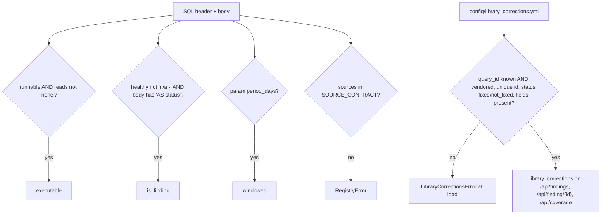

# Query registry classification and library corrections

The registry reads every query's header: a query is *executable* when runnable with real `reads`, a *finding* when its `healthy` text is not "n/a -" and its body emits `AS status`, *windowed* when it takes `:period_days`. Known defects in vendored queries are disclosed from `config/library_corrections.yml`, which must validate or the app fails loudly.

## Rule in plain words
- Executable / is_finding / windowed - `app/core/registry.py:239-246`; status regex and DEC-08 rationale - `app/core/registry.py:179-184`.
- Source contract (allowed system tables) - `app/core/registry.py:41-67`; parse errors raise - `app/core/registry.py:155-176`.
- `next:` tokens must resolve - `app/core/registry.py:282-291`.
- Corrections: status values, required fields - `app/core/library_corrections.py:61-63`.
- Only vendored query ids may have an entry (app-owned bugs are fixed directly) - `app/core/library_corrections.py:115-128`.
- Cached; grouped per query id - `app/core/library_corrections.py:158-194`.
- Same JSON shape on every endpoint - `app/api/service.py:1096-1124`.

## Example (test / config)
- 103 vendored, 42 inventory, 60 findings, 1 counterexample (`cost_premium_serverless_photon`: real `healthy` text, no status band), 3 non-executable - `tests/test_registry.py:47-133`.
- Real register loads; every entry is a known vendored query with problem, effect and fix - `tests/test_library_corrections.py:50-68`.
- Entry `cost_actual_vs_list_by_sku-ratio-backwards`: banded CRITICAL on a ratio always >= 1; fixed to NOT_ASSESSED - `config/library_corrections.yml:3-15`.

## Edge / rejected cases
- Unknown or non-vendored query id, duplicate id, bad status, blank or unknown field -> `LibraryCorrectionsError` - `app/core/library_corrections.py:66-71`, `tests/test_library_corrections.py:70-214`.
- A missing register file loads as `[]` - `app/core/library_corrections.py:158-184`.

## Implementing code
- `app/core/registry.py:41-291`, `app/core/library_corrections.py:55-194`, `app/api/service.py:1096-1124`

## Config knobs
- `config/library_corrections.yml` (157 entries: 153 fixed, 4 not_fixed).
