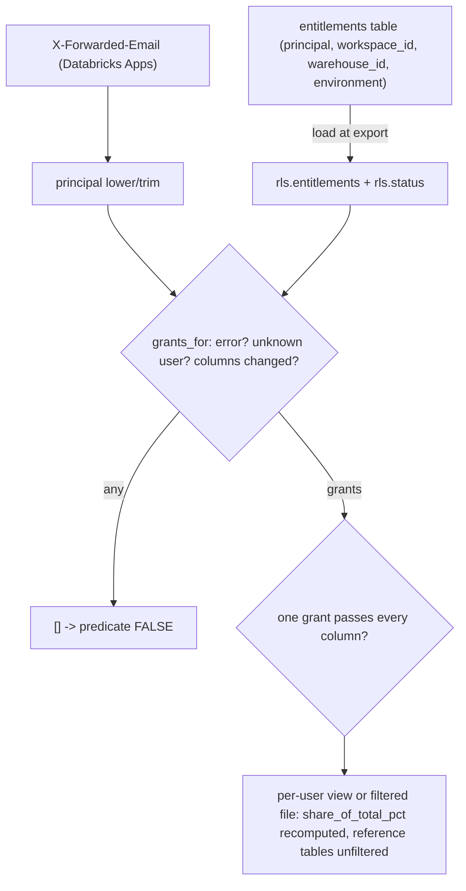

# Row-level security (entitlements)

When `rls.enabled`, a signed-in user sees a row only if ONE of their grant rows passes on every configured column (workspace, warehouse, environment; `*` = all); a NULL or account-level (`0`) row needs `*`; any load error, unknown user or newly added column means no rows (fail closed).



## Rule in plain words
- Columns map: workspace -> `workspace_id`, warehouse -> `warehouse_id`, environment -> `env` - `app/core/rls.py:27`.
- Same-grant rule; any all-`*` grant -> TRUE; no grants -> FALSE - `app/core/rls.py:134-146`.
- Workspace `'0'` is the account bucket (NULLIF) and environment is compared lower-case - `app/core/rls.py:119-126`.
- Entitlements load: principal lower/trim, empty grant cell = `*`, missing column or file -> empty table with reason - `app/core/rls.py:228-270`.
- `grants_for` fails closed on a load error, unknown user, or `rls.columns` widened after load - `app/core/rls.py:273-289`.
- Filtered schemas: `findings`, `dims`, `tags`, `usage`, `storage`, `warehouse` - `app/core/rls.py:29`. A table with no workspace column (e.g. `storage.table_detail`, `usage.table_grants`) gets a NULL `workspace_id`, so only a user granted every workspace sees it - `app/core/rls.py:1-8`.
- Reference tables (list prices, node types, and the `*_info` export notes of usage/storage/warehouse) are seen in full - `app/core/rls.py:32-38`.
- Chargeback shares are recomputed over the user's rows so they sum to 100 - `app/core/rls.py:39-50`, `app/core/rls.py:310-316`.
- Account-level ABAC policies only for a user who sees all workspaces - `app/core/rls.py:326-329`.
- Export mode writes a fresh file per grant set, so other users' bytes are not present - `app/core/rls.py:387-423`.
- Principal from `X-Forwarded-Email` - `app/api/app.py:188-202`.
- `POST /api/refresh` with rls on: only `refresh.admins` (config/app.yml) or a user whose grants cover everything (`unrestricted`), else 403 - `app/api/app.py:401-411`, `app/core/rls.py:149`.
- Query mode: a newer db file retires the old per-user handle (closed after a grace, not at once) - `app/core/rls.py:587-612`, `app/core/data.py:332-339`.

## Formula
```
visible(row) = EXISTS grant g: AND over cols c (g.c = '*' OR g.c = row_value(c))
row_value(workspace) = NULLIF(workspace_id, '0');  row_value(environment) = lower(env)
```

## Example (test)
- Grants (1, dev) and (2, prod): keeps 1/dev and 2/prod, not 1/prod -> 2 rows - `tests/test_rls.py:62-65`.
- `*` gives everything; no grant nothing - `tests/test_rls.py:68-70`.
- NULL and `0` workspace rows need `*`; environment matched case-insensitively - `tests/test_rls.py:73-77`.
- Load normalises principals (user A in upper case still matches) and fails closed on an error ("boom") - `tests/test_rls.py:88-96`.
- Filtered file holds none of the excluded rows' bytes; added columns hidden - `tests/test_rls.py:99-113`.
- Per-user chargeback share sums to 100 - `tests/test_rls_api.py:220-227`.

## Edge / rejected cases
- Table name must be `catalog.schema.table` - `app/core/rls.py:51`, `app/core/rls.py:68-85`.

## Implementing code
- `app/core/rls.py:27-330`, `app/core/rls.py:387-423`, `app/core/rls.py:587-612`

## Config knobs
- `config/app.yml:14-21` `rls.enabled` (false), `rls.table`, `rls.columns` (`[workspace]`), `rls.apply` (`query` | `export`).
