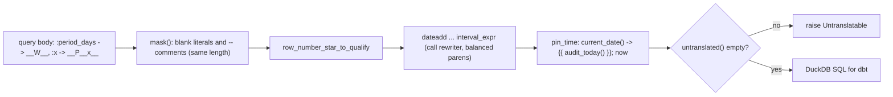

# Databricks SQL -> DuckDB SQL translation

Each vendored query body (sentinel form) runs through 25 ordered rewrite rules that never touch string literals, comments or `__W__`/`__P__x__` tokens; the as-of pinning pair runs last; any Databricks-only construct still present raises `Untranslatable` instead of shipping wrong SQL.

## Rule in plain words
- Input is sentinel form from the generator - `app/core/translate.py:13-15`.
- Masking drives every regex so literals/comments are never rewritten - `app/core/translate.py:17-21`, `app/core/translate.py:52-97`.
- Rule table (name, description, example in/out, fn) - `app/core/translate.py:723-880`.
- First rule rewrites the DuckDB 1.5.1 mis-binding `ROW_NUMBER ... WHERE rn = 1` shape into `QUALIFY` - `app/core/translate.py:27-30`, `app/core/translate.py:732`.
- Last two: `pin_time` and `now` (time pinned to the export's as-of date) - `app/core/translate.py:870-880`.
- Final check: unsupported functions and keywords (RLIKE, LATERAL VIEW, DISTRIBUTE/CLUSTER/SORT BY) - `app/core/translate.py:884-915`.
- `translate` = all rules, then refuse leftovers - `app/core/translate.py:918-926`.
- Helpers: `strip_resource_mask` (name-preview CASE -> plain column) and `mask_user_identities` (identity CASE -> macro) - `app/core/translate.py:245-256`, `app/core/translate.py:285-292`.

## Example (rule table / test)
- `dateadd(day, -LEAST(__W__, 90), current_date())` -> `({{ audit_today() }} - (LEAST(__W__, 90)) * INTERVAL 1 DAY)` - `app/core/translate.py:757-762`.
- `datediff(current_date(), DATE(inv.last_altered))` -> `date_diff('day', CAST(inv.last_altered AS DATE), {{ audit_today() }})` - `app/core/translate.py:823-827`.
- Every rule's example round-trips through the whole table - `tests/test_translate.py:57-62`.
- Order: `row_number_star_to_qualify` first, `pin_time`, `now` last; `lateral_view` before `explode` - `tests/test_translate.py:46-54`.
- Tokens untouched in every position - `tests/test_translate.py:509-524`.
- `size(x)` inside a literal or comment survives; real `size(l)` -> `len(l)` - `tests/test_translate.py:527-534`.
- `from_unixtime(x)` and `DISTRIBUTE BY` raise - `tests/test_translate.py:596-605`.

## Edge / rejected cases
- A comment inside a rewritten call is dropped, not swallowing the rest - `tests/test_translate.py:537-541`.
- A recognised shape that cannot be finished raises rather than half-rewrite - `app/core/translate.py:30`.

## Implementing code
- `app/core/translate.py:1-926`

## Config knobs
- None.
