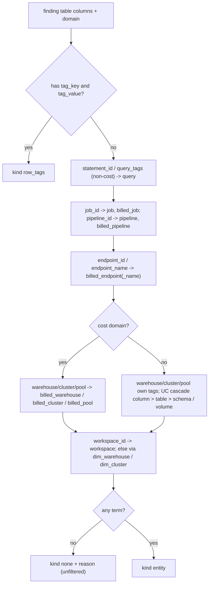

# Tag chain: which tag reaches a finding's rows

For a non-spend check, the tag filter is matched through an ordered chain of `tags.tag_entity` lookups built from the table's OWN columns and domain (query -> job/pipeline -> endpoint -> compute -> UC object -> workspace); the first allocating value on a row wins.

## Rule in plain words
- Built from columns, never a hard-coded per-query list - `app/core/tags.py:418-432`.
- Row-tags branch - `app/core/tags.py:433-435`.
- Query term only outside the cost domain - `app/core/tags.py:448-452`.
- Job/pipeline own then as-billed terms - `app/core/tags.py:454-469`; endpoints - `app/core/tags.py:471-475`; `cost_chargeback_by_cluster` kind-specific terms - `app/core/tags.py:477-490`.
- Cost domain reads billed compute tags; other domains read the resource's own tags and the UC cascade - `app/core/tags.py:492-527`, cascade `app/core/tags.py:375-415`.
- Workspace term; without a workspace column, the warehouse's/cluster's workspace from the dims - `app/core/tags.py:529-543`.
- Workspace match is only added when the table has `workspace_id` (else a binder error) - `app/core/tags.py:439-446`.
- No terms -> `kind="none"` with a plain reason - `app/core/tags.py:356-358`, `app/core/tags.py:545-546`.
- SQL per term: `min(tag_value)` from `tags.tag_entity` where `is_allocating` - `app/core/tags.py:577-588`; reporting columns `tag_match_value/level/source` - `app/core/tags.py:634-651`.
- Spend checks with a `app/queries/tag_spend/` variant bypass the chain (see [tag_spend_filter](tag_spend_filter.md)) - `app/core/data.py:597-602`.

## Example (test)
- `query_costly_statements` -> `["query", "compute", "workspace"]` - `tests/test_tag_filter.py:125-130`.
- `cost_chargeback_by_tag` -> `row_tags` - `tests/test_tag_filter.py:133-137`.
- `pricing_list_prices_raw` -> `none` with a reason - `tests/test_tag_filter.py:140-146`.
- `cost_dollarized_by_sku_day` -> `["workspace"]` - `tests/test_tag_filter.py:149-154`.
- `access_dead_table_candidates` -> `["object", "object"]` (table, schema) - `tests/test_tag_filter.py:157-162`.
- `cost_chargeback_by_cluster` chain starts `job, job, pipeline, pipeline, compute` - `tests/test_tag_spend.py:82-88`.
- `compute_warehouse_idle_gaps` (no workspace column) -> `["compute", "workspace"]` - `tests/test_tag_spend.py:91-98`.

## Edge / rejected cases
- A CATALOG securable matches nothing (catalog tags not modelled) - `app/core/tags.py:403-409`.
- Table without `workspace_id` does not crash - `tests/test_tag_filter.py:354-382`.

## Implementing code
- `app/core/tags.py:317-547` (`ChainTerm`, `TagChain`, `tag_chain`)

## Config knobs
- None.
