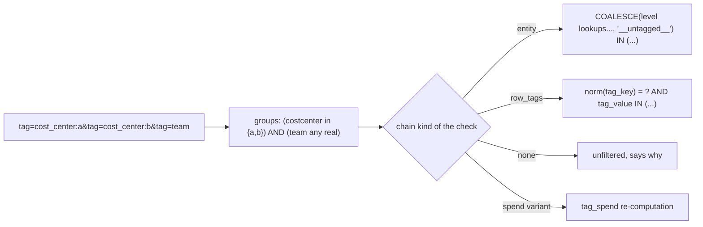

# Tag filter semantics (OR within a key, AND across keys)

The top-bar Tag filter is a set of groups: values of one key widen (OR), different keys narrow (AND); a key with no value means "any real value"; `__untagged__` means "no value at any level"; a filter that cannot apply to a check is never half-applied.

## Rule in plain words
- Legacy pair `tag_key`/`tag_value`: value without key -> `ValueError` (422); key normalising to empty -> `ValueError`; nothing -> no filter - `app/core/tags.py:61-74`.
- Repeated `tag` entries: `"<key>"` = All, `"<key>:<value>"` split on the FIRST `:`; a key with `:` must be percent-encoded - `app/core/tags.py:108-146`.
- Same key twice ORs values; "All" swallows specific values - `app/core/tags.py:119-128`.
- Entity chain compare: any value -> `<> '__untagged__'`; untagged -> `= '__untagged__'`; values -> `IN (...)` - `app/core/tags.py:676-688`, `app/core/tags.py:708-728`.
- Row-tags chain (a table with its own `tag_key`/`tag_value`): `__untagged__` is not representable -> not applicable; more than one key -> not applicable - `app/core/tags.py:665-674`, `app/core/tags.py:754-761`.
- Never partially apply: any group not applicable -> the whole set is not applicable - `app/core/tags.py:700-704`, `app/core/tags.py:766-769`.
- Values are always bound parameters; only closed-vocabulary identifiers are spliced - `app/core/tags.py:20-23`.
- Rollup and compliance apply the same AND/OR contract - `app/core/rollup.py:516-561`, `app/core/tag_compliance.py:89-106`.

## Example (test)
- `tg_cc:alpha` OR `tg_cc:etl` on `cost_by_compute_resource` -> `{tg_wh_a1, tg_wh_a2, tg_cl_a1, tg_cl_a2}` - `tests/test_tag_filter.py:422-435`.
- `tg_cc:alpha` AND `tg_env:prod` on warehouse posture -> `{tg_wh_a1}` only - `tests/test_tag_filter.py:438-451`.
- Row-tags chain with `__untagged__` -> `None` (not applicable) - `tests/test_tag_filter.py:453-462`.
- `["tg_cc:alpha", "tg_cc"]` -> one All group - `tests/test_tag_filter.py:417-419`.
- Untagged + any value = everything, per object type on the Tags page - `tests/test_tag_compliance.py:161-171`.

## Edge / rejected cases
- `["___:x"]` normalises to empty -> `ValueError` - `tests/test_tag_filter.py:390-392`.
- Tag models not built -> NOT_ASSESSED, never unfiltered rows - `app/core/tags.py:45-48`, `tests/test_tag_filter.py:491-512`.
- A key left out of the export (`export_tag_keys`) yields empty check tables ($0) - `config/settings.yml:38-42`, `README.md:594-598`.

## Implementing code
- `app/core/tags.py:56-146` (filter types), `app/core/tags.py:652-774` (clauses)

## Config knobs
- `export_tag_keys` (`config/settings.yml:38-42`), `load.top_tag_keys` / `load.tag_keys` (`config/settings.yml:47-56`).
