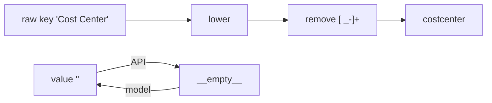

# Tag key normalisation and sentinel values

Tag keys are compared after lower-casing and removing every space, `_` and `-` ("Cost Center" = "cost-center" = "cost_center" = `costcenter`); four reserved `__x__` values stand for untagged, mixed, none and key-only.

## Rule in plain words
- Python normaliser `normalize_tag_key` (None or separators-only -> `""`) - `app/core/tag_keys.py:64-73`.
- dbt twin `norm_tag_key` (DuckDB needs the `'g'` flag; Spark replaces all by default) - `dbt/macros/norm_tag_key.sql:18-24`.
- Inline DuckDB copy used by the tag filter SQL - `app/core/tags.py:561-565`; tag compliance copy - `app/core/tag_compliance.py:35-37`.
- Sentinels: `__untagged__` (thing exists, no value), `__mixed__` (inferred level, no dominant value), `__none__` (no thing at this level), `__empty__` (API spelling of a key-only tag stored as `""`) - `app/core/tag_keys.py:14-19`.
- A real value includes key-only `""`; sentinels and None are not real - `app/core/tag_keys.py:87-89`.
- API <-> model value mapping - `app/core/tag_keys.py:76-84`.
- Same-meaning keys: `env` counts as `environment` unless both are mandatory - `app/core/tag_compliance.py:40-53`.
- When one map holds two spellings of the same key, the alphabetically first raw key wins - `dbt/models/tags/tag_workspace_history.sql:40-46`, `dbt/models/tags/cost_unit_tag.sql:41`.
- Source codes and their on-screen words - `app/core/tag_keys.py:39-62`.

## Example (test)
- `TagFilter.from_params("TG-CC", "alpha")` -> key `tgcc` - `tests/test_tag_filter.py:105-108`.
- `tag_value="__empty__"` -> stored `""` - `tests/test_tag_filter.py:111-113`.
- `key_variants(["costcenter","environment"])` maps `env -> environment`; with both mandatory each stays itself - `tests/test_tag_compliance.py:72-75`.
- Illustrative (derived from `app/core/tag_keys.py:73`): `"__"` -> `""`, rejected by the API.

## Edge / rejected cases
- A key normalising to `""` is a `ValueError` (422) - `app/core/tags.py:70-72`, `app/core/tags.py:137-139`.
- Real values never start with `__` - `app/core/tag_keys.py:14`.
- Top-tag keys must already be lower case with underscores - `app/core/config.py:804-805`.

## Implementing code
- `app/core/tag_keys.py:1-89`, `dbt/macros/norm_tag_key.sql:1-24`

## Config knobs
- `mandatory_tag_keys` and `top_tags` are normalised the same way - `README.md:600-601`.
