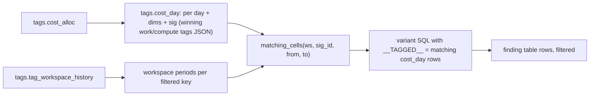

# Spend checks under a tag filter (tags.cost_day + tag_spend)

A billed dollar belongs to a tag value when its most specific tag carries it (query, job or pipeline, then the bill's compute tag, then the workspace's tag on that day); spend checks with a variant in `app/queries/tag_spend/` are re-computed over exactly those dollars, so totals, changes and statuses follow the filter.

## Rule in plain words
- `cost_day`: one row per (day, workspace, cloud, SKU, product, unit, flags, sig); per key the work value wins over the compute value; rows sum exactly to billing - `dbt/models/tags/cost_day.sql:1-12`, precedence `dbt/models/tags/cost_day.sql:30-43`, sums `:52-60`.
- `sig` JSON = `[{"k","v","l","s"}]`, `sig_id = md5(sig)`, `'[]'` when untagged - `dbt/models/tags/cost_day.sql:10-12`, `:44-51`.
- Workspace level is added at request time from `tag_workspace_history` periods (open ends = None; before a tag first showed carries none) - `app/core/tag_spend.py:72-93`.
- `_resolve`: own entry -> its origin; else inherited workspace value; else `__untagged__`; all groups must match (AND), values OR, no values = any real - `app/core/tag_spend.py:96-113`.
- Origins map, most specific first - `app/core/tag_spend.py:28-39`.
- `matching_cells` collapses a sig matching on every period to one open cell - `app/core/tag_spend.py:116-129`.
- `table_sql`: only when a variant exists, a filter is set and `cost_day` is built; ids validated by regex before splicing - `app/core/tag_spend.py:197-215`, regexes `:23-24`.
- Variant placeholders `__TAGGED__`, `__W__`, `__P__<name>__` (thresholds via `resolve_params`) - `app/core/tag_spend.py:188-224`.
- `origins()` splits the kept dollars per key by origin - `app/core/tag_spend.py:132-181`.
- Chain words shown to the user - `app/core/tag_spend.py:20-21`, `app/core/data.py:597-602`.

## Example (test)
- `cost_day` total == `cost_unit` total per window - `tests/test_tag_spend.py:33-43`.
- Every variant over all dollars reproduces its check's numeric sums and status counts - `tests/test_tag_spend.py:45-59`.
- `cost_chargeback_by_workspace` under `tg_cc=alpha` sums to the rollup's `selected` alpha usd (206) - `tests/test_tag_spend.py:62-72`, `tests/test_api_rollup.py:45-53`.
- Origins: work origins == rollup `by_level.work`, workspace origin == `by_level.workspace` - `tests/test_tag_spend.py:100-113`.
- No match -> `ok_empty_filters` - `tests/test_tag_spend.py:75-79`.

## Edge / rejected cases
- No filter -> `origins` returns None; API `keys: []` - `app/core/tag_spend.py:135-136`, `tests/test_tag_spend.py:116-117`.
- NULL workspace is keyed `~` - `app/core/tag_spend.py:26`, `app/core/tag_spend.py:127`.

## Implementing code
- `app/core/tag_spend.py:1-224`, `dbt/models/tags/cost_day.sql:1-60`, variants `app/queries/tag_spend/*.sql` (14 files)

## Config knobs
- Thresholds of the re-computed check (`config/thresholds.yml`) via `app/core/tag_spend.py:188-194`.
