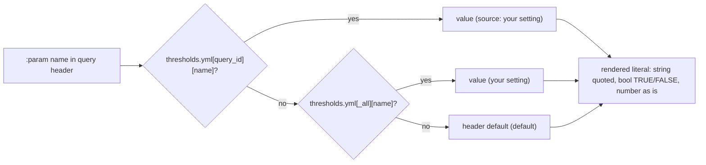

# Check thresholds: query, then _all, then header default

Every `:param` a check's SQL header declares resolves as `thresholds.yml[query_id][name]`, else `thresholds.yml[_all][name]`, else the header default; values are baked into the exported SQL, so a change needs a rebuild and a new export.

## Rule in plain words
- dbt macro: query map, then `_all`, then default - `dbt/macros/param.sql:10-30`.
- Python mirror for screens and the Settings page, with source label - `app/core/config.py:617-633`.
- Strings are single-quote escaped; booleans render TRUE/FALSE - `dbt/macros/param.sql:21-29`.
- Values must be numbers; param names strings - `app/core/config.py:610-613`.
- Missing file is seeded with `task_cluster_utilization.top_n = 100000` - `app/core/config.py:677-687`.
- Built into the export SQL: edit -> `python tools/build_direct_sql.py` -> export again; otherwise the export stops with a "changed since the SQL was generated" message - `README.md:389-392`.
- Materiality floors are separate and apply at read time - `README.md:384-387`, see [materiality_and_severity](materiality_and_severity.md).

## Example (test / config)
- query level 42 wins; `_all` 99 is the fallback; query 7 beats `_all` 99 - `tests/test_dbt_skeleton.py:110-130`.
- Direct-SQL builder renders like the macro: `SELECT 3, 'a''b', TRUE`; with `_all.n=9`, `q1.f=False` -> `SELECT 9, 'a''b', FALSE` - `tests/test_build_direct_sql.py:38-41`.
- Shipped overrides: `task_cluster_utilization.top_n` 100000, `node_timeline_utilization.min_slices` 15 - `config/thresholds.yml:7-11`.

## Edge / rejected cases
- A non-number value -> `ConfigError` - `app/core/config.py:612-613`.
- An empty file is a complete, valid threshold set - `config/thresholds.yml:3-5`.

## Implementing code
- `dbt/macros/param.sql:10-30`, `app/core/config.py:600-633`, `app/core/config.py:677-695`

## Config knobs
- `config/thresholds.yml` (per query or `_all`); e.g. `cost_chargeback_by_allocation_tag.allocation_keys` (commented example) - `config/thresholds.yml:12-17`.
