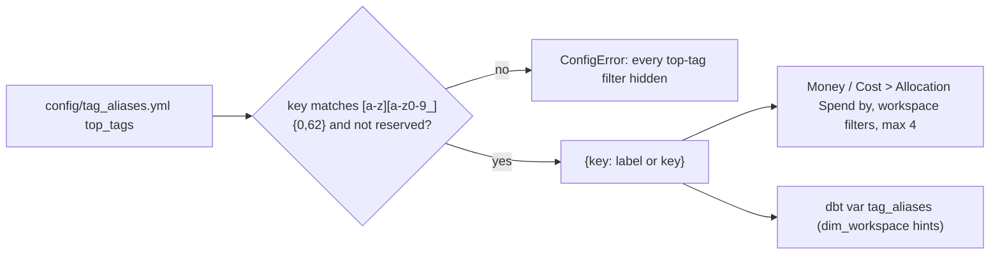

# Top tags (config/tag_aliases.yml)

`top_tags` names up to 4 tag keys shown as "Spend by" headlines and workspace filters, in file order; each key is validated and gets a display name.

## Rule in plain words
- File shape: exactly one top-level key `top_tags` - `app/core/config.py:796-801`.
- Key regex and reserved names (columns/params the app uses: `env`, `name`, `tag`, `status`, ...) - `app/core/config.py:786-791`, `app/core/config.py:804-805`.
- Empty label -> the key itself - `app/core/config.py:808`.
- Missing file is seeded with the defaults - `app/core/config.py:792`, `app/core/config.py:812-820`.
- A broken file returns `{}` so callers never crash (filters hidden) - `app/core/config.py:823-828`, `README.md:615`.
- At most 4 shown - `app/core/config.py:785`, `config/tag_aliases.yml:6`.
- Matching ignores case, spaces, `_` and `-` - `config/tag_aliases.yml:3-4`.
- A workspace's value for a top tag uses the coverage/share floors - `config/tag_aliases.yml:11-12`, see [workspace_tag_inference](workspace_tag_inference.md).
- Mandatory tags get their own top-bar filter instead - `config/tag_aliases.yml:2`, `README.md:611-612`.

## Example (config)
- Shipped: `cost_center: Cost center`, `domain: Domain`, `team: Team`, `business_unit: Business unit` - `config/tag_aliases.yml:15-19`.
- `{"env": "Env"}` and `{"Cost Center": None}` -> ConfigError; `{"bu": None}` -> `{"bu": "bu"}` - `tests/test_workspace_attributes.py:78-82`.
- `/api/meta` lists top tags in file order, first `cost_center: Cost center`, at most `TOP_TAGS_SHOWN` - `tests/test_attribute_filter.py:62-68`.

## Edge / rejected cases
- Two keys are never merged into one filter - `README.md:614`.
- A new key needs `python tools/load_direct_results.py`; a name change only a page refresh - `README.md:585`.

## Implementing code
- `app/core/config.py:785-828`; dbt feed `tools/dbt_run.py:13`, var `dbt/dbt_project.yml:35-40`

## Config knobs
- `config/tag_aliases.yml:15-19`
