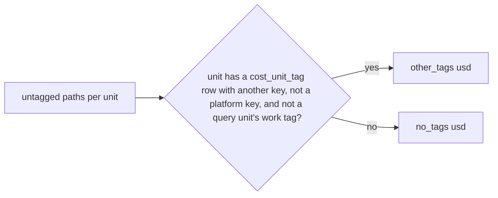

# Untagged spend split: other tags vs no tags

The untagged dollars for a key are split into units that carry OTHER (non-platform) tags - a key to rename or merge - and units with no tags at all - to tag.

## Rule in plain words
- Only paths whose effective value is `__untagged__` count - `app/core/rollup.py:722-725`.
- "Other tags" = any `cost_unit_tag` row on the unit with `tag_key <> key` and not in `PLATFORM_TAG_KEYS` - `app/core/rollup.py:730-741`.
- A query unit is a whole warehouse: one query's work-level tags do not move its untagged dollars - `app/core/rollup.py:728-737`.
- Platform keys (vendor, creator, clustername, jobid, sqlwarehouseid, auditapp, ...) say nothing about ownership - `app/core/tag_keys.py:21-27`.
- Both figures are rounded with the what-if twin - `app/core/rollup.py:744-745`.

## Example (test)
- units cl (project on cluster) $10, pf (vendor only) $20, wh (one query's team tag) $30, job (own project tag) $40 -> `other_tags` 50 (cl + job), `no_tags` 50 (pf + wh) - `tests/test_api_rollup.py:254-274`.

## Edge / rejected cases
- Cost area only; performance returns `None` - `app/core/rollup.py:674`.

## Implementing code
- `app/core/rollup.py:719-745`

## Config knobs
- None (platform list is code) - `app/core/tag_keys.py:23-27`.
