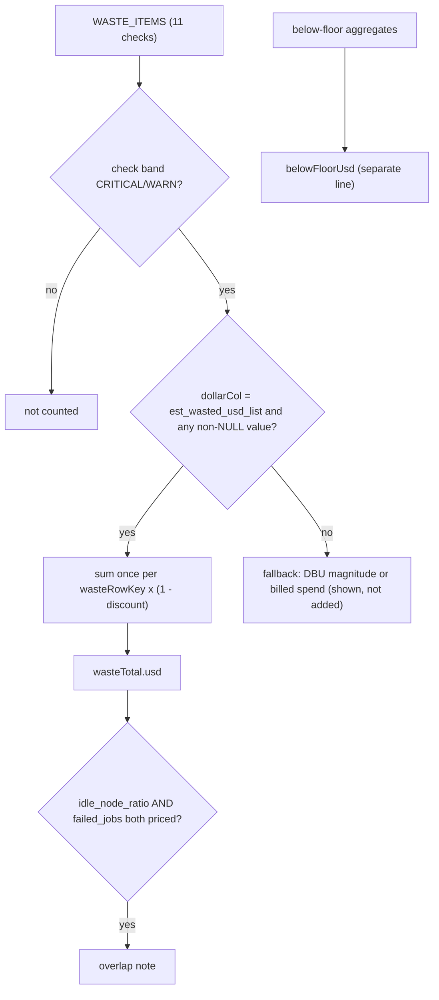

# Possible waste total

The Overview/Waste headline adds `est_wasted_usd_list` from the flagged rows of the waste checks only, once per resource, x (1 - discount); checks without a waste price show DBUs or billed spend for scale and are never added; below-floor dollars are reported beside, never inside.



## Rule in plain words
- Only `est_wasted_usd_list` is a waste dollar - `web/src/components/waste_total.ts:48-50`; contract test `tests/test_waste_contract.py:54-58`.
- Waste checks and their columns - `web/src/components/tab_registry.ts:103-115`; dollar-priced ones: warehouse idle minutes, idle node ratio, failed job runs, failed statements, serving endpoints with no requests - `web/src/components/tab_registry.ts:104-108`, `README.md:367-377`.
- One key per resource at the check's grain (warehouse, job, cluster, endpoint + served entity) - `web/src/components/waste_total.ts:52-67`.
- Only CRITICAL/WARN rows count - `web/src/components/waste_total.ts:69-71`.
- All-NULL values read "unknown", never $0 - `web/src/components/waste_total.ts:73-96`.
- Fallbacks: DBU magnitude, else billed spend (`spendCol`) for scale - `web/src/components/waste_total.ts:98-104`, `web/src/components/waste_total.ts:124-130`.
- Total = sum of priced flagged entries; overlap note when idle-node and failed-job waste are both priced - `web/src/components/waste_total.ts:187-203`.
- Below-floor dollars x (1 - discount) kept separate - `web/src/components/waste_total.ts:205-215`.

## Formula
```
waste_usd(check) = SUM over distinct wasteRowKey of flagged est_wasted_usd_list * (1 - discount_pct)
total            = SUM waste_usd(check) for flagged checks with a non-null waste_usd
```

## Example (test)
- Every `dollarCol` is `est_wasted_usd_list` or null - `tests/test_waste_contract.py:54-58`.
- Each `dollarCol`/`dbuCol` is an output column of its own query - `tests/test_waste_contract.py:61-69`.
- `compute_warehouse_idle_gaps` (whole warehouse spend) is not a waste item - `tests/test_waste_contract.py:72-79`.
- Illustrative (from `web/src/components/waste_total.ts:75-88`): two flagged rows for the same `ws:warehouse` with $30 each add $30, not $60.

## Edge / rejected cases
- No monthly projection of waste - `tests/test_waste_contract.py:82-85`.
- Pools, all-purpose jobs, stale jobs, pipeline tails, dormant endpoints, premium SKUs carry no waste $ - `web/src/components/tab_registry.ts:109-114`.

## Implementing code
- `web/src/components/waste_total.ts:48-221`, `web/src/components/tab_registry.ts:103-117`

## Config knobs
- `discount_pct` (`config/settings.yml:13-15`); floors (`config/materiality.yml:24-33`); idle gap etc. in `config/thresholds.yml`.
