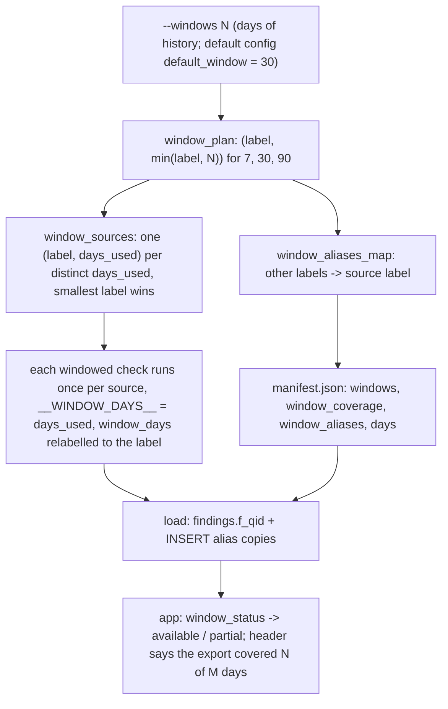

# Export window plan, aliases and partial windows

A direct export always fills the app's three windows 7/30/90: each label gets `days_used = min(label, days exported)`; a label whose days_used a smaller label already covers is an alias (never queried, its rows copied at load), and the app marks a window "partial" when its days_used is below the label.



## Rule in plain words
- Labels are fixed: `WINDOW_LABELS = (7, 30, 90)` - `tools/export_direct_results.py:219`.
- `window_plan(days)` = `[(w, min(w, days)) for w in labels]` - `tools/export_direct_results.py:222-225`.
- `window_sources`: one run per DISTINCT days_used, at the smallest label that has it - `tools/export_direct_results.py:228-233`.
- `window_aliases_map`: every label whose days_used is already run under a smaller label - `tools/export_direct_results.py:236-243`.
- Default days: `default_window` from settings (30 shipped), fallback 30 when settings cannot be read - `tools/export_direct_results.py:211-216`, `config/settings.yml:18`, `tools/export_direct_results.py:184`.
- A windowed check is one whose SQL carries `__WINDOW_DAYS__` (registry `windowed`) - `tools/export_direct_results.py:246-250`; a run relabels `window_days` from days_used to the label - `tools/export_direct_results.py:424-431`, `tools/export_direct_results.py:773-777`.
- Truncation follows the alias: an alias of a truncated source is truncated too - `tools/export_direct_results.py:1279-1283`.
- Manifest keys `windows`, `window_coverage` ({label: days_used}), `window_aliases`, `days` - `tools/export_direct_results.py:1144-1151`, `tools/export_direct_results.py:1328-1336`.
- Loader copies source rows under each alias label for windowed findings and windowed tag tables - `tools/load_direct_results.py:598-606`, `tools/load_direct_results.py:677-688`; no manifest -> aliases inferred from the windows the files hold - `tools/load_direct_results.py:447-461`.
- App: `exported_window_coverage()` reads `window_coverage`; an older manifest falls back to the measured day span - `app/core/data.py:3472-3490`; `window_status` gives `{days, available, covered_days, partial}` per label - `app/core/data.py:3493-3511`, served by `/api/meta` - `app/api/app.py:432-433`.
- A label not in `window_coverage` is unavailable: the window button is hidden - `web/src/App.tsx:263-271` - and a request for it is NOT_ASSESSED with "the export covered N days; the W-day window was not exported" - `app/api/service.py:262-272`.
- Header text uses the covered days, not the label: "the export covered N of the M days you picked" - `app/api/service.py:222-245`.
- A dbt/snapshot build has no coverage meta: every label is fully available - `app/core/data.py:3479-3482`, `app/core/data.py:3503-3505`.

## Formula
```
plan(N)    = [(7, min(7,N)), (30, min(30,N)), (90, min(90,N))]
sources    = first label per distinct days_used
aliases    = {label: source_label} for the rest
partial(w) = window_coverage[w] < w
```

## Example (test `tests/test_export_direct_results.py:297-316`)

| N days | plan | sources (queried) | aliases |
|---|---|---|---|
| 5 | (7,5) (30,5) (90,5) | (7,5) | 30->7, 90->7 |
| 10 | (7,7) (30,10) (90,10) | (7,7) (30,10) | 90->30 |
| 30 (default) | (7,7) (30,30) (90,30) | (7,7) (30,30) | 90->30 |
| 45 | (7,7) (30,30) (90,45) | all three | none |
| 90 or 120 | (7,7) (30,30) (90,90) | all three | none |

- So a default first run shows 90d as "partial" (30 of 90 days). Refresh `days=15` (choices `web/src/api.ts:7-8`) gives plan (7,7) (30,15) (90,15), alias 90->30 (derived from the rule above).

## Implementing code
- `tools/export_direct_results.py:219-250`, `tools/load_direct_results.py:447-461,509-529,598-606,677-688`, `app/core/data.py:3443-3511`, `app/api/service.py:215-272`

## Config knobs
- `default_window` (`config/settings.yml:18`), `--windows` on `tools/export_direct_results.py` / `tools/first_run.py`, `days` on `POST /api/refresh` (1..90, `app/api/app.py:402-412`).
