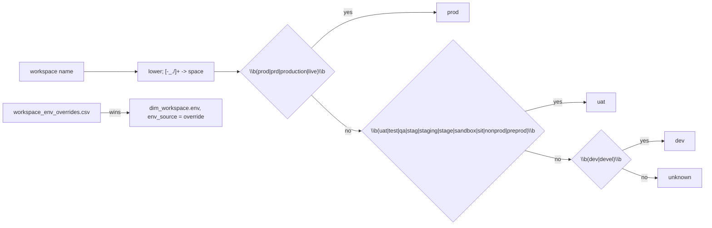

# Workspace environment from its name (prod / uat / dev / unknown)

A workspace's environment is its name, lower-cased with `-_./` runs turned into spaces, matched as WHOLE words against the prod, then uat, then dev word lists; nothing matched reads `unknown`, never a guess. A seed override wins over the name.

## Rule in plain words
- Python twin - `app/core/envmap.py:68-87`; ASCII word boundary to match DuckDB RE2 - `app/core/envmap.py:55-65`.
- dbt twin - `dbt/macros/classify_env.sql:33-61`.
- Word lists - `dbt/dbt_project.yml:48-53`; missing/empty lists raise - `app/core/envmap.py:50-52`.
- None name -> `unknown` - `app/core/envmap.py:79-80`.
- `stag` alone never matches "staging", so `staging`/`stage` are listed too - `dbt/dbt_project.yml:50-51`.
- Workspace tags and `dbt/seeds/workspace_env_overrides.csv` count only in the snapshot/dbt build - `README.md:401-402`.
- Environment feeds the Env filter and env partitions of totals - `tests/test_totals_agree.py:60-84`.

## Example (test)
- `example-prod`, `example_prd`, `example/live`, `EXAMPLE-PROD` -> prod; `example-nonprod`, `example_preprod`, `example-staging` -> uat; `example_devel` -> dev; `notprodx`, `predatory` -> unknown; `prod` + U+00FC + `ktion` -> prod; None -> unknown - `tests/test_envmap.py:100-122`.
- Override seed (workspace 2222 -> uat) beats the name's `dev`; `env_source = override` - `tests/test_envmap.py:238-246`, `tests/fixtures/seeds/workspace_env_overrides.csv:2`.

## Edge / rejected cases
- `nonprod` is uat, not prod: whole-word match means `prod` does not hit inside `nonprod` - `tests/test_envmap.py:113`.
- Python/RE2 parity defect on non-ASCII letters fixed by `re.ASCII` - `app/core/envmap.py:56-62`.

## Implementing code
- `app/core/envmap.py:40-87`, `dbt/macros/classify_env.sql:33-61`

## Config knobs
- `dbt/dbt_project.yml:48-53` `env_patterns` (rerun `python tools/load_direct_results.py` - `README.md:400`).
- `dbt/seeds/workspace_env_overrides.csv` (per-workspace override).
