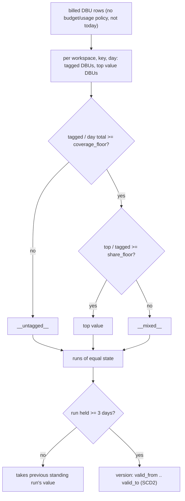

# Workspace tag inference (tag_workspace_history)

No system table holds a workspace's own tags, so each billed day's value is inferred from `billing.usage.custom_tags`: the top value counts when the key covers >= `coverage_floor` of the day's DBUs and the top value holds >= `share_floor` of the tagged DBUs; versions need 3 days to stand.



## Rule in plain words
- Inputs: DBU rows with a workspace, before today, without budget or usage policy - `dbt/models/tags/tag_workspace_history.sql:24-33`.
- Day state CASE - `dbt/models/tags/tag_workspace_history.sql:59-73`.
- Every billed day of the workspace exists for every key it ever carried, so days before a key showed are `__untagged__` - `dbt/models/tags/tag_workspace_history.sql:60-61`, header `:11-13`.
- Runs and 3-day smoothing - `dbt/models/tags/tag_workspace_history.sql:74-103`; versions and `valid_to` = next `valid_from` - `:104-117`.
- `is_allocating` only for a real value - `dbt/models/tags/tag_workspace_history.sql:180`; reason text cites both floors - `:196-209`.
- `tags.tag_workspace` is the current row; spend uses the history by usage date - `dbt/models/tags/tag_workspace.sql:1-15`.
- Azure copies a workspace's tag onto every bill row; elsewhere the inferred value is what most compute carries - `README.md:541-543`, `app/core/tag_compliance.py:287-290`.
- `config/workspace.csv` overrides the bill for listed workspaces, all dates; empty cell = no tag - `app/core/workspace_file.py:1-34`, `README.md:541-549`.

## Formula
```
coverage = tagged_dbus(day, key) / total_dbus(day)
share    = top_value_dbus(day, key) / tagged_dbus(day, key)
state    = coverage < coverage_floor -> '__untagged__'
         | share >= share_floor      -> top value
         | else                      -> '__mixed__'
```

## Example (test / fixture)
| workspace | key | value | share | coverage |
|---|---|---|---|---|
| tg_ws_a | tgcc | alpha | 0.7885 | 0.8333 |
| tg_ws_a | tgenv | `__untagged__` | 1.0 | 0.4386 |
| tg_ws_m | tgcc | `__mixed__` | 0.5556 | 0.9 |
| tg_ws_s | tgcc | `__untagged__` | 1.0 | 0.2 |
Source: `tests/test_tags_index.py:43-56`; scenarios `tests/fixtures/tagworld.py:14-16`, `:38`, `:42`.
- tg_ws_a history: `__untagged__` 2026-03-05 -> 2026-08-07, then alpha; one-day September blips are not versions - `tests/test_tags_index.py:59-70`.
- Query tags are never on the bill, so no workspace row for `tgapp` - `tests/test_tags_index.py:72-78`.

## Edge / rejected cases
- A short first run keeps its own value - `dbt/models/tags/tag_workspace_history.sql:94`.
- Floors must be in [0, 1] - `app/core/config.py:432-435`, `tests/test_tag_filter.py:515-530`.
- Worked over the whole export, not the selected window - `README.md:622`.

## Implementing code
- `dbt/models/tags/tag_workspace_history.sql:1-210`, `dbt/models/tags/tag_workspace.sql:1-15`, `app/core/workspace_file.py:1-40`

## Config knobs
- `config/settings.yml:58-62` `tag_coverage_floor` 0.5, `tag_share_floor` 0.6 (next export); fed as dbt vars - `tools/dbt_run.py:14-15`, defaults `dbt/dbt_project.yml:41`, `dbt/models/tags/tag_workspace_history.sql:21-22`.
