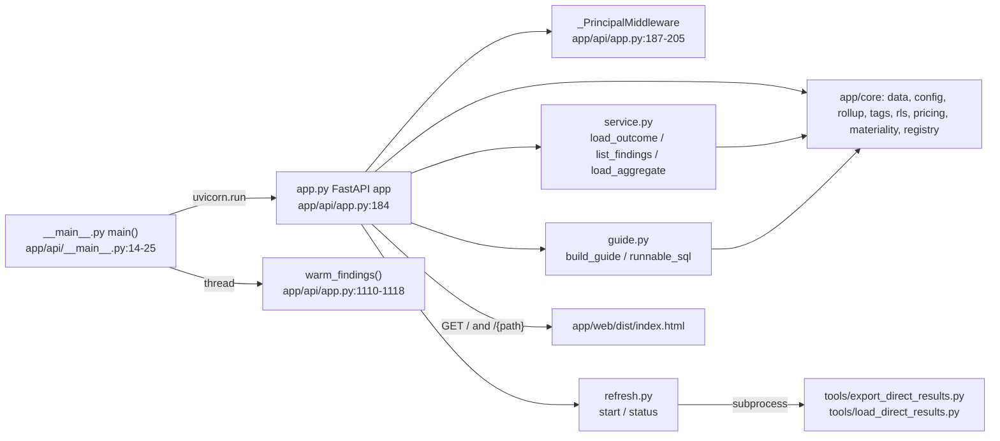

# app/api — FastAPI JSON backend

One FastAPI process (`app/api/app.py`) that serves read-only JSON under `/api/*` over the local DuckDB file, plus the built React page (`app/web/dist`). It never builds SQL itself: every read goes through `app/core` (`app/api/__init__.py:1-10`, `app/api/app.py:1-8`).

## Files

| File | Purpose | Evidence |
|---|---|---|
| `app/api/__init__.py` | Package docstring: read-only JSON over app/core | `app/api/__init__.py:1-10` |
| `app/api/__main__.py` | `python -m app.api` entry: picks host/port, starts uvicorn | `app/api/__main__.py:1-29` |
| `app/api/app.py` | FastAPI app, middleware, every route, caches, static page | `app/api/app.py:1-1488` |
| `app/api/service.py` | Four-outcome "honesty rule" per check, findings list, aggregates, JSON shaping | `app/api/service.py:1-76` |
| `app/api/guide.py` | Guide tab feed and runnable Databricks SQL per check | `app/api/guide.py:1-3`, `app/api/guide.py:182-202`, `app/api/guide.py:566` |
| `app/api/refresh.py` | In-app Refresh: export + load in a background thread, then switch db | `app/api/refresh.py:1-99` |

## `__main__.py`

- `main() -> None` — `app/api/__main__.py:14-25`
  - Host: `AUDIT_API_HOST`, else `0.0.0.0` when `DATABRICKS_APP_PORT` is set, else `127.0.0.1` (`app/api/__main__.py:15-16`).
  - Port: `AUDIT_API_PORT`, else `DATABRICKS_APP_PORT`, else `8000` (`app/api/__main__.py:17`).
  - Prints the db path it opens (`app/core/data._db_path`) and the URL (`app/api/__main__.py:18-20`).
  - Sets `app_core_data.share_connection = True` so the server reuses one read-only DuckDB connection per db file (`app/api/__main__.py:21`, `app/core/data.py:272-275`).
  - Starts `warm_findings` in a daemon thread (`app/api/__main__.py:24`), then `uvicorn.run("app.api.app:app", reload=False)` (`app/api/__main__.py:25`).

## `app.py` — app wiring

- `app = FastAPI(title="Crosshire API")` — `app/api/app.py:184`.
- `_PrincipalMiddleware` — pure ASGI middleware; reads header `x-forwarded-email` (set by Databricks Apps) and binds it with `rls.set_principal` for the request (`app/api/app.py:187-205`, `app/core/rls.py:434-443`).
- `library_corrections.load_corrections()` at import: a broken `config/library_corrections.yml` stops the app from serving (`app/api/app.py:207-211`).
- `_config_error_handler` — any `ConfigError` (bad `config/settings.yml`, bad `rls:` block) becomes a structured 503 `{detail, state: "settings_invalid", key, line}` (`app/api/app.py:221-231`).
- Helpers:
  - `_validate_window(window)` — 422 unless 7/30/90 (`app/api/app.py:234-238`, `app/api/service.py:110`).
  - `_resolve_window(window, settings)` — missing window → `settings["default_window"]` (`app/api/app.py:241-244`).
  - `_open_window(default_window, windows)` — the window the UI opens on: default if the db has it, else the largest available (`app/api/app.py:247-253`).
  - `_validate_statuses(statuses)` — closed set `CRITICAL/WARN/NOT_ASSESSED/OK` (`app/api/app.py:260-263`, `app/api/service.py:109`).
  - `_parse_tag_filter(tag_key, tag_value, tag)` → `TagFilterSet`; bad combination → 422 (`app/api/app.py:266-279`).
  - `_tag_json(tag)` — the echoed `"tag"` object (`app/api/app.py:282-308`).
  - `_populated_attribute_keys(keys)` — top tags at least one workspace carries (`app/api/app.py:324-339`).
- Caches (keyed by `_data_version()` = db identity + config mtimes + sidecars + `rls.scope_key()`): `_FINDINGS_CACHE` (32 entries) and `_ANSWER_CACHE` (64) (`app/api/app.py:1004-1015`, `app/api/app.py:1122-1138`).
- `warm_findings()` — computes the unfiltered findings summary for the default window at start-up; skipped in rls `query` mode (`app/api/app.py:1110-1118`).
- Static page: `index_page()` injects the brand name into `<title>` and `window.APP_BRAND`, 404 with a build hint when `app/web/dist/index.html` is missing (`app/api/app.py:1453-1471`); `/assets` mounted from `app/web/dist/assets` (`app/api/app.py:1479-1480`); `spa_fallback` returns the page for any non-`/api` path (`app/api/app.py:1483-1488`). JS/CSS MIME types forced for Windows (`app/api/app.py:1474-1477`).

## Endpoints

All `GET` unless stated; all return JSON. "core" = function called in `app/core`.

| Endpoint | Handler | Calls | Main params | Evidence |
|---|---|---|---|---|
| `GET /api/status` | `get_status` | `config.load_settings`, `data.db_state` | — | `app/api/app.py:349-377` |
| `GET /api/refresh` | `get_refresh` | `refresh.status` | — | `app/api/app.py:385-387` |
| `POST /api/refresh` | `post_refresh` | `refresh.start(days)`; in the app with rls on, 403 unless the user is in `refresh.admins` (`_refresh_admins`, config/app.yml + app.local.yml) or `rls.unrestricted` | `days` 1-90, default 30 | `app/api/app.py:390-411` |
| `GET /api/meta` | `get_meta` | `data.snapshot_manifest`, `data.run_results`, `data.direct_export_info`, `data.window_status`, `data.cost_cutoff`, `rls.meta`, `registry.load_registry` | — | `app/api/app.py:417-495` |
| `GET /api/workspaces` | `get_workspaces` | `data.read_dim_workspace`, `service.workspace_region` | — (503 if dims unreadable) | `app/api/app.py:509-544` |
| `GET /api/dims` | `get_dims` | `data.read_dim_job/cluster/warehouse/pipeline/notebook` | — | `app/api/app.py:600-641` |
| `GET /api/coverage` | `get_coverage` | `data.snapshot_manifest`, `data.run_results`, `data.direct_source_states`, `data.checks_not_ok`, `data.truncated_query_ids`, `service.region_split_or_none` | — | `app/api/app.py:658-723` |
| `GET /api/guide` | `get_guide` | `guide.build_guide` | — | `app/api/app.py:731-733` |
| `GET /api/guide/sql/{query_id}` | `get_guide_sql` | `guide.runnable_sql` | `window` | `app/api/app.py:736-743` |
| `GET /api/rollup` | `get_rollup` | `rollup.rollup` | `area`, `tag_key` (req.), `window`, `tag_value[]`, `workspace_ids[]`, `env[]`, `tag[]` | `app/api/app.py:754-780` |
| `GET /api/rollup/top` | `get_rollup_top` | `rollup.by_tag_top` | `area`, `tag_key`, `top` 1-100 | `app/api/app.py:783-803` |
| `GET /api/rollup/keys` | `get_rollup_keys` | `rollup.rollup_keys` | `area`, `window` | `app/api/app.py:964-974` |
| `GET /api/tag_origins` | `get_tag_origins` | `data.read_tag_origins` | `window`, `workspace_ids[]`, `env[]`, `tag[]` | `app/api/app.py:806-817` |
| `GET /api/workspace_tags` | `get_workspace_tags` | `data.read_workspace_tags` | `workspace_ids[]`, `env[]`, `tag[]` | `app/api/app.py:820-832` |
| `GET /api/abac_policies` | `get_abac_policies` | `data.read_abac_policies` | — | `app/api/app.py:835-837` |
| `GET /api/workspace_usage` | `get_workspace_usage` | `data.read_workspaces` | `window`, scope, `tag[]` | `app/api/app.py:840-849` |
| `GET /api/workspace_schemas` | `get_workspace_schemas` | `data.read_workspace_schemas` | `workspace_id`, `window` | `app/api/app.py:852-855` |
| `GET /api/activity` | `get_activity` | `data.read_activity` | `window`, scope, `workspace_id` | `app/api/app.py:858-867` |
| `GET /api/person_tables` | `get_person_tables` | `data.read_person_tables` | `identity` (req.), `window` | `app/api/app.py:870-873` |
| `GET /api/volumes` | `get_volumes` | `data.read_volumes` | `window`, scope, `tag[]` | `app/api/app.py:876-885` |
| `GET /api/volume_users` | `get_volume_users` | `data.read_volume_users` | `volume` (req.), `window` | `app/api/app.py:888-891` |
| `GET /api/tables` | `get_tables` | `data.read_tables` | `window`, scope (`none` = no home workspace), `tag[]` | `app/api/app.py:894-908` |
| `GET /api/table` | `get_table` | `data.read_table` | `name` (req.), `window` | `app/api/app.py:938-941` |
| `GET /api/table_sizes` | `get_table_sizes` | `data.read_table_sizes` | — | `app/api/app.py:945-947` |
| `GET /api/people` | `get_people` | `data.read_people` | `window`, scope | `app/api/app.py:911-919` |
| `GET /api/warehouses` | `get_warehouses` | `data.read_warehouses` | `window`, scope | `app/api/app.py:921-929` |
| `GET /api/warehouse` | `get_warehouse` | `data.read_warehouse` | `warehouse_id` (req.), `window` | `app/api/app.py:932-935` |
| `GET /api/tag_compliance` | `get_tag_compliance` | `data.read_tag_compliance` (cached) | `window`, scope, `tag[]` | `app/api/app.py:950-961` |
| `GET /api/tags` | `get_tags` | `tags.read_tag_index` (cached); 503 if tag models not built | `search`, `tag_key`, `limit_keys` 1-200, `limit_values` 1-500 | `app/api/app.py:983-994` |
| `GET /api/findings` | `get_findings` → `_findings_answer` | `service.list_findings`, `service.region_gap`, `service.library_corrections_for`, `materiality.severity_cap` | `window`, `workspace_ids[]`, `env[]`, `tag_key`, `tag_value`, `tag[]` | `app/api/app.py:1018-1107` |
| `GET /api/finding/{query_id}` | `get_finding` | `service.load_outcome`, `pricing.apply`, `service.classify_columns`, `service.records`, `service.floor_json`, `service.row_cap` | `window`, scope, `limit` 1-5000 (200), `offset`, `job_id`, `status[]`, tag params, `columns[]` | `app/api/app.py:1156-1313` |
| `GET /api/finding/{query_id}/aggregate` | `get_finding_aggregate` | `service.load_aggregate`, `service.aggregate_group_json` | `group[]`, `agg` (sum), `value`, `status[]`, `top` 1-10000, tag params, `below_floor` | `app/api/app.py:1325-1445` |
| `GET /`, `/index.html`, `/{path}` | `index_page`, `spa_fallback` | reads `app/web/dist/index.html` | — | `app/api/app.py:1453-1488` |

- "scope" = `workspace_ids[]` + `env[]`, resolved by `rollup._resolve_workspace_scope` (`app/api/app.py:815`, `app/core/rollup.py:482`).
- Error mapping: unknown `query_id` → 404 (`app/api/app.py:1197-1198`); bad window/status/tag/aggregate arg → 422 (`app/api/app.py:234-279`, `app/api/app.py:1360-1361`); `ConfigError` → 503 (`app/api/app.py:221-231`); store read failure → 200 with `outcome: "error"` (`app/api/service.py:521-524`).

## `service.py` — the honesty rule

- Outcome codes: `ok_rows`, `ok_empty_window`, `ok_empty_filters`, `not_assessed`, `error` (`app/api/service.py:103-107`).
- `get_spec(query_id)` → `registry.QuerySpec` or `QueryNotFoundError` (`app/api/service.py:113-118`).
- `window_for(spec, window_days)` — a snapshot-type (non-windowed) check always reads window 0 (`app/api/service.py:125`).
- `load_outcome(query_id, window_days, workspace_ids=None, env=None, limit=None, offset=0, job_id=None, statuses=None, tag=None) -> Outcome` — `app/api/service.py:427-608`. Order:
  1. `data.finding_status` + `data.truncation_info` (`app/api/service.py:475-478`).
  2. Model error/skipped or blocking source → `not_assessed` (`app/api/service.py:495-499`).
  3. Windowed check whose window was never exported → `not_assessed` (`app/api/service.py:504-512`).
  4. `data.count_finding` → `FindingNotBuiltError` = `not_assessed`; DuckDB/OS error = `error` (`app/api/service.py:514-524`).
  5. 0 rows in window → `ok_empty_window` (or `not_assessed` when only out-of-region workspaces are picked) (`app/api/service.py:533-546`).
  6. `data.read_finding` (page) → 0 rows after filters = `ok_empty_filters` (`app/api/service.py:548-585`).
  7. Else `ok_rows` with `window_coverage` (`app/api/service.py:591-608`).
- `load_aggregate(...)` — reruns `load_outcome(limit=1)`, then `data.aggregate_finding` (`app/api/service.py:644-706`).
- `list_findings(window_days, workspace_ids=None, env=None, tag=None) -> list[FindingRow]` — one row per executable check, counts via one `data.finding_window_counts` batch (`app/api/service.py:767-783`).
- `classify_columns(columns, discount_pct)` — money/id/magnitude kinds and labels (`app/api/service.py:996`); `records(df, kinds)` — JSON-safe rows, ids as strings (`app/api/service.py:1053`); `floor_json` (`app/api/service.py:1080`); `library_corrections_for` / `all_library_corrections` (`app/api/service.py:1111`, `app/api/service.py:1117`).
- `resolve_params`, `row_cap`, `substitute_params`, `substitute_header_params` — `:param` tokens replaced by built values (`app/api/service.py:137-253`).

## `guide.py`

- `build_guide() -> dict` — whole `GET /api/guide` body: one entry per executable check, docs map, "How this app works" numbers (`app/api/guide.py:566-572`).
- `runnable_sql(query_id, window_days) -> str | None` — reads `app/direct_sql/<id>.sql` and fills `__WINDOW_DAYS__`, `__AS_OF_DATE__`, `__AS_OF_TS__`, `__QUERY_SOURCE__` (`app/api/guide.py:182-202`); `tags_*` ids go through `_tag_sql` (`app/api/guide.py:81`, `app/api/guide.py:187-188`).

## `refresh.py`

- State dict `{running, step, days, started_at, finished_at, error}` guarded by a lock (`app/api/refresh.py:23-25`).
- `status() -> dict` adds `elapsed_s` (`app/api/refresh.py:28-31`).
- `start(days) -> dict` — no-op if running; else marks `step="export"` and starts `_run` in a daemon thread (`app/api/refresh.py:34-41`).
- `_call(args, timeout)` — `subprocess.run([sys.executable, *args], cwd=ROOT, timeout=...)`; non-zero → `RuntimeError` with the last 3 output lines; export times out after `EXPORT_TIMEOUT_S` (4 h), load after `LOAD_TIMEOUT_S` (30 min), so a hang ends as `failed` (`app/api/refresh.py:20-22`, `app/api/refresh.py:44-48`, `app/api/refresh.py:57-60`).
- `_run(days)` — export (`--windows days --max-rows 500000 --out <data>/results/<stamp>`) → load (`--db <data>/audit-<stamp>.duckdb`) → optional rls split → `datasource.set_current_db` + `AUDIT_DB` → clean old dbs/results (`app/api/refresh.py:51-73`). Full flow: `flows/refresh_in_app.md`.
- `_remove_old_dbs` keeps the new and previous db and their sidecars (`app/api/refresh.py:76-91`); `_remove_old_results` keeps the newest two `results/<stamp>` folders (`app/api/refresh.py:94-99`).

## Calls in / out

- In: `python -m app.api` (`app/api/__main__.py:28-29`), `tools/app_start.py` via `runpy.run_module("app.api")` (`tools/app_start.py:39`), browser via `web/src/api.ts` (`web/src/api.ts:24-37`, `web/src/api.ts:68-135`), tests via `TestClient(app)` (`tests/test_api.py:46`).
- Out: `app/core/*` (imports `app/api/app.py:168-180`, `app/api/service.py:95-101`, `app/api/guide.py:11-20`, `app/api/refresh.py:17`); subprocesses `tools/export_direct_results.py`, `tools/load_direct_results.py` (`app/api/refresh.py:57-60`).
