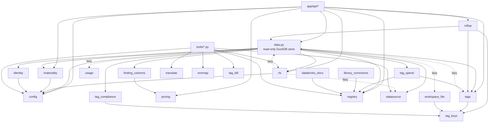

# app/core — shared Python core (config, store, rules)

The library both the API (`app/api`) and the tools (`tools/*.py`) import: settings, the read-only DuckDB store, the check registry, tag logic, row-level access and small rule modules. It never imports `tools/` (`app/core/registry.py:17-21`).

Import evidence: `app/core/data.py:129-138`, `app/core/rollup.py:26-29`, `app/core/tags.py:38`, `app/core/tags.py:158`, `app/core/tag_spend.py:14-17`, `app/core/rls.py:23`, `app/core/rls.py:465`, `app/core/rls.py:557`, `app/core/materiality.py:37`, `app/core/identity.py:53`, `app/core/library_corrections.py:56`, `app/core/databricks_docs.py:13`, `app/core/finding_columns.py:11`, `app/core/workspace_file.py:14`, `app/core/tag_compliance.py:27`, `app/core/data.py:1636`, `app/core/data.py:1676`, `tools/generate_models.py:58`, `tools/load_direct_results.py:177`, `tools/load_direct_results.py:702-706`.

---

## config.py — settings and config-file I/O

Purpose: load/validate/save `config/settings.yml` (+ `settings.local.yml` overlay), `thresholds.yml`, `materiality.yml`, `tag_aliases.yml`, env overrides CSV. Re-reads `AUDIT_CONFIG_DIR` on every call; atomic writes (`app/core/config.py:1-9`).

| Function | Signature | Evidence |
|---|---|---|
| `_config_dir` | `() -> Path` — `AUDIT_CONFIG_DIR` or `<repo>/config` | `app/core/config.py:127-129` |
| `load_settings` | `() -> dict` — seeds `settings.yml` from `DEFAULT_SETTINGS` if missing, merges `settings.local.yml`, validates; `SettingsError(key, line)` | `app/core/config.py:534-573` |
| `save_settings` | `(settings: dict) -> None` | `app/core/config.py:576-578` |
| `save_settings_local` | `(overrides: dict) -> dict` — writes only `settings.local.yml` | `app/core/config.py:581-591` |
| `_validate_settings` | `(settings: dict) -> dict` — types/ranges per key | `app/core/config.py:374-506` |
| `resolve_params` | `(spec) -> dict` — thresholds.yml[qid] → [_all] → header default | `app/core/config.py:617-633` |
| `query_tags` / `table_sizes` / `sources` / `dashboards` / `query_source` | setting accessors | `app/core/config.py:636-674` |
| `map_sources` | `(sql: str, sources: dict) -> str` — swap `system.*` names | `app/core/config.py:278` |
| `load_thresholds` / `save_thresholds` | thresholds.yml | `app/core/config.py:677-695` |
| `load_materiality` / `save_materiality` | materiality.yml | `app/core/config.py:764`, `app/core/config.py:777` |
| `load_tag_aliases` / `load_top_tags` / `save_tag_aliases` | tag_aliases.yml `top_tags` | `app/core/config.py:812-831` |
| `read_env_overrides` / `write_env_overrides` | `dbt/seeds/workspace_env_overrides.csv` | `app/core/config.py:851`, `app/core/config.py:862` |

- Constants: `SETTINGS_KEYS` (`app/core/config.py:160-177`), `DEFAULT_SETTINGS` (`app/core/config.py:187-219`), `WINDOW_CHOICES = (7, 30, 90)` (`app/core/config.py:182`), `TOP_TAGS_SHOWN = 4` (`app/core/config.py:786`).
- Errors: `ConfigError(ValueError)` (`app/core/config.py:96`), `SettingsError(ConfigError)` with `.key/.line` (`app/core/config.py:101-119`).
- Calls in: nearly every module and tool (see import list above). Tables read: none (files only).
- All settings and defaults: `processes/config_and_secrets.md`.

## data.py — the read-only DuckDB store

Purpose: every DuckDB read the app makes. Filters, ORDER BY and row caps are pushed into SQL with bound params; a separate `count(*)` gives `rows_total` (`app/core/data.py:1-17`).

Database resolution and connections:

| Function | Signature / behaviour | Evidence |
|---|---|---|
| `_db_path` | `() -> Path` — base db, or the signed-in user's file under rls `apply: export` | `app/core/data.py:197-199` |
| `_base_db_path` | `() -> Path` — `AUDIT_DB` → `datasource.current_db()` → `<data dir>/audit.duckdb` → `data/db_audit.duckdb` | `app/core/data.py:202-215` |
| `_snapshot_manifest_path` | `AUDIT_SNAPSHOT_MANIFEST` → sidecar of a loader-built db → `snapshot/manifest.json` | `app/core/data.py:245-254` |
| `_run_results_path` | `AUDIT_RUN_RESULTS` → `<db>.run_results.json` → `dbt/target/run_results.json` | `app/core/data.py:257-264` |
| `_is_loader_built` | `(db: Path) -> bool` — sidecar or `direct_export_meta` table | `app/core/data.py:223-242` |
| `share_connection` | module flag; server sets it `True` | `app/core/data.py:274`, `app/api/__main__.py:21` |
| `_connect` | `(read_only=True)` — rls `query` mode → `rls.scoped_connection`; else shared cached read-only connection (LRU 8) | `app/core/data.py:301-323` |
| `_cap` | applies `load.memory_limit` / `load.threads` to a connection | `app/core/data.py:290-298` |
| `_file_cached` | memoize on file identity + rls scope | `app/core/data.py:326-351` |
| `db_state` | `() -> dict` — `no_database` / `build_incomplete` / `ready` (probes `dims.dim_workspace`) | `app/core/data.py:367-393` |

Check (finding) reads:

| Function | Signature | Evidence |
|---|---|---|
| `read_finding` | `(query_id, window_days, workspace_ids=None, env=None, limit=None, offset=0, job_id=None, statuses=None, *, tag_filter=None) -> FindingResult` — `SELECT … FROM findings."f_<qid>" WHERE window_days=? … LIMIT ? OFFSET ?` | `app/core/data.py:806-888` |
| `count_finding` | `(query_id, window_days, workspace_ids=None, env=None, statuses=None, *, tag_filter=None) -> int` | `app/core/data.py:944` |
| `finding_columns` | `(query_id) -> list[str]` | `app/core/data.py:974` |
| `finding_window_counts` | `(specs: list[tuple[str,int]], workspace_ids=None, env=None, *, tag_filter=None)` — batch counts for `/api/findings` | `app/core/data.py:1027-1032` |
| `aggregate_finding` | `(query_id, window_days, group, agg, value=None, *, workspace_ids, env, statuses, top, tag_filter, below_floor)` | `app/core/data.py:1299-1310` |
| `finding_status` | `(query_id, results=None, manifest=None) -> dict` — run_results + manifest verdict | `app/core/data.py:3809-3812` |
| `not_assessed_status` | plain code/label/fix for a not-assessed check | `app/core/data.py:3931` |
| `window_coverage` | `(query_id, window_days, exported=…) -> dict` | `app/core/data.py:4021` |
| `truncation_info` | `(query_id, window_days=None) -> dict` — from `direct_export_findings_meta` | `app/core/data.py:3437`, `app/core/data.py:3449` |

Metadata and screen reads (table evidence = first reference line):

| Function | Tables read | Evidence |
|---|---|---|
| `snapshot_manifest`, `run_results` | JSON sidecars (no DuckDB) | `app/core/data.py:3280`, `app/core/data.py:3506` |
| `direct_export_info` | `main.direct_export_meta` | `app/core/data.py:3306-3325` |
| `exported_window_coverage`, `window_status` | via `direct_export_info` | `app/core/data.py:3391`, `app/core/data.py:3412` |
| `direct_source_states`, `checks_not_ok`, `truncated_query_ids` | run_results; `main.direct_export_findings_meta` | `app/core/data.py:3600`, `app/core/data.py:3679`, `app/core/data.py:3719-3727` |
| `cost_cutoff` | manifest / direct export as_of | `app/core/data.py:4076-4080` |
| `read_dim_workspace` | `dims.dim_workspace` | `app/core/data.py:1486-1495` |
| `read_dim_job/cluster/warehouse/pipeline/notebook` | `dims.dim_job`, `dims.dim_cluster`, `dims.dim_warehouse`, `dims.dim_pipeline`, `dims.dim_notebook` (identity masking applied) | `app/core/data.py:3141-3230` |
| `tag_spend_ready` | `tags.cost_day` | `app/core/data.py:1500-1501` |
| `read_tag_origins`, `read_tag_compliance` | via `tag_spend` / `tag_compliance` | `app/core/data.py:1509`, `app/core/data.py:1518` |
| `read_abac_policies` | `governance.abac_policies`, `governance.abac_policies_info` | `app/core/data.py:1529-1550` |
| `read_table_sizes` | `storage.table_detail`, `storage.table_detail_info`, `storage.volume_detail_info` | `app/core/data.py:1563-1576` |
| `read_workspaces` | `usage.workspace_activity`, `usage.workspace_activity_info`, `storage.*`, `tags.tag_workspace` | `app/core/data.py:1746-1762` |
| `read_workspace_schemas` | `storage.table_detail`, `storage.volume_detail` | `app/core/data.py:1966-1991` |
| `read_person_tables` | `usage.*` (inferred from `usage.workspace_activity_info` at `app/core/data.py:2031`) | `app/core/data.py:2021` |
| `read_activity` | `usage.table_daily`, `usage.user_last_seen`, `storage.*` | `app/core/data.py:2056-2095` |
| `read_volumes`, `read_volume_users` | `storage.volume_detail`, `usage.volume_access` | `app/core/data.py:2287-2316`, `app/core/data.py:2393` |
| `read_tables` | `storage.table_detail`, `usage.*` | `app/core/data.py:2429-2456` |
| `read_table` | `storage.table_detail`, `storage.table_history`, `usage.table_maintenance`, `usage.table_query_daily`, `usage.table_access`, `usage.table_edges`, `usage.table_grants` | `app/core/data.py:2502-2569` |
| `read_people` | `usage.user_last_seen`, `usage.table_grants` | `app/core/data.py:2738-2762` |
| `read_warehouses`, `read_warehouse` | `warehouse.warehouse_daily`, `warehouse.warehouse_activity_info`, `dims.dim_warehouse` | `app/core/data.py:2859-2961` |
| `read_workspace_tags` | `tags.tag_workspace` | `app/core/data.py:2983-2997` |
| `region_split` | `dims.dim_workspace` | `app/core/data.py:3016-3045` |

- Errors: `FindingNotBuiltError` (`app/core/data.py:168-171`). Result type `FindingResult` (`app/core/data.py:174-186`).
- Calls in: `app/api/app.py`, `app/api/service.py`, `app/api/guide.py`, `app/core/rollup.py`, `app/core/tags.py` (lazy), `app/core/rls.py` (lazy), `tools/export_direct_results.py:35`.

## datasource.py — where data lives

Purpose: one data folder outside the repo, so real-account data is never committed (`app/core/datasource.py:1-3`).

| Function | Behaviour | Evidence |
|---|---|---|
| `default_data_dir(platform, environ, home)` | `%LOCALAPPDATA%\databricks-audit` / `~/Library/Application Support/databricks-audit` / `$XDG_DATA_HOME or ~/.local/share/databricks-audit` | `app/core/datasource.py:14-26` |
| `data_dir()` | `AUDIT_DATA_DIR` or default | `app/core/datasource.py:29-31` |
| `inside_repo(path)` | guard used by export/load | `app/core/datasource.py:34-36` |
| `results_dir()` / `db_path()` | `<data>/results`, `<data>/audit.duckdb` | `app/core/datasource.py:39-44` |
| `sidecar(db, name)` | `<db stem>.<name>.json` | `app/core/datasource.py:47-48` |
| `set_current_db(path)` / `current_db()` | atomic pointer file `<data>/current_db.txt` | `app/core/datasource.py:51-75` |

Calls in: `app/core/data.py:130`, `app/api/refresh.py:17`, `tools/first_run.py:49`, `tools/export_direct_results.py:36`, `tools/load_direct_results.py:32`, `tools/deploy_app.py:28`.

## registry.py — check catalogue

Purpose: parse query headers + manifests into typed `QuerySpec`; validates sources and `next` tokens at load (`app/core/registry.py:1-23`).

- `QuerySpec` dataclass (`app/core/registry.py:188`); `load_registry() -> list[QuerySpec]` cached on file stamps (`app/core/registry.py:302-326`); `by_id(query_id) -> QuerySpec` (`app/core/registry.py:329`).
- Reads `app/queries/vendored`, `app/queries/app` (`app/core/registry.py:33-34`). Error `RegistryError` (`app/core/registry.py:70`).
- Calls in: `app/api/app.py:176`, `app/api/service.py:100`, `app/core/data.py:134`, `tools/export_direct_results.py:37`, `tools/generate_models.py:57`, `tools/generate_direct_models.py:50`.

## rls.py — row-level access

Purpose: per-person row filter from an entitlements table (`config/app.yml rls:`); off by default (`app/core/rls.py:1-7`).

| Function | Behaviour | Evidence |
|---|---|---|
| `validate(block)` / `load()` | `rls:` from `app.yml` + `app.local.yml` (key by key) | `app/core/rls.py:63-98` |
| `is_app()` | `DATABRICKS_APP_PORT` set | `app/core/rls.py:101-102` |
| `set_principal` / `reset_principal` / `current_principal` | contextvar of the signed-in email, lower-cased | `app/core/rls.py:429-438` |
| `mode()` | `off` / `export` (laptop, or app with `apply: export`) / `query` | `app/core/rls.py:451-456` |
| `scope_key()` | cache-key part per user in `query` mode | `app/core/rls.py:459-461` |
| `resolve(base)` | which db file to serve under `export` mode | `app/core/rls.py:476-486` |
| `build_sets(full_db)` | one filtered db per grant set + `<db>.rls_sets.json` | `app/core/rls.py:510-542` |
| `scoped_connection(base, principal)` | in-memory catalog of filtered views over the full db | `app/core/rls.py:582-608` |
| `load_entitlements`, `add_columns`, `filter_into` | used by the loader | `app/core/rls.py:223`, `app/core/rls.py:162`, `app/core/rls.py:382` |
| `meta()` | `/api/meta.rls` body | `app/core/rls.py:651-679` |

Tables read: `rls.entitlements` (`app/core/rls.py:520`), `rls.status` (`app/core/rls.py:640`), `rls.filtered` (`app/core/rls.py:499`), all `findings/dims/tags` tables for filtering (`app/core/rls.py:27`).

## rollup.py — nested cost/performance rollup by tag

Purpose: request-time rollup for one tag key, work → compute → workspace (`app/core/rollup.py:1-16`).

- `rollup(area, tag_key, window_days, *, tag_value, tag_values, workspace_ids, env, tag_filter)` (`app/core/rollup.py:583`); `rollup_keys(area, window_days)` (`app/core/rollup.py:1041`); `by_tag_top(area, tag_key, window_days, top, …)` (`app/core/rollup.py:1142`); `_resolve_workspace_scope(workspace_ids, env)` (`app/core/rollup.py:482`); `RollupError` → 422 (`app/core/rollup.py:71`, `app/api/app.py:760-761`).
- Tables read: `tags.cost_unit`, `tags.cost_unit_tag`, `tags.cost_reconciliation`, `tags.tag_workspace` (`app/core/rollup.py:2-3`), `tags.tag_workspace_history` (`app/core/rollup.py:281`), `tags.perf_unit`, `tags.perf_unit_tag` (`app/core/rollup.py:396-397`).

## tags.py — tag index, tag chain, tag filter SQL

- `TagFilter` / `TagFilterSet.from_params(tag_key, tag_value, tag)` (`app/core/tags.py:57`, `app/core/tags.py:96`); `read_tag_index(search, tag_key, limit_keys, limit_values)` (`app/core/tags.py:171`); `tag_chain(query_id, col_names, domain)` (`app/core/tags.py:418`); `tag_clause` / `tag_group_clause` / `tag_set_clause` (`app/core/tags.py:654`, `app/core/tags.py:702`, `app/core/tags.py:756`); `TagModelsNotBuiltError` (`app/core/tags.py:45`).
- Tables read: `tags.tag_entity`, `tags.tag_index` (`app/core/tags.py:15`, `app/core/tags.py:46`), `dims.dim_warehouse`, `dims.dim_cluster` (`app/core/tags.py:535-541`).

## tag_spend.py — spend checks under a tag filter

- Recomputes spend checks from `tags.cost_day` with `app/queries/tag_spend/*.sql` variants (`app/core/tag_spend.py:1-6`, `app/core/tag_spend.py:19`).
- `available(con)` (`app/core/tag_spend.py:46`), `matching_cells(con, tag_filter)` (`app/core/tag_spend.py:116`, memoized at `app/core/data.py:355`), `origins(...)` (`app/core/tag_spend.py:132`), `table_sql(con, query_id, window_days, tag_filter)` (`app/core/tag_spend.py:197`).
- Tables read: `tags.cost_day`, `tags.tag_workspace_history` (`app/core/tag_spend.py:1-5`).

## tag_compliance.py — mandatory tags coverage

- `compliance(con, raw_keys, window_days, …)` (`app/core/tag_compliance.py:264`); `norm_key` / `key_variants` (`app/core/tag_compliance.py:35`, `app/core/tag_compliance.py:44`); treats `environment` and `env` as the same tag (`app/core/tag_compliance.py:41`).
- Tables read: `tags.tag_workspace` (`:12`), `tags.cost_day` (`:69`), `tags.tag_entity` (`:125`), `tags.bill_tag_dates` (`:153`), `dims.dim_workspace` (`:294`), `tags.perf_unit_tag` / `tags.perf_unit` (`:328-329`), `dims.dim_warehouse` / `dims.dim_cluster` (`:335-337`), `tags.query_tag_keys` (`:344`), `findings.f_query_slices` (`:433`), `dims.dim_job` / `dims.dim_pipeline` / `dims.dim_notebook` (`:517-532`) — all `app/core/tag_compliance.py`.

## tag_keys.py — shared tag vocabulary

- Sentinels `__untagged__`, `__mixed__`, `__none__`, `__empty__` (`app/core/tag_keys.py:15-19`); `PLATFORM_TAG_KEYS` (`app/core/tag_keys.py:23`); `normalize_tag_key(raw)` (`app/core/tag_keys.py:67`); `api_value_to_model` / `model_value_to_api` (`app/core/tag_keys.py:76-82`). No tables.

## tag_bill.py — bill tags into the performance rollup

- `apply_bill_to_perf(con) -> int` rewrites `tags.perf_unit_tag`'s compute level from `tags.bill_tag_dates` (`app/core/tag_bill.py:9-17`); called once by the loader (`tools/load_direct_results.py:702`).

## workspace_file.py — workspace tags from `config/workspace.csv`

- `read(path)` (`app/core/workspace_file.py:22`), `catalogs(path)` (`app/core/workspace_file.py:37`), `apply(con, path) -> int` writes into `tags.tag_workspace`, `tags.tag_workspace_history`, `tags.tag_entity`, `tags.tag_index` (`app/core/workspace_file.py:65`, `app/core/workspace_file.py:77-111`). Called by `tools/load_direct_results.py:706-707` and `tools/dbt_run.py:325-330`.

## pricing.py — discount what-if

- `apply(df, discount_pct) -> DataFrame` adds `<col>_disc` for every list-price column (`app/core/pricing.py:3-11`, `app/core/pricing.py:48`); regex `_LIST_COL_RE` (`app/core/pricing.py:26`). Called by `app/api/app.py:1249`.

## materiality.py — per-check floors and severity cap

- `status_expr(query_id, columns)` (`app/core/materiality.py:142`), `below_floor_expr` (`app/core/materiality.py:171`), `severity_cap(query_id)` (`app/core/materiality.py:72`), `admin_group_expr` (`app/core/materiality.py:76`), `floor_for` / `applicable_floor` (`app/core/materiality.py:115-121`). Reads `config/materiality.yml` via config (`app/core/materiality.py:3`).

## identity.py — user identity masking

- `masking_enabled()` reads `privacy.mask_user_identities` (`app/core/identity.py:63`); `format_identity(value, real_id=None)` mirrors the SQL mask CASE (`app/core/identity.py:68`, `app/core/identity.py:18-25`). Used by `data.read_dim_*`, `tools/export_direct_results.py:41`, `tools/load_direct_results.py:33`.

## finding_columns.py — headline money / entity columns

- `money_column(columns)` (`app/core/finding_columns.py:75`), `entity_column(columns)` (`app/core/finding_columns.py:91`), `money_parent` (`app/core/finding_columns.py:44`), `row_noun` (`app/core/finding_columns.py:66`); maps at `app/core/finding_columns.py:15-25`.

## library_corrections.py — known-defect register

- `load_corrections()` validates `config/library_corrections.yml` (`app/core/library_corrections.py:169`); `by_query_id()` (`app/core/library_corrections.py:187`). Repo-owned, never from `AUDIT_CONFIG_DIR` (`app/core/library_corrections.py:19-24`). Loaded at API import (`app/api/app.py:210`).

## databricks_docs.py — docs link map

- `load_docs(valid_slugs, valid_query_ids) -> DocsMap` (`app/core/databricks_docs.py:242`), `resolve_cloud(meta, default_cloud)` (`app/core/databricks_docs.py:106`), `entry_urls(entry)` (`app/core/databricks_docs.py:89`). Reads `config/databricks_docs.yml` (`app/core/databricks_docs.py:16`). Used by `app/api/guide.py:14`.

## links.py — workspace UI URLs

- `job_url`, `run_url`, `cluster_url`, `warehouse_url`, `query_url` each return `{url, verified: False}` (`app/core/links.py:48-68`, `app/core/links.py:16-19`).

## envmap.py — prod/uat/dev classification

- `load_env_patterns(path)` from `dbt/dbt_project.yml vars.env_patterns` (`app/core/envmap.py:45`); `classify_env(name, patterns=None) -> str` (`app/core/envmap.py:68`). Used by `tools/load_direct_results.py:177`.

## usage.py — data usage rules

- `usage_class(...)` (`app/core/usage.py:49`), `complexity_index` (`app/core/usage.py:73`), `usage_index` (`app/core/usage.py:78`), `signal` (`app/core/usage.py:86`), `cleanup_order` (`app/core/usage.py:98`), `skipped_catalog` (`app/core/usage.py:25`); constants `IDLE_DAYS=90`, `NEW_DAYS=7` (`app/core/usage.py:10-11`). Used lazily by `data.py` (`app/core/data.py:1676`) and by `tools/direct_data_usage.py:13`, `tools/table_detail.py:29`.

## translate.py — Databricks SQL → DuckDB SQL

- `translate(sql) -> str` (`app/core/translate.py:918`), `pin_time(sql)` (`app/core/translate.py:700`), `untranslated(sql)` (`app/core/translate.py:909`), `rules_table()` (`app/core/translate.py:929`), `Untranslatable` (`app/core/translate.py:41`). Used by `tools/generate_models.py:58` (dbt path only; not used at app runtime — inferred from import list above).
