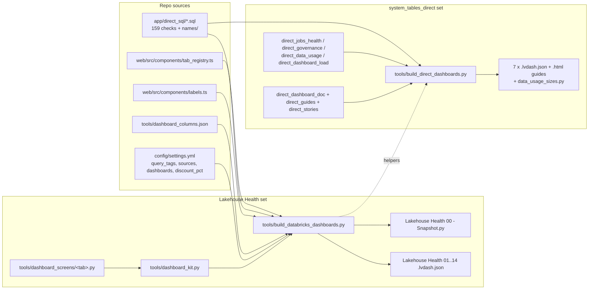

# Databricks AI/BI dashboards

Two generated dashboard sets: 14 "Lakehouse Health" dashboards that read a snapshot schema filled by one notebook, and 7 "system_tables_direct" dashboards that read `system.*` live.

Sources used: `databricks_dashboards/README.md`, `databricks_dashboards/system_tables_direct/README.md`, the `.lvdash.json` files (structure only), `tools/build_databricks_dashboards.py`, `tools/dashboard_kit.py`, `tools/dashboard_screens/*.py`, `tools/build_direct_dashboards.py`, `tools/direct_*.py`, the snapshot notebook.

## Structure

## Two sets compared

| | Lakehouse Health (14) | system_tables_direct (7) |
|---|---|---|
| Reads | only `<catalog>.databricks_audit_dashboard.*` tables (`tools/build_databricks_dashboards.py:3-6`) | `system.*` live on every open (`databricks_dashboards/system_tables_direct/README.md:3-5`) |
| Filled by | `Lakehouse Health 00 - Snapshot.py` (`databricks_dashboards/README.md:47-63`) | nothing; only Data usage needs `data_usage_sizes.py` (`databricks_dashboards/system_tables_direct/README.md:26-35`) |
| Window | fixed 30 days (`tools/build_databricks_dashboards.py:33`, `databricks_dashboards/README.md:129`) | Time Window parameter `:time_range` (`tools/build_direct_dashboards.py:30-46`) |
| Filters | Workspace filter on Global Filters page (`tools/dashboard_kit.py:266-284`) | Time Window + Workspace (`tools/build_direct_dashboards.py:917-921`) |
| Built by | `python tools/build_databricks_dashboards.py` | `python tools/build_direct_dashboards.py` |
| Row cap | 5,000 rows per check table (`tools/build_databricks_dashboards.py:914`) | per dataset SQL (unclear, none global) |
| Cost per open | small tables, 2X-Small warehouse is enough (`databricks_dashboards/README.md:43`) | slower: each page re-runs its checks (`databricks_dashboards/system_tables_direct/README.md:43-44`) |

## Lakehouse Health: the 14 dashboards

One dashboard per app tab, one page per sub-tab, plus a "Global Filters" page each (`databricks_dashboards/README.md:85-88`). Tab order comes from `TABS` (`tools/build_databricks_dashboards.py:918-919`); file name is `Lakehouse Health NN - <label>` (`tools/build_databricks_dashboards.py:927-931`).

| # | File (`databricks_dashboards/`) | Pages (line of page in file) | Datasets | KPIs shown (from dataset names) | Screen module |
|---|---|---|---|---|---|
| 01 | `Lakehouse Health 01 - Overview.lvdash.json` | Overview (776) | 19 | Spend, Possible waste, Jobs & pipelines, Query performance | `tools/dashboard_screens/overview.py:16-160` |
| 02 | `Lakehouse Health 02 - Actions.lvdash.json` | Actions (1298) | 10 | Flagged checks, Critical checks, Possible waste, Not priced, Security risks | `tools/dashboard_screens/actions.py:31-250` |
| 03 | `Lakehouse Health 03 - Jobs.lvdash.json` | Failures (3092), Slow & queued (7782), Hygiene (12235), Compute fit (17841), Pipelines (22967) | 77 | Broken now, Flaky jobs, Cost of failed runs, Failure rate, Slower than usual, queue/cold-start p95, no-timeout jobs/tasks, health-rule coverage, oversized compute, pipeline spend | `tools/dashboard_screens/jobs.py:5-343` |
| 04 | `Lakehouse Health 04 - Compute.lvdash.json` | Warehouses (1946), Clusters & pools (9819), Configuration (14458) | 50 | Idle while running, Idle cost, Waiting for auto-stop, idle clusters, pool idle capacity, no auto-terminate | `tools/dashboard_screens/compute.py:6-322` |
| 05 | `Lakehouse Health 05 - Queries.lvdash.json` | Heavy queries (3033), Efficiency (7932), Reliability (11238), Capacity (14120), Trend (20207) | 73 | Query groups over threshold, this audit's own query cost, spill/shuffle GB, cache %, pruning %, failed statements, queue and start-up waits | `tools/dashboard_screens/queries.py:64-561` |
| 06 | `Lakehouse Health 06 - Cost.lvdash.json` | Trend (3918), By product & SKU (8030), Allocation (10333), Chargeback (13258), By resource (18413), Before & after (21607), Pricing & policy (24369) | 98 | Spend, vs previous period, spike days, SKU/serverless/Photon share, charged back, no tag, movers, top job/compute, before/after $ a day, serverless with no policy, restatement % | `tools/dashboard_screens/cost.py:16-591` |
| 07 | `Lakehouse Health 07 - Waste & savings.lvdash.json` | Priced (1782), What-if (3386), Flagged, not priced (6518), How it's counted (7200) | 32 | Possible waste, Top 3 resources, Biggest single fix, auto-stop what-if at 1/5/10 min, flagged-not-priced counts | `tools/dashboard_screens/waste.py:16-358` |
| 08 | `Lakehouse Health 08 - ML & AI.lvdash.json` | Spend (1232), Endpoints (3567), AI Gateway (7411) | 32 | ML & AI spend, scale-from-zero %, Vector Search spend, endpoints with traffic, spend with no requests, gateway errors / rate limits / tokens | `tools/dashboard_screens/mlai.py:35-194` |
| 09 | `Lakehouse Health 09 - Genie.lvdash.json` | Genie (455) | 14 | Genie spend, DBUs, built into apps or agents, people using Genie | `tools/dashboard_screens/genie.py:14-115` |
| 10 | `Lakehouse Health 10 - Governance & PII.lvdash.json` | Access & grants (1358), Admin activity (4513), Sensitive data (5516), Lineage (8791), Sharing (11614) | 50 | Broad grants, run-as escalation, network denials, classified-no-mask, masks/row filters, blast radius, PII propagation, Delta Sharing exposure | `tools/dashboard_screens/governance.py:7-198` |
| 11 | `Lakehouse Health 11 - Storage.lvdash.json` | Tables (889), Maintenance (3411) | 33 | Tables discovered, by type, not altered recently, fastest growing, maintenance DBU burn, vacuum reclaiming nothing | `tools/dashboard_screens/storage.py:7-165` |
| 12 | `Lakehouse Health 12 - Tags.lvdash.json` | Tags (799) | 20 | Spend with no cost-center tag, unnamed workspaces still billing, serverless DBUs with no policy, per mandatory tag | `tools/dashboard_screens/tags.py:61-164` |
| 13 | `Lakehouse Health 13 - All findings.lvdash.json` | All findings (966) | 7 | Critical, Warn, No data this window, Not assessed | `tools/dashboard_screens/findings.py:37-62` |
| 14 | `Lakehouse Health 14 - Coverage & Gaps.lvdash.json` | Data sources (872), Not assessed (3596), Known limitations (3959) | 17 | System tables checked, empty tables, freshness problems, what this audit cost, checks not assessed | `tools/dashboard_screens/coverage.py:14-130` |

Page list matches the README table (`databricks_dashboards/README.md:16-32`). Dataset/page counts were read from the JSON (`datasets`, `pages` keys).

### What every page has (layout rules)

- Title text + "Days covered" banner counter from `snapshot_info` (`tools/dashboard_kit.py:287-299`, banner dataset `tools/dashboard_kit.py:213-217`).
- KPIs, charts, curated tables from the screen module (`tools/dashboard_kit.py:316-343`).
- "Every check on this page": a status table from `snapshot_log` plus each check's own rows, worst first (`tools/dashboard_kit.py:371-394`, status SQL `tools/build_databricks_dashboards.py:1235-1259`, rows `tools/build_databricks_dashboards.py:1181-1228`).
- Any registry sub-tab a screen module skips still gets a plain page with its checks (`tools/dashboard_kit.py:266-271`).
- Names joined from `dim_*` tables as "name (id)"; workspace filter on `ws_name` (`tools/build_databricks_dashboards.py:1186-1212`).
- Every KPI/chart/table carries a "how" line (`tools/dashboard_kit.py:20-21`, test `tests/test_databricks_dashboards.py:465`).
- Each dataset is prefixed with `SET QUERY_TAGS[...]` lines (settings tags + `dashboard` + `tab`) (`tools/build_databricks_dashboards.py:200-220`).
- Databricks-import rules a screen must keep: no WHERE on own SELECT alias, one row per chart category, plain table values (`tools/dashboard_kit.py:23-26`).

### Placeholders in screen SQL

Defined in `tools/dashboard_kit.py:7-19`, expanded by `Dashboard.expand` (`tools/dashboard_kit.py:223-228`):

- `{S}` snapshot schema; `{named:<id>}` a check's table with name columns (`tools/dashboard_kit.py:52`); `{ws}` / `{ws:r}` workspace filter; `{disc}` `1 - discount_pct` (`tools/build_databricks_dashboards.py:156`).

### Which checks land on which page

- `area_registry()` parses `web/src/components/tab_registry.ts` (labels, scope, sub-tabs, ids, refIds) and keeps only checks with an `app/direct_sql/<id>.sql` file; a check on two tabs lives on the first in `_HOME_ORDER` (`tools/build_databricks_dashboards.py:933-984`).
- Titles and "why" come from `web/src/components/labels.ts` (`tools/build_databricks_dashboards.py:1005-1014`).
- Column names/types per check come from `tools/dashboard_columns.json`, refreshed from the test DuckDB with `--refresh-columns` (`tools/build_databricks_dashboards.py:1068-1084`, `1462-1465`).
- Waste pages are hand-built because Waste has no registry pages; `PRICED_IDS`/`UNPRICED_IDS` mirror `WASTE_ITEMS` in `tab_registry.ts` (`tools/dashboard_screens/waste.py:1-5`).
- Actions page parses `web/src/components/action_templates.ts` (`tools/dashboard_screens/actions.py:1-6`, `92-115`).
- All findings reads `snapshot_log` only, to stay under the 100-dataset budget (`tools/dashboard_screens/findings.py:1-5`).

## The snapshot notebook

`databricks_dashboards/Lakehouse Health 00 - Snapshot.py`, generated by `build_snapshot_notebook` (`tools/build_databricks_dashboards.py:284-398`). Six cells (`# COMMAND` at lines 13, 20, 222, 16021, 16295, 16359).

| Cell | Lines | What it does |
|---|---|---|
| Markdown | 1-11 | How to run |
| Widgets | 15-18 | `catalog` (empty), `tag_keys`, `chargeback_keys`, `query_tags` |
| DIMS | 23-221 | 6 name queries: `dim_workspace`, `dim_warehouse`, `dim_job`, `dim_cluster`, `dim_pipeline`, `dim_notebook` (from `app/direct_sql/names/`) |
| CHECKS | 225-16019 | 159 check SQL strings, copied unchanged from `app/direct_sql` with markers filled (`tools/build_databricks_dashboards.py:75-91`) |
| EMPTY / HAS_STATUS | 16024-16293 | column DDL for the empty table a failure leaves; which checks have a `status` column |
| Run | 16297-16357 | validate catalog, set query tags, `CREATE SCHEMA`, run dims then checks 4 at a time, write `snapshot_info`, `snapshot_log` |
| Links | 16361-16380 | list `Lakehouse Health *` dashboards via Databricks SDK, write `dashboard_links` |

Run cell rules (line numbers in the notebook):

- No catalog -> `ValueError("Set the catalog widget at the top, then run all.")` (16301-16303).
- Query tags: only `[A-Za-z0-9_]{1,64}` keys/values; failure to `SET QUERY_TAGS` prints and carries on (16306-16316).
- `chargeback_keys` widget is spliced into `cost_chargeback_by_allocation_tag` (16319-16320).
- Schema is fixed `databricks_audit_dashboard` under `USE CATALOG` (16321-16323); `SNAPSHOT_AT` one instant for all tables (16324-16325).
- `snapshot(name, sql)`: `CREATE OR REPLACE TABLE <schema>.<name> AS SELECT <ts> AS snapshot_at, q.*`; on error an empty typed table and the first 500 chars of the error (16328-16340).
- Dims run serially, `snapshot_info` written (window_days 30, tag keys, check list), checks run with `ThreadPoolExecutor(max_workers=4)` (16343-16350).
- `snapshot_log` columns: `query_id, ok, error, row_count, critical, warn, has_status, seconds, snapshot_at` (16352-16355).
- Order: checks reading only core sources (billing.usage, list_prices, workspaces_latest, query.history, compute.*, lakeflow.*) first (`tools/build_databricks_dashboards.py:240-263`); the build's `CHECKS` list fixes the first 23, with `cost_failed_statement_waste` last on purpose (it needs `billing.attributed_usage`) (`tools/build_databricks_dashboards.py:38-65`).

Tables in `<catalog>.databricks_audit_dashboard` after a run:

- one table per check (159) and per dim (6); `snapshot_info`; `snapshot_log`; `dashboard_links` (test: `tests/test_databricks_dashboards.py:321`).

Count note: README says "It runs 159 checks" (`databricks_dashboards/README.md:60`); `all_checks()` = `CHECKS` + placed checks + rest of `app/direct_sql` minus `lakeflow_termination_type_probe` (`tools/build_databricks_dashboards.py:921`, `980-986`); 160 `.sql` files in `app/direct_sql` minus that one probe = 159.

## system_tables_direct: the 7 live dashboards

Folder `databricks_dashboards/system_tables_direct/`. Registered in `dashboards()` (`tools/build_direct_dashboards.py:924-937`).

| File | Pages (line in file) | Datasets | What it shows | Builder |
|---|---|---|---|---|
| `waste_savings.lvdash.json` | Possible waste (4908), Warehouses (5725), Auto-stop what-if (6735), Clusters & pools (8045), Failed runs & queries (9123), Serving endpoints (10113), Flagged, not priced (10991), Global Filters (11918) | 13 | Flagged resources from the 5 priced checks, idle time, auto-stop savings, idle nodes, failed runs, serving | `tools/build_direct_dashboards.py:142-916` (`WASTE` dataset `142-206`, `waste_dashboard` `729`) |
| `jobs_health.lvdash.json` | Failed jobs (2624), Failed job details (3476), Slow jobs (4026), Hygiene (5358), Job size (6222), Pipelines (7229), Global Filters (7882) | 13 | Failed, flaky, slow jobs, cold/failed starts, timeouts, ownership, oversized jobs, pipeline cost | `tools/direct_jobs_health.py:1-524`; thresholds `19-23` |
| `workspace_usage.lvdash.json` | Workspace usage (112) | 2 | Monthly active users per class and workspace; workspaces inactive 90+ days | `tools/direct_governance.py:60-126`, `302`; `INACTIVE_DAYS=90`, `LOOKBACK_DAYS=365` (`19-20`) |
| `broad_grants.lvdash.json` | Broad grants (79) | 1 | UC grants from the audit log, ALL PRIVILEGES and account users flagged | `tools/direct_governance.py:142-196`, `332` |
| `admin_changes.lvdash.json` | Admin changes (102) | 1 | Who changed groups, roles, access, grants, settings | `tools/direct_governance.py:197-261`, `359` |
| `data_usage.lvdash.json` | Overview (4397), Workspaces (8381), Workspace detail (10441), Tables (15029), Table detail (17045), Volumes (21706), People (23150), Person detail (24591) | 30 | App's Data usage section: usage class per table/view/volume, complexity and usage index per workspace, sizes, people | `tools/direct_data_usage.py:1-1805` (`dashboard` `1380`) |
| `dashboard_load.lvdash.json` | Dashboard load (137) | 1 | Queries of every dashboard in both sets, by `dashboard`/`tab` query tags: count, failures, cache hits, run/queue time, GB read | `tools/direct_dashboard_load.py:18-152` |

Also in the folder (`databricks_dashboards/system_tables_direct/README.md:15-17`):

- `<name>.html`: per-dashboard query guide, `<name>_summary.html` short guide when `direct_guides.SHORT` has the stem (`tools/build_direct_dashboards.py:940-952`).
- `data_usage_sizes.py`: notebook job writing `table_sizes`, `table_history`, `volume_sizes` into `sizes_schema` (default `main.data_usage`); widgets at `databricks_dashboards/system_tables_direct/data_usage_sizes.py:10-14`; generated by `collect_sizes_notebook` (`tools/direct_data_usage.py:1672`).
  - Tables: lists Delta tables with `last_altered`, newest first, up to `max_tables` (`databricks_dashboards/system_tables_direct/data_usage_sizes.py:35-41`). A table whose `last_altered` equals the one stored in last run's `table_sizes` keeps its row; only the rest get `DESCRIBE DETAIL` / `DESCRIBE HISTORY` (`databricks_dashboards/system_tables_direct/data_usage_sizes.py:44-55`, `databricks_dashboards/system_tables_direct/data_usage_sizes.py:60-82`).
  - `table_sizes` is overwritten with described + reused rows and now has a `last_altered` column; `table_history` keeps old rows of reused tables (left-semi join) plus the new history rows (`databricks_dashboards/system_tables_direct/data_usage_sizes.py:84-96`).
  - Volumes: walked breadth-first with `os.scandir` on `/Volumes/...` (no `dbutils.fs.ls`), stopping at `max_entries_per_volume` with `truncated = true` (`databricks_dashboards/system_tables_direct/data_usage_sizes.py:105-125`).
  - Tests: `tests/test_direct_dashboards.py:95` (walk without dbutils), `tests/test_direct_dashboards.py:123` (only changed tables described).

How the live SQL is made:

- A `Dataset` = named CTEs, each one app check from `app/direct_sql`, plus name lookups and a final SELECT (`tools/build_direct_dashboards.py:111-136`).
- `windowed()` swaps the fixed 30-day window for `:time_range` (`START`/`END`), keeping ages measured from today (`KEEP_TODAY`) and the stale-jobs 30-day threshold (`KEEP_BY_ID`) (`tools/build_direct_dashboards.py:30-63`).
- Dashboard load finds every dashboard by its tag slug: 14 Lakehouse Health names + 7 direct titles (`tools/direct_dashboard_load.py:18-23`).
- HTML guides: `direct_dashboard_doc.build` / `build_short` (`tools/direct_dashboard_doc.py:1-6`), prose from `tools/direct_guides.py`, example stories from `tools/direct_stories.py`.

CLI options (`tools/build_direct_dashboards.py:960-976`): `--out-dir`, `--query-tags k=v,...`, `--workspace-class CLASS=PATTERN` (repeatable), `--sizes-schema`.

## Determinism and tests

- Internal ids are 8-hex SHA1 of a stable key, so reruns are byte-identical (`tools/build_databricks_dashboards.py:8-9`, `103-105`).
- Settings `sources` swaps system table names in every output file (`tools/build_databricks_dashboards.py:98-100`, applied `1451`, `tools/build_direct_dashboards.py:953`).
- Committed files must equal a fresh build: `tests/test_databricks_dashboards.py:294`, `tests/test_direct_dashboards.py:10`.
- Lakehouse Health datasets read only snapshot tables (`tests/test_databricks_dashboards.py:314`), run on the test DuckDB (`tests/test_databricks_dashboards.py:532`), start with query tags (`tests/test_databricks_dashboards.py:561`).
- Direct datasets parse and use the Time Window (`tests/test_direct_dashboards.py:23`), carry query tags (`tests/test_direct_dashboards.py:58`).

## What differs from the app

From `databricks_dashboards/README.md:127-134`:

- Fixed 30-day window, list price.
- Tags as billing records them; the app also falls back to workspace tags.
- Auto-stop savings assume 1 min serverless, 10 min pro/classic.
- Before & after fixed to warehouses, last 7 days vs the rest.
- Up to 5,000 rows per check table.
