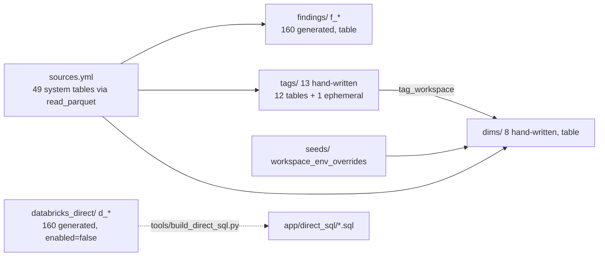
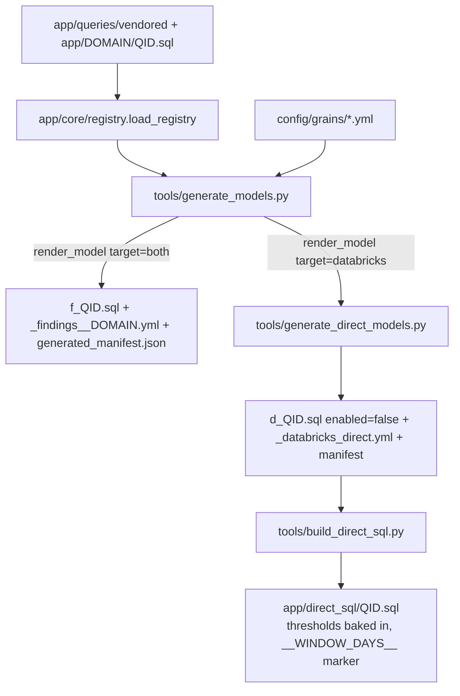

# dbt project (dbt/)

`databricks_audit` is a DuckDB-only dbt project that turns snapshot parquet of `system.*` tables into `findings.*`, `dims.*` and `tags.*` tables; its Databricks-dialect SQL is rendered offline into `app/direct_sql/` instead of being run by dbt (`dbt/dbt_project.yml:3-7`, `dbt/profiles.yml:14-36`, `tools/generate_direct_models.py:15-24`).

## Layers

| Folder | Models | Materialization / schema | Written by | Evidence |
|---|---|---|---|---|
| models/sources | 49 source tables in 10 sources | external parquet | `tools/build_sources.py` (generated) | `dbt/models/sources/sources.yml:1-2,12` |
| models/findings/<domain> | 160 `f_<qid>` + one `_findings__<domain>.yml` each | table, schema `findings` | `tools/generate_models.py` | `dbt/dbt_project.yml:60-62`, `tools/generate_models.py:36-39` |
| models/databricks_direct/<domain> | 160 `d_<qid>`, `_databricks_direct.yml` | `enabled=false` (never built) | `tools/generate_direct_models.py` | `dbt/models/databricks_direct/cost/d_cost_by_job.sql:1`, `tools/generate_direct_models.py:32-35` |
| models/dims | dim_workspace, dim_job, dim_cluster, dim_warehouse, dim_pipeline, dim_notebook, dim_list_prices, int_workspace_tag_hints | table, schema `dims` | hand-written | `dbt/dbt_project.yml:63-65`, `dbt/models/dims/_dims.yml:1-7` |
| models/tags | cost_alloc (ephemeral), cost_unit, cost_unit_tag, cost_day, cost_reconciliation, perf_unit, perf_unit_tag, query_tag_keys, tag_workspace_history, tag_workspace, tag_entity, tag_index, bill_tag_dates | table, schema `tags` set per model | hand-written | `dbt/models/tags/cost_unit.sql:1`, `dbt/models/tags/cost_alloc.sql:1` |
| seeds | workspace_env_overrides.csv (header only) | seed, schema `seeds` | hand-edited | `dbt/dbt_project.yml:67-69`, `dbt/models/_seeds.yml:4-12` |
| tests | generic `unique_grain`, singular `tags_cost_reconciles` | test | hand-written | `dbt/tests/generic/test_unique_grain.sql:12-34`, `dbt/tests/tags_cost_reconciles.sql:6-9` |

- Every tags model except `tag_workspace` raises a compiler error on a non-DuckDB target (e.g. `dbt/models/tags/cost_unit.sql:9-11`); their Databricks twins are hand-written in `app/direct_sql/tags/` (e.g. `app/direct_sql/tags/cost_unit.sql:1-3`).
- `analysis-paths: ["analyses"]` is declared (`dbt/dbt_project.yml:14`) but no `dbt/analyses` folder exists (unclear, harmless).

## Profiles and targets

| Target | Adapter | DB file | Snapshot dir | Evidence |
|---|---|---|---|---|
| dev (default) | duckdb | env `AUDIT_DB`, default `data/db_audit.duckdb` | env `AUDIT_SNAPSHOT_DIR`, default `snapshot` (via wrapper) | `dbt/profiles.yml:15-24`, `tools/dbt_run.py:227-231` |
| test | duckdb | env `AUDIT_TEST_DB`, default `tests/db_audit_test.duckdb` | `tests/fixtures/parquet` | `dbt/profiles.yml:26-36`, `dbt/models/sources/sources.yml:12` |

- No Databricks target exists. The `` Databricks branches are rendered by `tools/build_direct_sql.py` with a fake `target={"type": "databricks"}` and plain-Python `param/source/var` (`tools/build_direct_sql.py:60-104`).
- Settings: `TimeZone: UTC`, `temp_directory: dbt/target/tmp`, 4 threads (`dbt/profiles.yml:21-24`). No secrets in profiles (only env var names `AUDIT_DB`, `AUDIT_TEST_DB`).

## Vars

| Var | Default | Fed by | Consumer |
|---|---|---|---|
| windows | [7, 30, 90] | `tools/dbt_run.py:181` | every windowed model (`dbt/models/tags/cost_unit.sql:20`) |
| thresholds | {} | `config/thresholds.yml` (`tools/dbt_run.py:120-128`) | `dbt/macros/param.sql:10-30` |
| as_of_date / as_of_ts | null | snapshot manifest, dev only (`tools/dbt_run.py:191-208`) | `dbt/macros/audit_time.sql:12-42` |
| tag_aliases | {} | `config/tag_aliases.yml` top_tags | `dbt/models/dims/dim_workspace.sql:35`, `dbt/models/dims/int_workspace_tag_hints.sql:16` |
| share_floor / coverage_floor | 0.6 / 0.5 | `config/settings.yml:61-62` | `dbt/models/tags/tag_workspace_history.sql:21-22`, `dbt/macros/tag_entity_billed_inference.sql:26-27` |
| mask_user_identities | false | `config/settings.yml` privacy | `dbt/macros/mask_user.sql:7-25` |
| env_patterns | prod/uat/dev word lists | project only | `dbt/macros/classify_env.sql:33-61` |
| grain_severity | error (warn on dev) | `tools/dbt_run.py:222-224` | `dbt/tests/generic/test_unique_grain.sql:13` |

Declared at `dbt/dbt_project.yml:30-53`; merged into one `--vars` JSON by `tools/dbt_run.py:210-225,243-253`.

## Macros

| Macro | What it does | Evidence |
|---|---|---|
| audit_today() / audit_now() | test target -> fixed `2026-09-21`; else `as_of_*` var (regex-validated); else `current_date()` / `current_timestamp` per dialect | `dbt/macros/audit_time.sql:12-42` |
| list_prices() | inline de-duplicated `system.billing.list_prices`: USD only, each row's end capped at the next start per (sku_name, cloud, usage_unit), empty intervals dropped | `dbt/macros/list_prices.sql:10-37` |
| param(qid, name, default) | threshold literal: `thresholds[qid][name]` -> `thresholds._all[name]` -> default; strings quoted | `dbt/macros/param.sql:10-30` |
| norm_tag_key(expr) | `regexp_replace(lower(expr), '[ _-]+', '')` (DuckDB adds 'g') | `dbt/macros/norm_tag_key.sql:18-24` |
| classify_env(expr) | normalise `[-_./]+` to space, word-boundary match prod > uat > dev, else 'unknown' | `dbt/macros/classify_env.sql:33-61` |
| mask_user(expr, real_id) | off: raw; on: `<id or sha256[:8]> <first 2 chars>***`, GUID/NULL pass through | `dbt/macros/mask_user.sql:7-25` |
| generate_schema_name | custom schema used verbatim (`findings`, `dims`, `tags`, `seeds`), no target prefix | `dbt/macros/generate_schema_name.sql:8-14` |
| tag_entity_billed_inference(base_cte, entity_type) | dominant billed tag value per entity id with share/coverage floors and reason text | `dbt/macros/tag_entity_billed_inference.sql:25-116` |
| test unique_grain(columns) | fails when more than one row per column combination | `dbt/tests/generic/test_unique_grain.sql:12-34` |

## How generated models are produced

- `generate_models.py` steps: strip comments, tokenise `:params`, mask rewrite, DuckDB `translate()` vs Databricks `pin_time()`, `source()` substitution checked against the header `reads:`, window loop (`tools/generate_models.py:12-34,334-363`).
- `generate_direct_models.py` reuses `render_model(spec, target="databricks")` and swaps only the first two lines for `config(enabled=false, ...)` + origin comment (`tools/generate_direct_models.py:83-100`).
- Both refuse to overwrite a file without their GENERATED marker unless `--force`; `--check` reports stale/missing/extra (`tools/generate_direct_models.py:198-215,261-328`).
- `build_direct_sql.py` renders `windows` as `__WINDOW_DAYS__`, `audit_today()` as `__AS_OF_DATE__`, forbids `ref()` (`tools/build_direct_sql.py:28-31,68-81,90`).

## Running dbt

- Only via `python tools/dbt_run.py build --target dev|test [--select ...]` (`tools/dbt_run.py:1-7`).
- Dev builds into a tmp copy of the db, applies `config/workspace.csv` tags, then `os.replace` swaps it in; a partly failed build is kept when some models succeeded (exit 3) (`tools/dbt_run.py:380-386,420-460`, `tools/dbt_run.py:325-339`).
- Command: `dbt build --project-dir dbt --profiles-dir dbt --target <t> --vars <json>` (`tools/dbt_run.py:234-259`).
