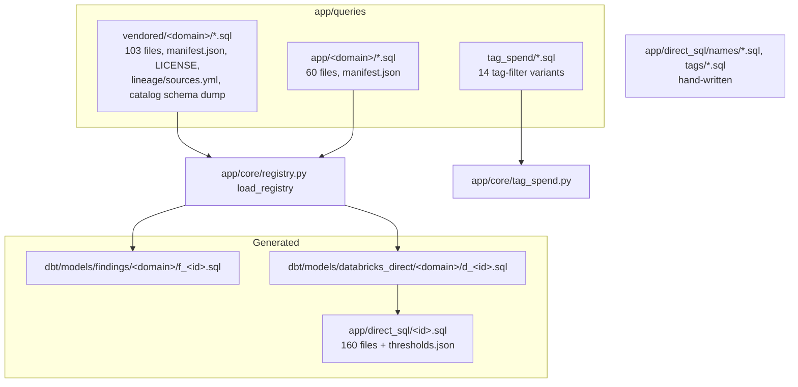
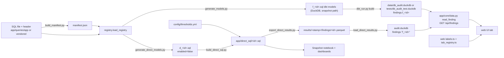

# Queries: the SQL check library

Every check is one `.sql` file with a comment header; generators turn it into dbt models and plain SQL, the export runs the plain SQL, the loader writes `findings."f_<id>"`, and the app and dashboards read that.

Sources used: `app/queries/**`, `app/direct_sql/**`, `tools/header_schema.py`, `tools/lint_headers.py`, `tools/build_manifest.py`, `tools/sync_queries.py`, `config/vendored.lock`, `tools/generate_models.py`, `tools/generate_direct_models.py`, `tools/build_direct_sql.py`, `app/core/registry.py`, `app/core/tag_spend.py`, `tools/export_direct_results.py`, `tools/load_direct_results.py`, `app/core/data.py`.

## Folders

| Folder | Count | Owner | Edited how | Evidence |
|---|---|---|---|---|
| `app/queries/vendored/<domain>/` | 103 `.sql` (compute 11, cost 23, governance_access 21, jobs_pipelines 22, performance 13, serving_ai 4, storage 9) | copied from the public library `crosshire-audit-databricks-admin`, then fixed in place | edit the file, then `sync_queries.py --relock` | `config/vendored.lock:2-15`, `tools/sync_queries.py:1-11` |
| `app/queries/app/<domain>/` | 60 `.sql` | this repo | edit the file, `build_manifest.py` | `tools/build_manifest.py:1-10` |
| `app/queries/tag_spend/` | 14 `.sql` | this repo | hand-edit | `app/core/tag_spend.py:1-6`, `19` |
| `app/direct_sql/` | 160 `.sql` + `thresholds.json` | generated | never edit; `build_direct_sql.py` | `tools/build_direct_sql.py:1-6`, header line in each file (e.g. `app/direct_sql/compute_warehouse_idle_minutes.sql:1-2`) |
| `app/direct_sql/names/` | 6 dim SQL | hand-written | edit | `databricks_dashboards/Lakehouse Health 00 - Snapshot.py:25-27` (comment "hand-written; not generated") |
| `app/direct_sql/tags/` | 14 tag-table SQL | hand-written Databricks twins of `dbt/models/tags/*.sql` | edit | `tools/export_direct_results.py:78` |

Vendored vs app vs tag_spend:

- **Vendored**: upstream library queries, pinned by `config/vendored.lock` (commit `f700dd5`, branch `long-running-runs`, `dirty: true`) (`config/vendored.lock:2-3`, `16`). Our copy is fixed in place; `diverged` lists 51 files with the commit item ids that changed them (`config/vendored.lock:33`). Known defects are disclosed in `config/library_corrections.yml` (`config/library_corrections.yml:1-15`, loader `app/core/library_corrections.py:1-17`).
- **App**: queries this repo owns, linted strictly (`tools/lint_headers.py:4-11`) and listed in `app/queries/app/manifest.json` generated from headers (`tools/build_manifest.py:81-97`).
- **tag_spend**: spend checks re-computed over `tags.cost_day` dollars when a tag filter is on; placeholders `__TAGGED__`, `__W__`, `__P__<name>__` (`app/queries/tag_spend/cost_daily_spikes.sql:1-12`, `app/core/tag_spend.py:42-43`, `197-220`).

## The SQL header (v2 schema)

Parser: `tools/header_schema.py`. Read only the leading `--` block; a line `-- <field>: value` starts a field, other `--` lines continue it (`tools/header_schema.py:109-126`).

| Field | Required | Rule | Evidence |
|---|---|---|---|
| `query_id` | yes | must equal file name (lint) | `tools/header_schema.py:15-30`, `tools/lint_headers.py:87-88` |
| `title` | yes | non-empty | `tools/lint_headers.py:81-85` |
| `domain` + `tier` | yes | one line `<domain>   tier: <tier>`; domain = folder; tier in lite/standard/deep | `tools/header_schema.py:62-71`, `212-217`, `tools/lint_headers.py:89-92` |
| `reads` | yes | comma list of `system.<schema>.<table>`; must match the body's system tables (generator) | `tools/header_schema.py:178-179`, `tools/generate_models.py:31-32` |
| `requires` | yes | free text | `tools/header_schema.py:245` |
| `params` | yes | `:name (default X) meaning; ...`; must declare `:period_days` when body uses it | `tools/header_schema.py:94`, `129-148`, `tools/lint_headers.py:119-121` |
| `confidence` | yes | `confirmed` or `needs_confirmation` | `tools/header_schema.py:61`, `tools/lint_headers.py:93-94` |
| `confidence_note`, `read_this`, `healthy`, `investigate_if`, `caveats` | yes | non-empty text | `tools/header_schema.py:15-30` |
| `actions` | yes | `1) ... 2) ...` | `tools/header_schema.py:102`, `171-175` |
| `next` | yes | `query_id (if ...)` list; every target must exist (app or vendored) | `tools/header_schema.py:151-168`, `tools/lint_headers.py:123-125` |
| `runnable` | optional | `false` = copy-paste only, not run | `tools/header_schema.py:32-38`, `225` |
| `empty_if` | optional | tokens from a fixed vocabulary (15 values, e.g. `ingestion_lag`, `no_activity`) | `tools/header_schema.py:43-59`, `tools/lint_headers.py:98-100` |
| `not_assessed_reasons` | optional | `code: words; ...`; every code must appear in the body | `tools/header_schema.py:182-198`, `tools/lint_headers.py:107-109` |

Example header: `app/queries/app/cost/cost_chargeback_by_warehouse.sql:1-60`.

Other lint rules (`tools/lint_headers.py`):

- Forbidden words anywhere in the file: `collector`, `verifier`, `--share`, `findings/`, `databricks_audit:`, `feeds:`, `lookback_days` (`tools/lint_headers.py:32-40`).
- No hard-coded windows in the body (`INTERVAL n DAYS`, `date_add(current_date(), -n)` ...): use `:period_days` (`tools/lint_headers.py:63-68`, `116-118`).
- A `status` CASE may only emit `OK`, `WARN`, `CRITICAL`, `NOT_ASSESSED` (`tools/lint_headers.py:44-60`, `133-136`).
- Ends by running `build_manifest.py --check` (`tools/lint_headers.py:163-176`).
- Scope: only `app/queries/app/**`; vendored files are read only to resolve `next` ids (`tools/lint_headers.py:142-149`).

Stars (first-audit picks) are a fixed set in `tools/header_schema.py:77-87`.

## Registry

`app/core/registry.py` turns both manifests + `.sql` files into `QuerySpec` records (`app/core/registry.py:188-221`).

- Loads vendored then app (`app/core/registry.py:314-327`); cached on manifest mtime/size (`app/core/registry.py:300-311`).
- `executable = runnable and reads[0] not "none ..."` (`app/core/registry.py:239-241`).
- `sources` validated against the 48-table contract (`app/core/registry.py:36-41`, `155`; contract dict starts at `41`); `next` validated across both sets (`app/core/registry.py:282`).
- `by_id()` raises `KeyError` (`app/core/registry.py:329-333`).

## From header to finding (end to end)

| Step | What happens | Evidence |
|---|---|---|
| 1. Header | file in `app/queries/app/<domain>/<id>.sql` | `tools/header_schema.py:1-5` |
| 2. Manifest | `build_manifest.py` writes `app/queries/app/manifest.json` from headers; `--check` for drift | `tools/build_manifest.py:1-10`, `81-97` |
| 3. Registry | `QuerySpec` per query | `app/core/registry.py:314-327` |
| 4. dbt model | `generate_models.py`: strip comments, tokenise params, translate to DuckDB, `system.*` -> `source()`, one `SELECT {{ w }} AS window_days` block per window 7/30/90 | `tools/generate_models.py:12-37`, `64-65` |
| 5. Grain | `config/grains/*.yml` key columns; generator prepends `window_days` for the `unique_grain` test | `tools/generate_models.py:41`, `config/grains/compute_snapshots.yml:1-3` |
| 6. Direct model | `generate_direct_models.py`: same Databricks branch, `config(enabled=false)`, plus `generated_manifest.json` | `tools/generate_direct_models.py:14-33` |
| 7. Plain SQL | `build_direct_sql.py`: Jinja render, thresholds baked, window as `__WINDOW_DAYS__`, as-of as `__AS_OF_DATE__`/`__AS_OF_TS__`, query source `__QUERY_SOURCE__`; `ref()` forbidden | `tools/build_direct_sql.py:26-31`, `60-103`, `106-117` |
| 8. Export | roster from `dbt/models/databricks_direct/generated_manifest.json`; markers filled; stops if `thresholds.json` differs from `config/thresholds.yml` | `tools/export_direct_results.py:1114-1135`, `344-358` |
| 9. Write | one `findings/<id>.parquet` per check | `tools/export_direct_results.py:938-985` |
| 10. Load | `CREATE OR REPLACE TABLE findings."f_<id>"` in DuckDB; run_results-shaped status per id | `tools/load_direct_results.py:548`, `580`, `375-400` |
| 11. Read | `read_finding(query_id, window_days, ...)` selects from `findings."f_<id>"` | `app/core/data.py:806-841` |
| 12. Serve | `GET /api/findings`, `GET /api/finding/{query_id}` | `app/api/app.py:999`, `1137` |
| 13. Show | title/why in `labels.ts`, tab placement in `tab_registry.ts` | `web/src/components/labels.ts:67`, `web/src/components/tab_registry.ts:104`, `147` |
| 14. Test | `tests/test_findings/test_<id>.py` asserts rows via `tests/dbutil.py rows()`; `fixture_coverage.py --check` requires grain + test per executable id | `tests/dbutil.py:4-6`, `tools/fixture_coverage.py:1-30` |

Notes:

- `cost_chargeback_by_warehouse` is a worked example: header `app/queries/app/cost/cost_chargeback_by_warehouse.sql:1-60`, test `tests/test_findings/test_cost_chargeback_by_warehouse.py`, notebook entry `databricks_dashboards/Lakehouse Health 00 - Snapshot.py:2728`.
- `generate_models.py` docstring says "113 today: 100 vendored + 13 app-owned" (`tools/generate_models.py:4`); current files are 103 + 60, so that count is stale (inferred).
- `fixture_coverage.py` docstring says "109 today" (`tools/fixture_coverage.py:9`); also likely stale (inferred).

## Vendored lock and sync

`tools/sync_queries.py` has three modes (`tools/sync_queries.py:13-63`):

| Mode | Touches | What it does |
|---|---|---|
| `--commit <sha> [--allow-dirty] [--source] [--force]` | `app/queries/vendored/`, lock | re-sync from a local upstream clone via `git archive`; refuses to overwrite a diverged file unless `--force` (`tools/sync_queries.py:13-37`) |
| `--relock [--item <id>]` | lock only | recompute `files` sha256 and `diverged` from this repo's `git log`; uncommitted vendored edits need `--item` (`tools/sync_queries.py:39-56`) |
| `--check` | read only | sha256 of every vendored file vs lock `files`; exit 1 on any mismatch (`tools/sync_queries.py:58-63`) |

Lock fields: `branch`, `commit`, `counts`, `dirty`, `dirty_files`, `diverged`, `files` (107 entries), `synced_at`, `url` (`config/vendored.lock:1-306`). Hashes are over LF-normalised bytes (`tools/sync_queries.py:86-93`, `164`). Default source clone path: sibling folder `crosshire-audit-databricks-admin` or env `AUDIT_QUERY_SOURCE` (`tools/sync_queries.py:65-67`, `129`).

## Tests on this module

- `tests/test_registry.py:47` (103 vendored), `:55` (3 non-executable), `:66` (source contract), `:79` (next resolves).
- `tests/test_sync_queries.py:221` (check passes then fails on tamper), `:258` (relock records divergence), `:319` (refuse diverged overwrite).
- `tests/test_build_direct_sql.py:19` (in sync), `:23` (no Jinja left), `:34` (same window marker as export).
- `tests/test_library_corrections.py:50` (register loads).
