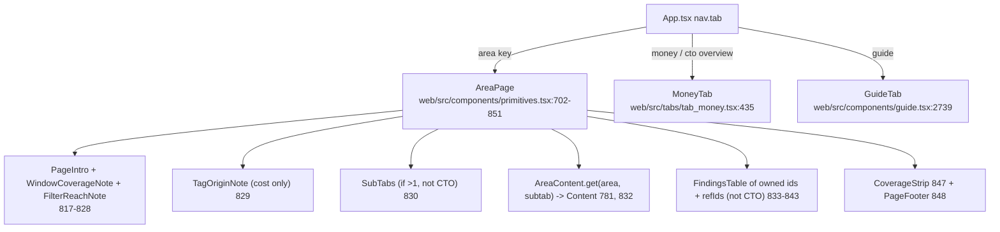

# UI screens (one section per tab)

Every tab, what it shows, which API calls feed it and where the code is. Most tabs are an `AREA_REGISTRY` area rendered by the generic `AreaPage`. Money and Guide are rendered by App.tsx directly.

## Shared rules for every area page

- Data passed to Content (`TabProps`): `findings` scoped to the sub-tab's ids, `filters`, `dims`, `maxCat`, `meta`, `allFindingsIndex`, `goTo`, `onExternalJump`, `setVerdict/onVerdict`, `role`, `roleAreas`, `canDrill` (web/src/components/primitives.tsx:587-602, 796-805).
- All findings for the window come from one `GET /api/findings` in App (web/src/App.tsx:905-915); sub-tab badges count CRITICAL/WARN via `countsForIds` (web/src/components/primitives.tsx:772-779; web/src/components/tab_registry.ts:356-378).
- The checks table under each page lists owned `ids` + `refIds`; a row expands to `FindingDetail` which calls `GET /api/finding/{query_id}` (web/src/components/primitives.tsx:833-843; web/src/components/finding_detail.tsx:1223-1266).
- `filters` (window, workspaceIds, envs) is passed to every hook; the tag filter rides along from module state (web/src/api.ts:39-57).
- CTO lens: `summaryOnly` -> no sub-tab bar, no checks table, first sub-tab only, links open the Guide drawer (web/src/components/primitives.tsx:735-737, 787-805).
- Scope line: governance, storage and usage show the metastore, others the registry scope (web/src/components/primitives.tsx:811-813).
- Abbreviations below: **F(qid)** = `GET /api/finding/{qid}` (useFindingData / useMultiFindingData), **A(qid)** = `GET /api/finding/{qid}/aggregate` (useFindingAgg).

## overview

- Purpose: verdict sentence, KPI cards, ranked "Fix these first", coverage, account shape, spend in dollars (web/src/tabs/tab_overview.tsx:1-4).
- Hash: `tab=overview`; area def web/src/components/tab_registry.ts:317; registered web/src/tabs/tab_overview.tsx:1033.
- Role switch: governance -> `GovernanceOverviewContent` (web/src/tabs/tab_overview.tsx:515-560); others -> `SpendOverviewContent` (web/src/tabs/tab_overview.tsx:592); CTO never sees this (App renders MoneyTab) (web/src/App.tsx:1150, 1175).
- Data:
  - F(OVERVIEW_IDS minus overview_dbu_by_sku, overview_daily_dbu_trend) web/src/tabs/tab_overview.tsx:601-604; F(WASTE_IDS, CRITICAL/WARN) 605
  - A(cost_dollarized_by_sku_day) by product 606, by day 607, total 611; A(cost_monthly_actuals) when grain=month 610
  - F(cost_daily_spikes) 612; F(cost_period_over_period) 711; below-floor waste A(...) 724
  - F(worst check of jobs / performance domain, limit 1) 735-736; F(lakeflow_job_reliability, CRITICAL) 737
  - `GET /api/rollup/top` for the top tag in SpendPathCard 574
  - `JobStateCard` F/A(lakeflow_daily_state) web/src/tabs/job_state.tsx:43-45 (rendered 944)
  - `QueueHeatCards only="week"` A(perf_queue_by_hour) web/src/tabs/query_queue.tsx:37-38 (rendered 949)
  - `TagsOverviewCard` -> `GET /api/tag_compliance` web/src/tabs/tab_tags.tsx:59 (rendered 556, 1004)
- Key widgets: `FixFirstCard` "Fix these first" (405-425), `CoverageCard` "How much this audit could see" (437-465), `AccountShapeCard` (467-480), `OverviewKpiCard` (482), `SpendPathCard` (572-590), `OvSection` blocks "Jobs & pipelines, day by day", "Queued share by hour", "Daily spend & by product", "Mandatory tags", "Coverage & account shape" (943-1009), `SpendMoversCard` (926).
- Filters: global only; local day/month `GrainSwitch` (608).
- Checks table: refIds OVERVIEW_IDS (only for lenses that see Cost) (web/src/components/primitives.tsx:754).

## actions

- Purpose: flagged checks turned into a short fix list with impact, effort, team (web/src/tabs/tab_actions.tsx:1-4).
- Hash `tab=actions`; area web/src/components/tab_registry.ts:318; registered web/src/tabs/tab_actions.tsx:293.
- Data: F(WASTE_IDS, CRITICAL/WARN, 5000) web/src/tabs/tab_actions.tsx:169; `GET /api/rollup/top` cost_center untagged (175); per action F(action.main.query_id, flagged, 200) in `ActionEvidence` (86).
- Logic: `buildActions` joins `ACTION_TEMPLATES` with the findings index and waste worklist; `roleSeesCheck` limits to the lens's areas (29-58; web/src/components/action_templates.ts:28).
- Widgets: action list, `ActionDetail` (136-165) with "open check" -> `goTo(homeForQuery)` (158), `ActionEvidence` (84-134).
- Filters: kind and selected action (185-186).

## money

- Purpose: executive overview: CFO home and CTO Overview (adds Performance with `showPerformance`) (web/src/tabs/tab_money.tsx:1-7).
- Hash `tab=money`; not an AREA_REGISTRY area; rendered at web/src/App.tsx:1175-1182; accepted in hash at web/src/App.tsx:33.
- Data (web/src/tabs/tab_money.tsx):
  - A(cost_dollarized_by_sku_day) by day 443, product 446, workspace 447, product x workspace (multi-env) 526
  - F(cost_period_over_period) 444; A(cost_monthly_actuals) 445; F(cost_unnamed_workspaces) 448; F(WASTE_IDS) 449
  - `/api/rollup/keys` via useTopTags 452; `/api/rollup` via useTagAllocation 459-460
  - F(storage_unused_table_cost) 531
  - CTO only: A(query_failed_queries_daily) 537-538, A(query_queuing_waits) 539-540, useStartupWaits 541, F(lakeflow_job_reliability) 542, F(lakeflow_job_duration_regression) 543, F(cost_chargeback_by_warehouse) 545, F(cost_chargeback_by_cluster) 546
  - `MoneyShapeSection`: F(overview_serverless_classic_split) 119, A(cost_dollarized_by_sku_day by sku) 122, A(cost_chargeback_by_tag_value) 123
  - `TagOriginNote` -> `GET /api/tag_origins` (web/src/components/primitives.tsx:679)
- Widgets: "What moved spend" (`SpendMoversCard` 365-402), "Top cost drivers by product/workspace" (799, 808), "Top 10 warehouses and clusters" (816), "Spend by calendar month" (828), "Spend by environment" (837), "Unnamed workspaces" (866), "Unused tables" (404-433), Compute/Photon/Resource type/SKU/tag value cards (144-162), CTO: failed queries, time queued, job reliability, jobs getting slower (878-923).
- Filters: section switch (456), chosen tag (453), env row open (228), failure grain (622).

## cost

- Purpose: spend by trend, product, allocation, chargeback, resource, before/after and pricing (web/src/tabs/tab_cost.tsx:1-4). Area def web/src/components/tab_registry.ts:319; sub-tabs 52-99. Adds `TagOriginNote` (web/src/components/primitives.tsx:829).

| Sub-tab (hash `subtab=`) | Content | Data | Key widgets |
|---|---|---|---|
| trend | `CostTrendContent` web/src/tabs/tab_cost.tsx:279-474 (reg 475) | A(cost_dollarized_by_sku_day by day) 281; F(cost_period_over_period) 282; F(cost_daily_spikes) 283; A(cost_monthly_actuals) 284; F(cost_by_hour_of_day) 285; A(cost_daily_spikes count_distinct day, CRITICAL/WARN) 310; `ChangeBreakdownCard` F(cost_chargeback_by_warehouse/cluster/job) 211; `TrendByCard` A(cost_dollarized_by_sku_day / cost_daily_by_resource; cost_monthly_actuals / cost_sku_trend_12m) web/src/tabs/cost_trend_by.tsx:83-84 | "Daily spend" 434, "By calendar month" 452, "When you spend" heatmap 461, TrendByCard "Spend by workspace, warehouse or SKU" web/src/tabs/cost_trend_by.tsx:178 |
| product | `CostProductContent` 478-628 (reg 629) | A(cost_dollarized_by_sku_day by sku) 482; F(cost_by_billing_origin_product) 483; A(cost_premium_serverless_photon) 484; F(overview_serverless_classic_split) 485; F(cost_sku_trend_12m) 488 | "Spend by SKU" 588, "Fastest-growing SKUs" 592, "DBUs by product" 612, "Premium usage" 616 |
| allocation | `CostAllocationContent` 793-946 (reg 947) | `/api/rollup/keys` (useTopTags 797, TagKeysBySpendCard 769, TagRollupView web/src/components/tag_rollup.tsx:482); `/api/rollup` (useTagAllocation 800; web/src/components/tag_rollup.tsx:150); A(cost_dollarized_by_sku_day by workspace, all and untagged) 807-808; A(cost_chargeback_by_identity) 809; F(cost_unnamed_workspaces) 812; `useTagDaySplit` A(cost_dollarized_by_sku_day, extraTags key / key:__untagged__) 637-638; `WorkspaceTagsCard` `GET /api/workspace_tags` 959 | "Spend by <cost center>" 898, "Where each dollar lands" (TagRollupView) 908-909, "Who ran it" 914, "Unnamed workspaces" 926, "Tag keys by spend" 777, "Workspace tags" 1044 |
| chargeback | `CostChargebackContent` 1693-1973 (reg 1974) | F(dim.id, 5000) 1702 where dim is one of 8 `CB_DIMENSIONS` ids (1356-1366); F(cost_chargeback_by_service) for workspace dim 1704; F(cost_chargeback_reconcile) 1706 | dimension picker, spend/change metric, "Chargeback by <dim>" 1931, tag key pickers 1622 |
| resource | `CostResourceContent` 1068-1181 (reg 1182) | A(cost_by_job) 1070; F(cost_by_compute_resource) 1071; A(cost_by_notebook) 1072; A(cost_default_storage_dsu) 1073; A/F(cost_genai_token_gpu) 1074-1078; F(compute_warehouse_idle_minutes) 1079 | "DBUs by job" 1138, "DBUs by compute resource" 1141, "Top warehouses by cost" 1146, "Notebooks & default storage" 1155, "GenAI serving by endpoint" 1163 |
| before_after | see cost_before_after below | | |
| pricing | `CostPricingContent` 1253-1348 (reg 1349) | A(cost_usage_policy_coverage) x2 1254-1255; F(cost_actual_vs_list_by_sku) 1256; F(cost_restatement_trust_metric) 1257; A(cost_networking_egress) 1260; A(cost_cloud_infra) 1261; `ContractBurndownCard` A(cost_monthly_actuals, cost_dollarized_by_sku_day, noTagFilter, all workspaces) 1196-1197 | "Commit burndown" 1201, "Usage policy & tag coverage" 1315, "Effective list price by SKU" 1323, "Networking egress & cloud infra" 1331 |

- Example: `#tab=cost&subtab=chargeback&w=30` opens Cost > Chargeback with the workspace dimension (default `dimKey` workspace, web/src/tabs/tab_cost.tsx:1695).

## cost_before_after

- Purpose: one resource's average day (or per query/run) before vs after a chosen date, and what drove it (web/src/tabs/tab_cost_before_after.tsx:1-3).
- Hash `tab=cost&subtab=before_after`; sub-tab def web/src/components/tab_registry.ts:87-91 (refIds cost_daily_by_resource, perf_daily_by_resource, perf_failure_causes_daily); registered web/src/tabs/tab_cost_before_after.tsx:556.
- Data: A(m.qid) numerator/denominator grouped by resource_type, resource_key, usage_date (349-350) where `m.qid` is `cost_daily_by_resource` (COST_QID 19) or `perf_daily_by_resource` (PERF_QID 20) per metric (`BA_METRICS` 38-52); `WhatChanged`: driver columns A(...) 242, A(cost_dollarized_by_sku_day by product, day) 243, A(perf_failure_causes_daily) 244.
- Widgets: "Before and after a fix" 456/480, "<Level>s by change" 508, "What changed" 249/292.
- Filters: level (workspace/warehouse/job/cluster/pipeline, default warehouse), metric, fix day, direction (338-344).

## waste

- Purpose: possible waste roll-up over checks homed on other tabs; no checks table of its own (web/src/tabs/tab_waste.tsx:1-3). Area def web/src/components/tab_registry.ts:320-324; `WASTE_ITEMS` 103-115.

| Sub-tab | Content | Data | Widgets |
|---|---|---|---|
| priced | `WastePricedContent` web/src/tabs/tab_waste.tsx:438-545 (reg 672) | F(WASTE_IDS, flagged, 5000) 440; F(compute_warehouse_cache_reuse) 441; useBelowFloorWaste A(each WASTE_ITEM, below floor) 450 | `PricedSourceCard` per source (370-436), offender rows, link to unpriced 540 |
| unpriced | `WasteUnpricedContent` 580-629 (reg 673) | F(WASTE_ITEMS without dollarCol, 2000) 581-584 | "Also flagged, no dollar figure yet" 611, "Not counted as waste" 617 |
| method | `WasteMethodContent` 641-670 (reg 674) | none (static from WASTE_ITEMS) | "How it's counted" 648, "Priced sources" 662 |

- Total computed in `waste_total.ts` (`buildWasteWorklist` 159, `wasteTotal` 187), shared with Overview, Actions and Money.

## compute

- Purpose: SQL warehouses, clusters & pools, configuration (web/src/tabs/tab_compute.tsx:1-5). Area def web/src/components/tab_registry.ts:327; sub-tabs 142-165.

| Sub-tab | Content | Data | Widgets |
|---|---|---|---|
| warehouses | `ComputeWarehousesContent` web/src/tabs/tab_compute.tsx:721-862 (reg 863) | F(compute_warehouse_idle_minutes, _idle_gaps, _autoscale_churn, sql_warehouse_config_current, sql_warehouse_events_activity, compute_warehouse_autostop_churn, _cache_reuse, _late_autostop, query_warehouse_pressure) 722-730; useStartupWaits A(perf_daily_by_resource) 741; `LastActivityCard kind=warehouse` F(compute_last_activity) web/src/components/last_activity.tsx:39 (844) | "Where each warehouse's running time went" 837, "Idle time by warehouse" 447, "Warehouses by auto-stop setting" 188, auto-stop what-if 513-563, "Auto-stop churn" 575, "Late auto-stop" 632, "Cache reuse" 679 |
| warehouse_detail | see warehouse below | | |
| clusters | `ComputeClustersContent` 867-980 (reg 981) | F(compute_idle_node_ratio) 868; A(classic_clusters_config_current by node type, by source x auto-termination, by cluster) 870-873; F(instance_pools_idle_capacity) 874; `LastActivityCard kind=cluster` (977) | "All-purpose clusters by auto-termination" 215, "Worst idle-node ratio, by cluster" 955, "Cluster count by worker node type" 967 |
| config | `ComputeConfigContent` 1039-1109 (reg 1110) | F(compute_cluster_config_posture) 1040; F(compute_warehouse_config_posture) 1042 | "Cluster setup risks" 1080, "Warehouse setup risks" 1093 |

## warehouse

- Purpose: Compute > Warehouse detail: every SQL warehouse with spend, up/busy/idle time, queries; click one for its detail (web/src/tabs/tab_warehouse.tsx:1-3).
- Hash `tab=compute&subtab=warehouse_detail`; sub-tab def web/src/components/tab_registry.ts:150-154; registered web/src/tabs/tab_warehouse.tsx:210.
- Data: `GET /api/warehouses` (38); per picked warehouse `GET /api/warehouse` (`WarehouseCard` 93-208, call 94).
- Widgets: "Every warehouse" 57; detail cards "Up time" 120, "Idle" 124, "Queries" 129, "Settings" 133, "Busy and idle by day" 141, "Queries by day" 149, "Who uses it" 160, "Tables it touches most" 166, "Everyone who ran queries on it" 175, "Slowest queries" 191; spend by day/month via `TrendItemCard` (114).
- Filters: picked warehouse, show all (39-40).

## jobs

- Purpose: Failures, Slow & queued, Hygiene, Compute fit, Pipelines; job rows open the run panel (`JobFocus.open`, job_panel.tsx) (web/src/tabs/tab_jobs.tsx:1-4). Area def web/src/components/tab_registry.ts:328; sub-tabs 169-195.

| Sub-tab | Content | Data | Widgets |
|---|---|---|---|
| failures | `JobsFailuresContent` web/src/tabs/tab_jobs.tsx:161-338 (reg 339) | F(lakeflow_job_reliability) 162; F(lakeflow_failed_jobs_wasted_dbus) 169; A(lakeflow_termination_taxonomy) 171; A(reliability runs, failed_runs) 176-177; A(wasted $ and count, flagged) 178-179; `JobStateCard` F/A(lakeflow_daily_state) web/src/tabs/job_state.tsx:43-45 (306) | "Jobs with failed runs" 308, "Failed runs by reason" 333, state lines per job |
| slow | `JobsSlowContent` 373-496 (reg 497) | F(lakeflow_job_duration_regression, lakeflow_job_queue_time, lakeflow_phase_cold_start, lakeflow_failed_cluster_starts) 374-377; A(cost_by_job by serverless) 385; `RunTimeCard` A(lakeflow_daily_state) web/src/tabs/job_state.tsx:157-160 (482) | "Jobs by cluster start time (p95)" 352, "Jobs waiting longest on compute" 458, "Slowest cluster cold starts" 471, "Slower than usual, by job" 486, "Failed cluster starts" 503, "Jobs and pipelines by run time" web/src/tabs/job_state.tsx:202 |
| hygiene | `JobsHygieneContent` 563-664 (reg 665) | F(lakeflow_jobs_no_timeout, lakeflow_job_tasks_no_timeout [col no_timeout], lakeflow_health_rule_coverage, lakeflow_job_ownership_orphans, lakeflow_retries_repairs, lakeflow_stale_zombie_jobs) 564-569 | "Jobs relying on retries or repairs" 641, "Stale jobs with no recent run" 647 |
| compute_fit | `JobsComputeFitContent` 728-848 (reg 849) | F(lakeflow_job_compute_pressure) 729; F(task_cluster_utilization [col status]) 731; A(task_cluster_utilization by bottleneck_hint) 733; F(lakeflow_job_oversized) 734 | "Jobs by compute pressure" 805, "Tasks by bottleneck hint" 808, "Flagged jobs, worst first" 817, "Jobs on bigger machines than they need" 834 |
| pipelines | `JobsPipelinesContent` 866-913 (reg 914) | F(lakeflow_pipeline_cost, lakeflow_pipeline_idle_tail_duration, lakeflow_pipeline_update_failures_retries) 867-869 | "Spend by pipeline" 901 |

- Run panel: F(JOB_PANEL_IDS, job_id=<id>, one workspace, no tag filter) (web/src/components/job_panel.tsx:79; web/src/api.ts:119-122); hash `job=<ws>:<job>` (web/src/components/names.tsx:243-256).

## query

- Hash area key is `queries` (old `query` redirects) (web/src/components/tab_registry.ts:329, 382). Sub-tabs 198-235.

| Sub-tab | Content | Data | Widgets |
|---|---|---|---|
| heavy | `QueryHeavyContent` web/src/tabs/tab_query.tsx:229-415 (reg 1064) | F(query_top_by_cost, query_provenance_by_source, cost_audit_self_usage, query_costly_statements_grouped) 230-233; A(query_top_by_cost by statement_type: $ and runs) 236-237 | "Query groups over threshold" 299, "Worst query group" 307, "This audit's own query cost" 319, "Heaviest statement shapes" 219 |
| efficiency | `QueryEfficiencyContent` 506-672 (reg 1065) | F(query_local_spillage, query_shuffle_write_amplification, query_pruning_effectiveness, query_cache_coldstart) 507-510; A(perf_daily_by_resource read_gb) 513 | `ProblemCard` per problem (428), per-warehouse efficiency (471-504), "Files read out of all..." 379 |
| reliability | `QueryReliabilityContent` 690-806 (reg 1066) | useDims 691; F(query_failed_statements_grouped, query_failed_queries_daily, cost_failed_statement_waste) 692-694 | "Failed statements" 726, "Compute burned on failed statements" 737 |
| capacity | `QueryCapacityContent` 880-1056 (reg 1067) | F(query_warehouse_pressure) 881; F(query_queuing_waits) when no tag filter 884; else A(query_slices slot_wait_s, provision_s) 885-886; F(query_workload_mix_hours) 888; useStartupWaits 889; A(fetch_s, runs on query_slices or perf_daily_by_resource) 891-893; `QueueHeatCards` A(perf_queue_by_hour) web/src/tabs/query_queue.tsx:37-41 (1021) | "Warehouses under pressure" 956, "Queued for a slot" 972, "Waiting for start-up" 983, "Result fetching by clients" 998, "Workload peak hour" 1010, "Queued share, weekday by hour (UTC)" web/src/tabs/query_queue.tsx:95, "Queued share, warehouse by day" web/src/tabs/query_queue.tsx:122 |
| trend | `QueryTrendContent` web/src/tabs/query_trend.tsx:92-352 (reg 387) | qid = query_slices when a tag filter is on, else perf_daily_by_resource (98-99); F(probe, limit 1) 100; A(num, den, runs by resource, day) 107-109; provisioning A(provision_s, starts, start_s, failed_starts, max start_s_max) 113-117 | "SQL warehouse trend" 261, `WarehouseTrendCard` 354 |
| team | `QueryTeamContent` 1060-1062 (reg 1068) | `TagRollupView area="performance"` -> `/api/rollup/keys`, `/api/rollup` (web/src/components/tag_rollup.tsx:482, 150) | nested tag rollup |

- Tag filter changes the data source (slices) on capacity and trend: `sliced = !!Api.tagFilterKey()` (web/src/tabs/tab_query.tsx:884; web/src/tabs/query_trend.tsx:98).

## storage

- Purpose: tables and maintenance; whole metastore (web/src/tabs/tab_storage.tsx:1-4). Area def web/src/components/tab_registry.ts:335; sub-tabs 269-284.

| Sub-tab | Content | Data | Widgets |
|---|---|---|---|
| tables | `StorageTablesContent` web/src/tabs/tab_storage.tsx:111-263 (reg 660) | F(storage_target_table_discovery, table_inventory_type, access_dead_table_candidates, storage_growth) 111-116; `UnreadTablesCard` F(storage_unused_table_cost) 24 + `GET /api/tables` 32; `TableSizesPanel` `GET /api/table_sizes` 304 | "Tables nobody read in the last N days" 65, "Tables discovered" 160, "Tables and views by type" 171, "Not altered recently" 179, "Fastest-growing tables" 195 |
| maintenance | `StorageMaintenanceContent` 545-658 (reg 661) | F(po_maintenance_cost_by_table, po_vacuum_reclaimed_bytes, po_clustering_activity, po_clustering_column_churn, po_data_skipping_backfill, storage_small_files, storage_po_coverage, po_failure_reasons) 546-553 | "Maintenance DBU burn" 598, "Vacuum reclaiming nothing" 609, "Clustering activity" 620, "Data-skipping backfill" 631, small files 265, PO coverage 429, failure reasons 482 |

## mlai

- Purpose: ML & AI spend, endpoints, AI Gateway (web/src/tabs/tab_mlai.tsx:1-3). Area def web/src/components/tab_registry.ts:325; sub-tabs 120-138.

| Sub-tab | Content | Data | Widgets |
|---|---|---|---|
| spend | `MlaiSpendContent` web/src/tabs/tab_mlai.tsx:27-116 (reg 117) | A(cost_by_serving_endpoint) 32, 34; A(cost_serving_mode_by_endpoint) 35-36; A(cost_vector_search_spend) 37; A(cost_dollarized_by_sku_day by product) 40 | "Compute time by endpoint" 98, "Model-serving $ by endpoint" 103, "Vector Search $ by endpoint" 106 |
| endpoints | `MlaiEndpointsContent` 227-361 (reg 362) | F(compute_serving_endpoint_cost_status, serving_endpoint_traffic_by_endpoint, compute_serving_endpoint_usage) 229-231; A(cost_serving_mode_by_endpoint flagged days) 233; F(probe) 236 | `EndpointCard` per endpoint (170-225), daily cost range |
| gateway | `MlaiGatewayContent` 368-434 (reg 435) | A(compute_ai_gateway_usage: requests, errors, rate-limited, tokens, by endpoint) 369-377 | "Requests by endpoint" 429 |

## genie

- Purpose: who uses Genie, where and how (Genie Code, agents, One; built-in vs browser) (web/src/tabs/tab_genie.tsx:1-3).
- Hash `tab=genie`; area web/src/components/tab_registry.ts:326 (refIds genie_usage); registered web/src/tabs/tab_genie.tsx:321.
- Data: A(genie_usage) by period x surface x free ($, DBU) 96-97, by channel x identity 98-99, by workspace 100-101, by agent 102, by day 103, by identity x run_as 107, unpriced DBUs 108; A(cost_monthly_actuals by product) 105; F(genie_usage, 5000) 109; A(query_provenance_by_source) 110.
- Widgets: "By kind of use" 202, "Built in or in the browser" 219, "Who uses Genie, where and how" 238, "By workspace" 274, "Top Genie agents" 280, "Genie spend per day/month" 299.
- Filters: day/month grain 106, show all 111.

## governance

- Purpose: access, admin, sensitive data, lineage, sharing; whole metastore (web/src/tabs/tab_governance.tsx:1-5). Area def web/src/components/tab_registry.ts:334; sub-tabs 240-266.

| Sub-tab | Content | Data | Widgets |
|---|---|---|---|
| access | `GovAccessContent` web/src/tabs/tab_governance.tsx:102-248 (reg 681) | `GET /api/coverage` (useCoverage 69); F(access_broad_grants, access_grants_inventory, access_runas_escalation, access_login_concentration, access_network_inbound_denials, access_network_outbound_denials) 104-109; `ActivityByWorkspacePanel` `GET /api/workspace_usage` web/src/tabs/tab_usage.tsx:187 (245) | "Broad grants" 176, "Grants inventory" 192, "Run-as escalation" 203, "Network denials" 219 |
| admin | `GovAdminContent` 253-305 (reg 682) | F(access_admin_role_change_events) 254; `LastActivityCard kind=workspace` (302) | "Admin and permission changes" 281 |
| sensitive | `GovSensitiveContent` 368-524 (reg 683) | `GET /api/abac_policies` (329); F(access_pii_outside_tables, access_column_masks_inventory, access_row_filters_inventory, access_tags_inventory, access_classified_unmasked) 373-377 | "Classified, no mask" 431, "Volumes & schemas outside tagged tables" 439, "Column masks in place" 454, "Row filters in place" 470, "Tagged objects" 478, "ABAC policies" 501 |
| lineage | `GovLineageContent` 527-637 (reg 684) | F(access_table_lineage_blast_radius, access_column_lineage_sensitive_reach, access_pii_propagation_untagged) 528-531 | "Table blast radius" 579, "Sensitive column reach" 594, "PII propagating untagged" 609 |
| sharing | `GovSharingContent` 640-679 (reg 685) | F(access_delta_sharing_exposure) 641 | "Delta Sharing exposure" 655 |

- Old `#tab=lineage` lands on Governance > Lineage (web/src/components/nav_hash.ts:116-118).

## tags

- Purpose: which queries, jobs, pipelines, notebooks, clusters, warehouses and workspaces miss the mandatory tags, and where each tag is found (web/src/tabs/tab_tags.tsx:1-4).
- Hash `tab=tags`; area web/src/components/tab_registry.ts:336; registered web/src/tabs/tab_tags.tsx:484.
- Data: `GET /api/tag_compliance` via `useTagCompliance` (53-66, call 59; key includes Api.tagFilterKey 54); `WorkspaceTagsCard` `GET /api/workspace_tags` (web/src/tabs/tab_cost.tsx:959; rendered web/src/tabs/tab_tags.tsx:480).
- Widgets: `TagTypeCard` per object kind (358-435), `TagOrigins` (191), `TagOffenders` with CSV (231, 165), `TagConflicts` (300), `TagEnvTable` (329), `TagLevelBars` (135); `TagsOverviewCard` reused on Overview (487).

## usage

- Purpose: data usage: Activity, Workspaces, Catalogs, Schemas, Tables, Volumes, People; usage classes from app/core/usage.py (web/src/tabs/tab_usage.tsx:1-4). Area def web/src/components/tab_registry.ts:333; sub-tabs 288-296 (no checks of their own).

| Sub-tab | Content | Data | Widgets |
|---|---|---|---|
| activity | `UsageActivityContent` web/src/tabs/usage_activity.tsx:254-388 (reg 390) | `GET /api/activity` (useActivity 17-29, call 22; optional workspace_id); `GET /api/workspace_usage` 271 | "Most active workspaces" 308, "How much of each workspace is in use" 311, "Activity per workspace per day" 320, "Complexity against usage" 325, "Most used tables" 330, "Most active people" 333, "Read and write events per day" 366; picking a workspace calls `setManyWorkspaces([id])` 261 |
| workspaces | `UsageWorkspacesContent` web/src/tabs/tab_usage.tsx:216-400 (reg 1228) | `GET /api/workspace_usage` 221; `GET /api/tables` and `GET /api/people` for the picked workspace 222-223 | "Complexity against usage" 311, "Every workspace" 316, "Clean up first" 363, "Sensitive data" 390, Scatter 148 |
| catalogs | `UsageLevelContent` level="catalog" web/src/tabs/tab_usage.tsx:412-519 (reg 1229) | `GET /api/data_levels` 416 | workspace and name filters (client-side), "Complexity against usage" 464, "Every catalog" 469 (index hover shows each input's points); click hands the catalog to Schemas 445 |
| schemas | `UsageLevelContent` level="schema" 412-519 (reg 1230) | `GET /api/data_levels` 416 | workspace, catalog and name filters, "Complexity against usage" 464, "Every schema" 469; click opens Tables searched by `catalog.schema.` 446 |
| tables | `UsageTablesContent` 522-623 (reg 1231) | `GET /api/tables` 524, 528; `TableDetail` `GET /api/table` 845 | "Tables by class" 576, "Largest tables" 581, "Most active tables" 586; detail: "Changes and maintenance" 705, "Slowest queries" 785, "Who reads and writes it" 898, "Sensitive columns" 920, "Where it comes from, where it goes" 930 |
| volumes | `UsageVolumesContent` 958-1029 (reg 1232) | `GET /api/volumes` 960; `VolumeDetail` `GET /api/volume_users` 1063 | "File reads" 983, "File writes" 984, "People using volumes" 985, "Not read" 987 |
| people | `UsagePeopleContent` 1092-1173 (reg 1233) | `GET /api/people` 1096; `GET /api/workspaces` 1097; `PersonTables` `GET /api/person_tables` 1200 | people list, seen bands 1178 |

- Cross-sub-tab handoff: module object `handoff` {workspace, cls, table, person, volume, catalog, q} set before `goTo` (web/src/tabs/tab_usage.tsx:30; web/src/tabs/usage_activity.tsx:281-283).

## findings

- Purpose: "All findings": every check, one row each, worst status, grouped by area/status/none; rows expand in place (web/src/tabs/tab_findings.tsx:1-7).
- Hash `tab=findings` (old `domains` redirects); area web/src/components/tab_registry.ts:337; registered web/src/tabs/tab_findings.tsx:541.
- Data: reads `allFindingsIndex` (from `/api/findings`), limited to `roleAreas`; expanded row -> `FindingDetail` F(query_id) (97, 137; web/src/components/finding_detail.tsx:1238-1266).
- Widgets: `CheckStatusTabs` status tabs (web/src/components/findings_table.tsx:151), `AfRow`/`AfCard` (68, 114; card view on narrow screens 27-40), group rows (210, 223), home-tab link `AfHomeLink` (50), CSV download (424).
- Filters: search (262), area (263), status tab (266-269), group mode (271), show all rows (270).

## coverage

- Purpose: Coverage & Gaps: what this audit covers; an empty panel is never a verified zero (web/src/tabs/tab_coverage.tsx:1-5). Area def web/src/components/tab_registry.ts:338-342.

| Sub-tab | Content | Data | Widgets |
|---|---|---|---|
| sources | `CoverageSourcesPanel` web/src/tabs/tab_coverage.tsx:260-440 (reg 634) | `GET /api/coverage` (useCoverageWithError 22-35, call 27); `SourceTableHealthCard` F(access_source_table_coverage) 160; `AuditSelfCostKpi` F(cost_audit_self_usage) 222 | "System table health" 169, "Sources by area" 335, "Models not built cleanly" 415, `RegionCoverageCard` |
| couldnt | `CoverageCouldntPanel` 484-523 (reg 635) | `GET /api/coverage`; `FindingsTable` of not-assessed checks (517) -> FindingDetail | `ChecksNotOkCard` 456 |
| limits | `CoverageLimitsPanel` 546-632 (reg 636) | `GET /api/coverage` | known limitations lists (570, 594, 613) |

- CTO lens still gets full Coverage (sub-tabs and table): `summaryOnly={role === "cto" && nav.tab !== "coverage"}` (web/src/App.tsx:1166).

## guide (not in the area list)

- `tab=guide`: "How it works"; renders from `GET /api/guide` (cached, web/src/components/guide_drawer.tsx:20-29) and `GET /api/guide/sql/{query_id}` (web/src/components/guide.tsx:2323); deep links `#tab=guide&focus=<query_id | how-<slug> | how-area-<key> | how-troubleshooting | how-glossary | how-checks>` (web/src/components/guide.tsx:1-4).
- Also opens while the database is not ready (web/src/App.tsx:1015-1027).
