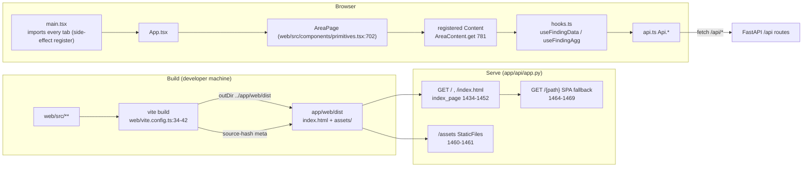
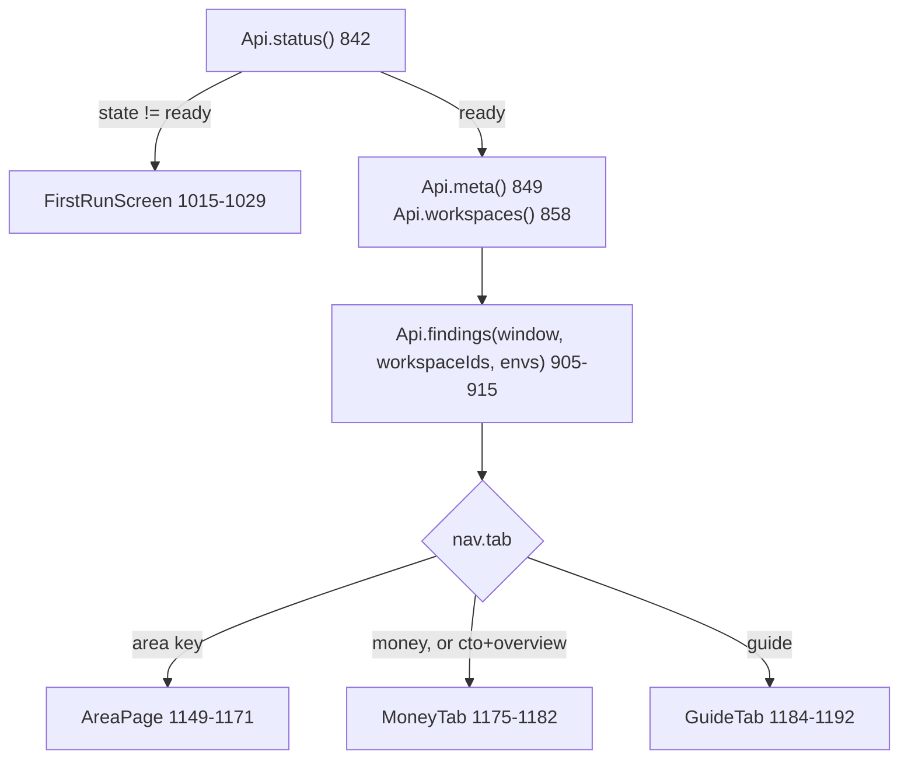
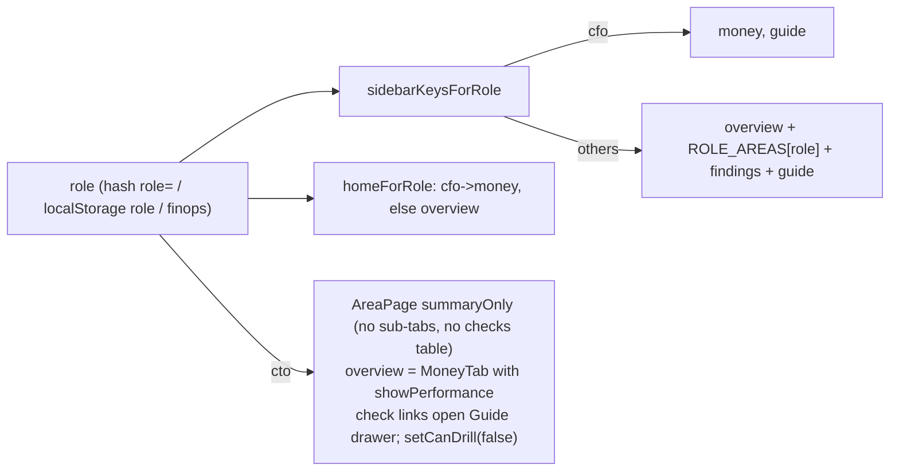

# Module: web UI (web/ -> app/web/dist)

A React 18 + Vite single-page app with no router library. It keeps every view in `location.hash`, reads data only through `web/src/api.ts` (plus one rollup fetcher), and is built into `app/web/dist`, which the FastAPI app serves.

## Build

| Step | What happens | Source |
|---|---|---|
| Scripts | `dev` = vite, `build` = vite build, `typecheck` = tsc --noEmit, `test` = vitest run | web/package.json:5-10 |
| Runtime deps | react 18.3.1, react-dom 18.3.1 only (no router, no chart lib) | web/package.json:11-14 |
| Output dir | `build.outDir: "../app/web/dist"`, `emptyOutDir: true`, chunk warning at 1500 kB (one bundle on purpose) | web/vite.config.ts:36-37 |
| Source-hash | `sourceHash()` = sha256 over `git ls-files -z web/` (sorted, CRLF -> LF), first 16 hex | web/vite.config.ts:11-24 |
| Hash into page | plugin `source-hash` (build only) adds `<meta name="source-hash">` before `</head>` | web/vite.config.ts:26-32 |
| Dev proxy | `npm run dev` serves the page, proxies `/api` to `http://127.0.0.1:${AUDIT_API_PORT or 8000}` | web/vite.config.ts:38-39 |
| Tests | vitest with jsdom, `pool: "threads"` (forks time out on Windows) | web/vite.config.ts:40-41 |
| Page shell | theme script runs before first paint (localStorage `theme`, else OS), `#root`, `/src/main.tsx` | web/index.html:13-27 |
| Commit rule | built page is committed; `web/node_modules/` ignored | .gitignore:35-36; README.md:756-759 |

- Example: change `web/src/tabs/tab_cost.tsx`, forget `npm run build` -> `tests/test_web_dist.py:36-39` fails with "web/ changed since the last build".

### How the app serves it

- `WEB_DIR = app/web/dist` (app/api/app.py:183).
- `GET /` and `/index.html` -> `index_page()`: reads `dist/index.html`, swaps `<title>Crosshire</title>` for the settings brand and injects `window.APP_BRAND`; 404 with the build command if missing; `Cache-Control: no-cache` (app/api/app.py:1461-1479).
- `.js/.css/.woff2` MIME types forced (Windows registry can map `.js` to text/plain) (app/api/app.py:1482-1485).
- `/assets` mounted as StaticFiles when present (app/api/app.py:1487-1488).
- Any other non-`/api` path returns the page (SPA fallback); unknown `/api/*` stays 404 (app/api/app.py:1491-1496).
- The page reads `window.APP_BRAND` for its name before `/api/meta` answers (web/src/globals.d.ts:1-4; web/src/App.tsx:150).

### Build checks (tests/test_web_dist.py)

| Test | Asserts | Lines |
|---|---|---|
| `test_page_is_built_from_the_current_source` | dist `source-hash` meta == Python re-computation of the same hash | tests/test_web_dist.py:21-33, 36-39 |
| `test_page_keeps_what_runs_before_first_paint` | theme `localStorage.getItem("theme")` + try, author/copyright metas, `data:,` icon, `<title>Crosshire</title>` (server swaps it) | tests/test_web_dist.py:42-48 |
| `test_page_loads_nothing_from_other_sites` | every src/href is local and exists in dist; no Google Fonts in CSS | tests/test_web_dist.py:51-61 |

## Entry and load order

- `main.tsx` imports CSS (web/src/main.tsx:4-18), then every tab module **for its side effect**: each calls `AreaContent.register(area, subtab, Component)` at load (web/src/main.tsx:20-41), then `components/job_panel` which mounts its own overlay root (web/src/main.tsx:42; web/src/components/job_panel.tsx:577), then renders `<App/>` (web/src/main.tsx:43-45).
- `AreaContent` is a plain map `"area::subtab" -> Component` (web/src/components/primitives.tsx:604-611).
- `AREA_REGISTRY` (data only) maps area -> label, scope, sub-tabs -> owned `ids` and `refIds` (query_ids) (web/src/components/tab_registry.ts:316-343); sidebar order `AREA_ORDER` (web/src/components/tab_registry.ts:344).

## App shell (App.tsx)

- Shell parts: `Rail` (brand, lens, page list, Guide, theme) web/src/App.tsx:566-604; `TopBar` web/src/App.tsx:471-520; mobile `SideNavDrawer` (<900px) web/src/App.tsx:610-700; `BrandFooter` web/src/App.tsx:720-742; `GuideDrawer` overlay web/src/App.tsx:1199.
- Top bar controls: `LensSelect` (CFO solo only), `WindowControl`, `MainFilters` (Env + mandatory tag pickers), `FiltersButton`, `RegionScopeBanner`, `SnapshotStatus`, `RefreshControl` (web/src/App.tsx:495-517).
- Sidebar dot: areas with at least one CRITICAL finding (`bandOf` + `homeForQuery`) (web/src/App.tsx:976-980).
- Banners in content: region (mobile), `TagScopeBanner`, RLS "No access" (web/src/App.tsx:1131-1135).
- Exec look for overview/money/actions (web/src/App.tsx:1146).
- Loading text "Loading data..." until findings arrive (web/src/App.tsx:1147).

## State

### URL hash state

All views are linkable. `HashState` is the one reader/writer of `location.hash` (web/src/components/hash_state.tsx:1-43):

- `get()` -> `URLSearchParams` of the hash (web/src/components/hash_state.tsx:7-10).
- `write()` uses `history.replaceState` so filter or panel changes never add history entries (web/src/components/hash_state.tsx:11-18).
- `set(patch)` touches only given keys; null/""/undefined deletes (web/src/components/hash_state.tsx:21-29).
- `setGroup(prefix, obj)` replaces every `prefix*` key (for `attr_*`) (web/src/components/hash_state.tsx:33-41).
- `CopyLinkButton` copies `location.href` (web/src/components/hash_state.tsx:50-74).

| Hash key | Meaning | Written at | Read at |
|---|---|---|---|
| `tab` | area key, `money` or `guide` | web/src/App.tsx:917-922 | web/src/components/nav_hash.ts:29-43 (must be in accepted list) |
| `subtab` | sub-tab key | web/src/App.tsx:917-922 | web/src/components/nav_hash.ts:38 (token regex) |
| `focus` | focused query_id / guide topic | web/src/App.tsx:919; web/src/components/findings_table.tsx:269 | web/src/components/nav_hash.ts:40 |
| `domain` | backend domain | web/src/App.tsx:919 | web/src/components/nav_hash.ts:41 |
| `view` | findings status view (overview/critical/warning/ok/not_assessed/reference) | navHref callers | web/src/components/nav_hash.ts:26, 35-39 |
| `w` | window days | web/src/App.tsx:920 | web/src/components/nav_hash.ts:89, 103 |
| `ws` | comma workspace ids (omitted when all) | web/src/App.tsx:924-928 | web/src/components/nav_hash.ts:90, 104 |
| `env` | comma envs | web/src/App.tsx:930-933 | web/src/components/nav_hash.ts:91, 105 |
| `attr_<key>` | comma values per workspace attribute | web/src/App.tsx:935-941 (setGroup) | web/src/components/nav_hash.ts:93-96 |
| `tags` | JSON `[[key, display_key, values, all?]...]` | web/src/App.tsx:943-947 | web/src/components/nav_hash.ts:97-101 (broken JSON drops it) |
| `role` | persona (omitted for finops) | web/src/App.tsx:802-803 | web/src/App.tsx:765-769, 819-820 |
| `job` | `workspaceId:jobId` of the open job panel | web/src/components/names.tsx:243-245 | web/src/components/names.tsx:248-256 |

- `readNavHash(validTabs)` rejects unknown tabs and odd tokens (`/^[A-Za-z0-9_.:-]{1,200}$/`) (web/src/components/nav_hash.ts:27-43).
- `navHref(patch)` builds a hash, merging; accepts field name or short key (web/src/components/nav_hash.ts:59-71).
- `guideLinkProps(focus)` real hash change into the Guide (web/src/components/nav_hash.ts:75-85).
- `applyOldKeyRedirects` maps old keys: `query->queries`, `lineage->governance/lineage`, `domains->findings`, old sub-tabs (`timing->slow`, ...) unless the key is now a live sub-tab (web/src/components/nav_hash.ts:112-128; web/src/components/tab_registry.ts:382-390).
- Example: `#tab=query` -> Queries tab (web/src/components/nav_hash.test.ts:50); `#tab=jobs&subtab=timing` -> Jobs > Slow & queued, sub-tab `slow` (web/src/components/nav_hash.test.ts:57-59).

### Filters

`filters` object handed to every page: `{window, workspaceIds, envs, workspaceIdSet, tag}` (web/src/App.tsx:970; type web/src/types.ts:352-359).

| Filter | State | Control | Sent as |
|---|---|---|---|
| Window | `window_` init from hash `w` else 30, then `meta.open_window`/`default_window` (web/src/App.tsx:758, 852-855) | `WindowControl` hides unavailable windows, labels partial (web/src/App.tsx:266-286) | `window=` |
| Env | `envFilter` Set (web/src/App.tsx:762) | `AttributePicker attrKey="env"` (web/src/App.tsx:409) | `env=` repeated |
| Workspace attributes | `attrFilters` {key: Set} (web/src/App.tsx:763, 962-968) | `AttributeFilters` in Filters popover (web/src/App.tsx:450-456) | narrows `workspace_ids` client-side (web/src/App.tsx:873-881) |
| Workspaces | `workspaceIdSet` (web/src/App.tsx:759; all by default 709-712) | `WorkspacesControl` (web/src/App.tsx:362-391), list follows Env (356-358) | `workspace_ids=` repeated |
| Tag filter | `tagFilter` -> `activeTag = narrowingTag(tagFilter)` (web/src/App.tsx:764, 833) | `MandatoryTagPicker` per mandatory key + `TagPicker` (web/src/App.tsx:410, 457) | module state `Api.setTagFilter` (web/src/App.tsx:834) -> `tag=key:value` repeated (web/src/api.ts:53-57) |

- `workspaceIds` rule (web/src/App.tsx:883-895): not loaded -> `[]`; None picked -> `[NO_WORKSPACE_MATCH]`; all picked and no attr filter -> `[]` (= every workspace); attr filter matching none -> `[NO_WORKSPACE_MATCH]` (sentinel web/src/components/filters.tsx:156-159).
- Tag filter semantics: values OR within a name, names AND; empty values = any value (untagged left out); `all` = narrows nothing (web/src/components/tag_picker.tsx:5-8, 78).
- Mandatory tag keys get their own picker; an `attr_` filter for such a key is dropped (web/src/App.tsx:865-871; web/src/components/tag_picker.tsx:149-163).
- Every data hook joins `Api.tagFilterKey()` into its memo key, so a tag change refetches (web/src/components/hooks.ts:90, 122; web/src/api.ts:47-49).
- `FilterReachNote` names panels a filter did not narrow (from `scope` on each response) (web/src/components/primitives.tsx:659-668; web/src/components/hooks.ts:27-78).

### Scope wording (scope.tsx)

- One place for coverage words: region (only billing and workspaces_latest are account-wide) and filter reach (no `workspace_id` column -> not filtered) (web/src/components/scope.tsx:1-5).
- `RegionScopeBanner` from `/api/findings` `region_gap` (web/src/components/scope.tsx:75); `OutsideRegionCard` per finding (118); `TabScopeNote` (145); `RegionCoverageCard` for `/api/coverage` `region` (186).
- `OUTSIDE_REGION_LABEL` must equal app/api/service.py's (checked by tests/test_scope_disclosure.py) (web/src/components/scope.tsx:5, 15).
- `NOT_BUILT_READING` "Not in this export yet." for a missing `findings.f_<id>` (web/src/components/scope.tsx:19-30).

## Roles (lenses, not permissions)

| Role | Areas (`ROLE_AREAS`) | Lines |
|---|---|---|
| finops (default) | actions, cost, waste, mlai, genie, compute, tags, coverage | web/src/components/roles.ts:33 |
| data_engineer | actions, jobs, compute, queries first, then the rest of CONTENT_AREAS | web/src/components/roles.ts:34 |
| cto | every content area (AREA_ORDER minus overview, findings) | web/src/components/roles.ts:27, 35 |
| governance | actions, usage, governance, tags | web/src/components/roles.ts:36 |
| cfo | cost, waste, mlai (scope only; sidebar is money + guide) | web/src/components/roles.ts:39, 48-51 |

- Initial role: hash `role` -> localStorage `role` -> `finops` (web/src/App.tsx:765-770).
- `applyRole` stores it and jumps to the new home (web/src/App.tsx:786-792); tab not in sidebar -> home (web/src/App.tsx:50-52, 802-808); CFO safety net (web/src/App.tsx:797-801).
- CTO: `setCanDrill(role !== "cto")` (web/src/App.tsx:839); `summaryOnly` (web/src/App.tsx:1166); check link -> `openGuideDrawer` (web/src/App.tsx:988-993); overview -> `MoneyTab showPerformance` (web/src/App.tsx:1150, 1175-1180).
- Overview for governance role is a different Content (`GovernanceOverviewContent`) (web/src/tabs/tab_overview.tsx:1029-1031).
- Tests: web/src/components/roles.test.ts:5-31.

## API client (web/src/api.ts)

- `getJson(path, params)` = fetch with `Accept: application/json`; non-2xx throws `Error("<status> <detail>")` with `.status` (web/src/api.ts:24-37).
- `qs` drops null/undefined/"" and repeats array params (web/src/api.ts:10-22).
- Tag filter is module state set by App before children render (web/src/api.ts:39-57).

| Api member | Endpoint | Params | Line | Backend route |
|---|---|---|---|---|
| `status` | GET /api/status | - | web/src/api.ts:70 | app/api/app.py:350 |
| `meta` | GET /api/meta | - | web/src/api.ts:71 | app/api/app.py:418 |
| `workspaces` | GET /api/workspaces | - | web/src/api.ts:72 | app/api/app.py:510 |
| `dims` | GET /api/dims | - | web/src/api.ts:75 | app/api/app.py:601 |
| `coverage` | GET /api/coverage | - | web/src/api.ts:76 | app/api/app.py:659 |
| `refreshStatus` | GET /api/refresh | - | web/src/api.ts:77 | app/api/app.py:386 |
| `refreshStart` | POST /api/refresh | days | web/src/api.ts:78 | app/api/app.py:402 |
| `guide` | GET /api/guide | - | web/src/api.ts:80 | app/api/app.py:732 |
| `guideSql` | GET /api/guide/sql/{query_id} | window | web/src/api.ts:81 | app/api/app.py:737 |
| `tags` | GET /api/tags | search, tag_key, limit_keys, limit_values | web/src/api.ts:86 | app/api/app.py:991 |
| `tagOrigins` | GET /api/tag_origins | window, workspace_ids, env, tag | web/src/api.ts:88-89 | app/api/app.py:807 |
| `tagCompliance` | GET /api/tag_compliance | window, workspace_ids, env, tag | web/src/api.ts:90 | app/api/app.py:958 |
| `abacPolicies` | GET /api/abac_policies | - | web/src/api.ts:91 | app/api/app.py:836 |
| `tableSizes` | GET /api/table_sizes | - | web/src/api.ts:92 | app/api/app.py:953 |
| `tables` | GET /api/tables | workspace_ids, env, window?, tag | web/src/api.ts:93 | app/api/app.py:902 |
| `table` | GET /api/table | name, window? | web/src/api.ts:94 | app/api/app.py:946 |
| `people` | GET /api/people | window, workspace_ids, env | web/src/api.ts:95 | app/api/app.py:919 |
| `volumes` | GET /api/volumes | window (30), workspace_ids, env, tag | web/src/api.ts:96 | app/api/app.py:884 |
| `volumeUsers` | GET /api/volume_users | volume, window | web/src/api.ts:97 | app/api/app.py:896 |
| `warehouses` | GET /api/warehouses | window, workspace_ids, env | web/src/api.ts:98 | app/api/app.py:929 |
| `warehouse` | GET /api/warehouse | warehouse_id, window | web/src/api.ts:99 | app/api/app.py:940 |
| `dataLevels` | GET /api/data_levels | level, window, workspace_ids, env, tag | web/src/api.ts:100 | app/api/app.py:853 |
| `activity` | GET /api/activity | window, workspace_ids, env, workspace_id? | web/src/api.ts:101 | app/api/app.py:866 |
| `personTables` | GET /api/person_tables | identity, window | web/src/api.ts:102 | app/api/app.py:878 |
| `workspaceUsage` | GET /api/workspace_usage | window, workspace_ids, env, tag | web/src/api.ts:103 | app/api/app.py:841 |
| `workspaceTags` | GET /api/workspace_tags | workspace_ids, env, tag | web/src/api.ts:104 | app/api/app.py:821 |
| `findings` | GET /api/findings | window, workspace_ids, env, tag | web/src/api.ts:105-108 | app/api/app.py:1026 |
| `finding` | GET /api/finding/{query_id} | window, workspace_ids, env, limit, offset, job_id, status, columns, tag (not with job_id) | web/src/api.ts:111-123 | app/api/app.py:1164 |
| `aggregate` | GET /api/finding/{query_id}/aggregate | window, workspace_ids, env, group, agg, value, status, top, below_floor, tag (+extraTags replace same-key tags; noTagFilter drops) | web/src/api.ts:125-147 | app/api/app.py:1333 |
| (outside Api) `tagRollupFetch` | GET /api/rollup/keys, /api/rollup, /api/rollup/top | area, tag_key, window, tag_value, workspace_ids, env, tag | web/src/components/tag_rollup.tsx:115-128, 135, 150, 170, 259 | app/api/app.py:972, 755, 784 |

- The `dims` comment mentions a PUT for the Settings cost-center picker (web/src/api.ts:73-74); no client call and no `@app.put` route found in app/api/app.py -> unclear / not wired.
- Example request (inferred from qs + params): `GET /api/finding/cost_daily_spikes/aggregate?window=30&workspace_ids=123&env=prod&agg=count_distinct&value=usage_date&status=CRITICAL&status=WARN&tag=cost_center:finance` (web/src/tabs/tab_cost.tsx:310; web/src/api.ts:125-147).

### Data hooks (web/src/components/hooks.ts)

| Hook | Calls | Returns | Lines |
|---|---|---|---|
| `useFindingData(qid, window, ws, envs, limit=5000, statuses, columns)` | Api.finding | `{phase, outcome, data, error}` | web/src/components/hooks.ts:85-108 |
| `useFindingAgg(qid, window, ws, envs, group, agg, value, opts)` | Api.aggregate | same shape | web/src/components/hooks.ts:114-141 |
| `useMultiFindingData(ids, ...)` | Api.finding per id, Promise.all | `{phase, byId}` | web/src/components/hooks.ts:227-256 |
| `useDims()` | Api.dims once | Maps jobs/clusters/warehouses/pipelines | web/src/components/hooks.ts:261-280 |
| `useRollupKeys/useRollupTop/useTagAllocation/useTopTags` | tagRollupFetch | rollup state | web/src/components/tag_rollup.tsx:130-141, 163-180, 204-212, 249-269 |
| `useStartupWaits` | 5x useFindingAgg on perf_daily_by_resource | per-warehouse waits | web/src/tabs/startup_waits.ts:22-44 |
| `useBelowFloorWaste` | useFindingAgg per WASTE_ITEMS (below_floor) | per-id agg | web/src/components/waste_total.ts:169-177 |
| `useRefresh` | Api.refreshStatus (poll 3 s), Api.refreshStart | `{st, start}` | web/src/components/first_run.tsx:10-23 |

- A null `queryId` means "do not fetch" (conditional panels pass `cond ? "qid" : null`) (web/src/components/hooks.ts:94).
- Each response's `scope` feeds `IgnoredFilterTracker` via `reportIgnoredFilters` (web/src/components/hooks.ts:27, 57, 101, 134).

## Components

| File | Role | Key exports (line) | Calls API |
|---|---|---|---|
| web/src/components/tab_registry.ts | Areas, sub-tabs, owned query_ids; bands; homes; redirects | AREA_REGISTRY 314, AREA_ORDER 342, WASTE_ITEMS 103, OVERVIEW_IDS 296, countsForIds 354, OLD_TAB_REDIRECTS 380, homeForQuery 412, bandOf 440 | no |
| web/src/components/hash_state.tsx | Hash read/write | HashState 6, CopyLinkButton 50 | no |
| web/src/components/nav_hash.ts | Nav + filters <-> hash | readNavHash 29, navHref 59, guideLinkProps 75, filtersFromHash 88, applyOldKeyRedirects 112 | no |
| web/src/components/filters.tsx | Attribute pickers | AttributePicker 32, AttributeFilters 131, NO_WORKSPACE_MATCH 159 | no (props only) |
| web/src/components/scope.tsx | Coverage wording | RegionScopeBanner 75, OutsideRegionCard 118, FindingScopeBadge 137, TabScopeNote 145, RegionCoverageCard 186 | no |
| web/src/components/tag_picker.tsx | Tag filter UI | narrowingTag 78, mandatoryFilterKeys 149, dropMandatoryAttrs 158, MandatoryTagPicker 166, TagPicker 237, TagScopeBanner 310 | GET /api/tags (49, 111, 179) |
| web/src/components/roles.ts | Personas | ROLES 9, homeForRole 14, ROLE_AREAS 32, roleAreasFor 42, sidebarKeysForRole 48 | no |
| web/src/components/guide.tsx | How it works page | GuideTab 2737 | GET /api/guide (via guide_drawer 2771), GET /api/guide/sql (2321), finding (2207) |
| web/src/components/guide_drawer.tsx | Check explainer drawer | fetchGuideData 20, openGuideDrawer 109, GuideDrawer 137 | GET /api/guide (22) |
| web/src/components/first_run.tsx | Not-ready screen | useRefresh 10, FirstRunScreen 145 | GET/POST /api/refresh (12, 15, 21) |
| web/src/components/finding_detail.tsx | Expand-in-place check detail; honesty cards | setAppMasking 75, NotAssessedCard 592, EmptyWindowCard 658, ErrorCard 718, FindingDetail 1223 | GET /api/finding/{id} (1238, 1262, 1266) |
| web/src/components/findings_table.tsx | Checks table under every area | tabOf 84, CheckStatusTabs 151, FindingsTable 252; CSV cells starting `= + - @` get a leading `'` (formula guard, 144) | via FindingDetail; writes `focus` hash (269) |
| web/src/components/primitives.tsx | UI atoms + page frame | PageIntro 429, Card 492, AreaContent 604, FilterReachNote 659, TagOriginNote 671, AreaPage 702 | GET /api/tag_origins (679) |
| web/src/components/hooks.ts | Data hooks | see table above | finding, aggregate, dims |
| web/src/components/tag_rollup.tsx | Tag rollup views | useRollupKeys 130, useRollupTop 163, useTopTags 204, useTagAllocation 249, TagRollupView 476; chart totals use `usd_disc` when present (232-240) | /api/rollup* |
| web/src/components/names.tsx | id -> name, deep links, job panel store | Names 53, useNames 219, JobFocus 239, Ref 341 | dims + workspaces once (72) |
| web/src/components/job_panel.tsx | Job run drawer | own root 577 | GET /api/finding/{id}?job_id (79) |
| web/src/components/waste_total.ts | Possible-waste worklist and total | buildWasteWorklist 159, useBelowFloorWaste 169, wasteTotal 187 | aggregate (via hook) |
| web/src/components/last_activity.tsx | Last activity card | LastActivityCard 38 | finding compute_last_activity (39) |
| web/src/components/charts.tsx, charts_more.tsx, design_parts.tsx, band_rows.tsx, grain.tsx | SVG charts, grids, day/month switch | ChartNote (charts.tsx), RankedBars 104, Columns 193, HeatGrid 39, StateBands 88, GrainSwitch 10 | no |
| web/src/components/labels.ts, columns.ts, pressure.tsx, trend_tone.ts, action_templates.ts, overview_tile.tsx | Words, column meta, tones, fix templates, tile props | CHECK_LABELS 12, getCheckLabel 248, columnMeta 176, ACTION_TEMPLATES 28 | no |
| web/src/format.tsx | Formatters ("-" for non-numbers) | fmtMoney 37, fmtDbu 56, fmtPct 64 | no |
| web/src/types.ts | API answer shapes | Filters 352 | no |

## Tests (vitest)

| File | Covers | Lines |
|---|---|---|
| web/src/components/nav_hash.test.ts | navHref merge/delete, readNavHash validation, applyOldKeyRedirects, filtersFromHash incl. broken `tags` | 10-85 |
| web/src/components/roles.test.ts | CFO money+guide, other roles' sidebar, areas exist, CTO/data engineer order, unknown -> finops | 5-31 |
| web/src/components/tag_picker.test.ts | dropMandatoryAttrs normalises key | 4-9 |
| web/src/components/honesty.test.tsx | rowsOf only for ok_rows; ChartNote shows a note (no svg) for loading/empty/error/not_assessed | 14-45 |
