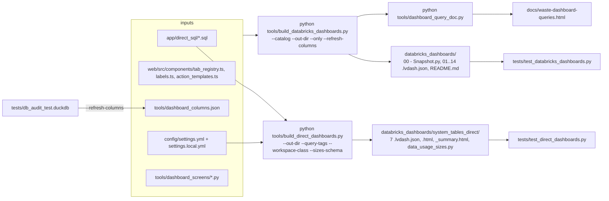

# Process: build the Databricks dashboards

Two scripts regenerate every file in `databricks_dashboards/`; rerun them after a check, tab layout, label, setting (`query_tags`, `sources`, `dashboards`, `discount_pct`) or screen change, then re-import in Databricks.

## Lakehouse Health set

| Option | Meaning | Evidence |
|---|---|---|
| `--catalog C` | catalog written into every file; default settings `dashboards.snapshot_catalog`, else none | `tools/build_databricks_dashboards.py:1456-1459` |
| `--out-dir DIR` | default `databricks_dashboards/` | `tools/build_databricks_dashboards.py:1460` |
| `--only TAB` | just one tab's dashboard | `tools/build_databricks_dashboards.py:1461`, `1470-1472` |
| `--refresh-columns` | rewrite `tools/dashboard_columns.json` from `tests/db_audit_test.duckdb` first | `tools/build_databricks_dashboards.py:1462-1465`, `1052-1063` |

- Use `--out-dir` outside the repo with your catalog to get import-ready files (`databricks_dashboards/README.md:72-77`).
- Output is byte-identical on rerun (hashed ids) (`tools/build_databricks_dashboards.py:8-9`).
- Files written with LF (`tools/build_databricks_dashboards.py:1475-1477`).
- Rebuild after `query_tags`, `sources` or `dashboards` settings change (`README.md:437-440`, `484-485`).

## system_tables_direct set

| Option | Meaning | Evidence |
|---|---|---|
| `--out-dir` | default `databricks_dashboards/system_tables_direct` | `tools/build_direct_dashboards.py:28`, `957` |
| `--query-tags k=v,...` | replaces settings `query_tags`; letters, digits, `_` | `tools/build_direct_dashboards.py:958`, `964-965`, `tools/build_databricks_dashboards.py:164-176` |
| `--workspace-class CLASS=PATTERN` | Workspace usage classes, LIKE on lower-case name | `tools/build_direct_dashboards.py:959-960`, `databricks_dashboards/system_tables_direct/README.md:24-25` |
| `--sizes-schema cat.schema` | Data usage sizes tables (default `main.data_usage`) | `tools/build_direct_dashboards.py:961-962`, `967` |

- For the `databricks-observability` bundle: build into a scratch folder, copy `.lvdash.json` to its `src/` and `.html` to `docs/queries/` (`databricks_dashboards/system_tables_direct/README.md:39-40`).

## Waste query guide

- `python tools/dashboard_query_doc.py` writes `docs/waste-dashboard-queries.html` from `Lakehouse Health 07 - Waste & savings.lvdash.json` (`tools/dashboard_query_doc.py:1-16`); tested by `tests/test_dashboard_query_doc.py`.

## After building

1. Run the gate tests: `tests/test_databricks_dashboards.py:294` and `tests/test_direct_dashboards.py:10` compare committed files with a fresh build.
2. In Databricks: import each `.lvdash.json`, pick a warehouse, publish with embed credentials (`databricks_dashboards/README.md:65-83`); run the snapshot notebook again (`databricks_dashboards/README.md:98-102`).
