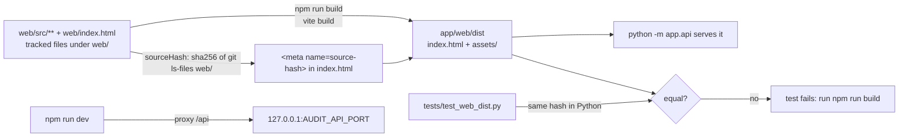

# Process: build the web UI

The React/TypeScript UI in `web/` is built by Vite into `app/web/dist`, which is committed; a source hash in the built page makes a test fail when `web/` changed without a rebuild.

## Steps

1. Change files under `web/` (React 18.3.1, TypeScript, Vite) (`web/package.json:11-14`, `README.md:734`).
2. `cd web && npm ci && npm run build` (`README.md:756-757`). `build` = `vite build` (`web/package.json:7`).
3. Vite writes to `../app/web/dist`, empties it first (`web/vite.config.ts:37`).
4. The `source-hash` plugin adds `<meta name="source-hash">` = first 16 hex of sha256 over every tracked `web/` file, CRLF -> LF (`web/vite.config.ts:11-32`).
5. Commit `app/web/dist` with the source change (`README.md:756-757`).
6. `tests/test_web_dist.py` recomputes the hash with `git ls-files -z web/` and compares (`tests/test_web_dist.py:21-39`); skips without git (`tests/test_web_dist.py:23-27`).

## Checks on the built page

- Theme script, author/copyright meta, `data:,` icon, `<title>Crosshire</title>` present (`tests/test_web_dist.py:42-48`).
- Nothing loaded from other sites; every `src`/`href` exists in `dist` (`tests/test_web_dist.py:51-60`).

## Dev loop

- `npm run dev` serves the UI with live reload and proxies `/api` to `http://127.0.0.1:${AUDIT_API_PORT||8000}` (`web/vite.config.ts:38-39`, `README.md:757-759`). Needs Node and git (`README.md:759`).
- Type check and tests: `npm run typecheck` (`tsc --noEmit`), `npm test` (`vitest run`) (`web/package.json:8-9`); the gate runs them only when `web/node_modules` exists (`tools/gate.py:107-117`).
- Node is not needed to run the app; the built UI is in the repo (`README.md:44`).
