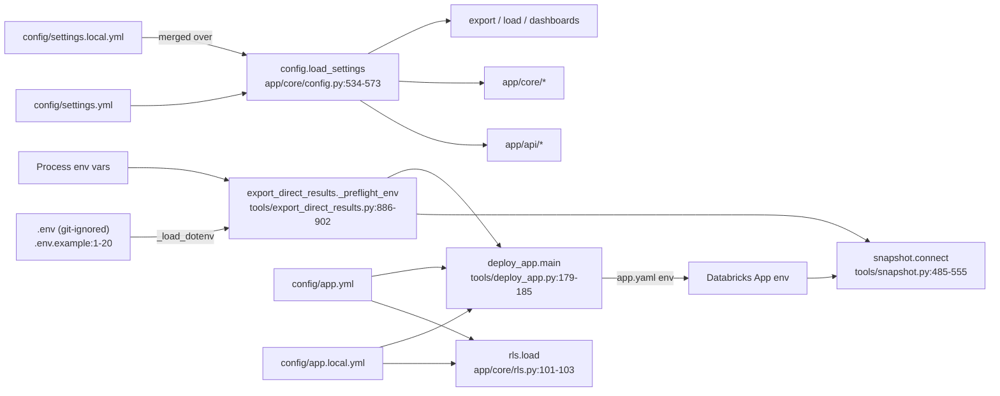

# Process: configuration and secrets

Every setting the Python app and tools read: `config/settings.yml` (+ git-ignored `settings.local.yml` overlay), `config/app.yml` (+ `app.local.yml`), other `config/*` files, environment variables, and the three Databricks credentials (names only).

## Rules

- `config/settings.yml` is tracked; put changes in `config/settings.local.yml` (git-ignored); local values win key by key; a block (`ui`, `brand`, `privacy`, `load`…) in the local file replaces the whole block (`config/settings.yml:1-5`, `README.md:422-424`, `README.md:450-451`, `app/core/config.py:567`).
- Config dir = `AUDIT_CONFIG_DIR` or `<repo>/config`, re-read on every call (`app/core/config.py:127-129`).
- Missing `settings.yml` is seeded from `DEFAULT_SETTINGS` (`app/core/config.py:547-557`).
- Unknown keys / wrong types raise `SettingsError(key, line)`; the API answers 503 and `/api/status` shows the key and line (`app/core/config.py:101-119`, `app/core/config.py:374-506`, `app/api/app.py:221-231`, `app/api/app.py:349-377`).

## settings.yml keys

Default = `DEFAULT_SETTINGS` (`app/core/config.py:187-219`); "shipped" = value in the tracked `config/settings.yml`.

| Key | Default (code) | Shipped | Validation | Read by | Takes effect |
|---|---|---|---|---|---|
| `discount_pct` | 0.0 | 0.0 (`config/settings.yml:15`) | number in [0,1) (`app/core/config.py:387-388`) | `app/api/app.py:463`, `app/api/app.py:1268-1273`, `app/api/app.py:1298`, `app/api/app.py:1437`, `app/api/guide.py:597` | page refresh |
| `dbt_target` | "dev" | not set | non-empty string (`app/core/config.py:389-390`) | no reader found in app/ or tools/ (unclear) | — |
| `default_window` | 30 | 30 (`config/settings.yml:18`) | 7/30/90 (`app/core/config.py:430-431`) | `app/api/app.py:241-244`, `app/api/app.py:458-462`, `app/api/app.py:847-940`, `tools/export_direct_results.py:211-216` | next export / page |
| `include_today` | true | true (`config/settings.yml:22`) | bool (`app/core/config.py:428-429`) | `tools/export_direct_results.py:203-208`, `app/api/guide.py:76` | next export |
| `ui.max_rows` | 500 | 500 (`config/settings.yml:27`) | positive int (`app/core/config.py:446-447`) | `app/core/data.py:898` (default page LIMIT) | page refresh |
| `ui.max_chart_categories` | 8 | 8 (`config/settings.yml:28`) | positive int | `app/api/app.py:477` | page refresh |
| `mandatory_tag_keys` | `[cost_center, domain, env]` (`app/core/config.py:206`) | `[cost_center, domain, environment]` (`config/settings.yml:36`) | list of 1-5 (`app/core/config.py:419-422`) | `app/api/app.py:466`, `app/core/data.py:1537`, `app/core/rollup.py:1035`, `app/api/guide.py:83`, `tools/export_direct_results.py:624`, `tools/load_direct_results.py:184` | page refresh |
| `export_tag_keys` | None (all) | commented (`config/settings.yml:42`) | list of names (`app/core/config.py:413-417`) | `tools/export_direct_results.py:621` | next export |
| `load.memory_limit` | "1GB" | 1GB (`config/settings.yml:53`) | `\d+(MB|GB)` (`app/core/config.py:493-494`) | `app/core/data.py:297-299`, `tools/load_direct_results.py:560-562` | next load / app restart |
| `load.threads` | 4 | 4 (`config/settings.yml:54`) | int range (`app/core/config.py:497-498`) | same as above | next load / app restart |
| `load.top_tag_keys` | 10 | 10 (`config/settings.yml:55`) | int range | `tools/load_direct_results.py:162-182` | next load |
| `load.tag_keys` | None | commented (`config/settings.yml:56`) | list (`app/core/config.py:500-504`) | `tools/load_direct_results.py:174-175` | next load |
| `tag_coverage_floor` | 0.5 | 0.5 (`config/settings.yml:61`) | [0,1] (`app/core/config.py:434-435`) | `app/api/app.py:829`, `app/api/guide.py:659`; export via `tools/dbt_run.py:144-146` (`tools/export_direct_results.py:646-664`) | next export |
| `tag_share_floor` | 0.6 | 0.6 (`config/settings.yml:62`) | [0,1] (`app/core/config.py:432-433`) | `app/api/app.py:829`, `app/api/guide.py:658`; export via `tools/dbt_run.py:139-141` | next export |
| `admin_groups` | [] | commented (`config/settings.yml:66`) | ≤ 50 names (`app/core/config.py:424-427`) | `app/core/materiality.py:81` | page refresh |
| `brand.name/url/contact_name/contact_email` | Crosshire defaults (`app/core/config.py:194-199`) | `config/settings.yml:69-73` | strings (`app/core/config.py:450-464`) | `app/api/app.py:376`, `app/api/app.py:464`, `app/api/app.py:1458`, `app/core/config.py:673` (query_source fallback), `tools/build_databricks_dashboards.py:121` | page refresh |
| `privacy.mask_user_identities` | false | false (`config/settings.yml:80`) | bool (`app/core/config.py:477-478`) | `app/core/identity.py:63-65`, `app/api/app.py:465`, `tools/export_direct_results.py:1548`, `tools/dbt_run.py:154-159` | next export / load |
| `query_source` | None → brand name | commented (`config/settings.yml:85`) | 1-40 `[A-Za-z0-9_-]` (`app/core/config.py:392-395`) | `app/core/config.py:664-674` → `tools/snapshot.py:156-161`, `tools/snapshot.py:81`, `tools/snapshot.py:544-546`, `tools/export_direct_results.py:367`, `app/api/guide.py:201` | next export |
| `query_tags` | `{cost_center: lakehouse_health, domain: lakehouse_health}` | same (`config/settings.yml:92-94`) | ≤10, `[A-Za-z0-9_]{1,64}`, not `audit_app/dashboard/tab` (`app/core/config.py:183-185`, `app/core/config.py:399-405`) | `app/core/config.py:636-642` → `tools/snapshot.py:102-107`, `tools/build_databricks_dashboards.py:187` | next export; rebuild dashboards |
| `table_sizes.*` (`enabled, source, threads, max_tables, volumes, volume_max_entries, volume_full_days, tables_from, columns_from, volumes_from`) | `app/core/config.py:209-213` | `config/settings.yml:99-112` | `app/core/config.py:310-339` | `tools/export_direct_results.py:1230-1231`, `tools/export_direct_results.py:1427`, `tools/table_detail.py:90-104`, `tools/direct_data_usage.py:25` | next export |
| `sources` | {} | commented (`config/settings.yml:117-119`) | `app/core/config.py:263-277` | `app/core/config.py:653-656` → `tools/snapshot.py:110-115`, `tools/snapshot.py:549-552`, `tools/build_databricks_dashboards.py:100` | next export; rebuild dashboards |
| `contract.start/end/commit_usd` | None | commented (`config/settings.yml:124-127`) | `app/core/config.py:292-308` | `app/api/app.py:467` (UI burndown) | page load |
| `dashboards.*` (`snapshot_catalog, snapshot_schema, sizes_schema, sizes_tables`) | `app/core/config.py:215-218` | commented (`config/settings.yml:135-142`) | `app/core/config.py:234-261` | `tools/build_databricks_dashboards.py:36`, `tools/build_databricks_dashboards.py:1458-1472`, `tools/direct_data_usage.py:23-24`, `tools/table_detail.py:104`, `tools/dashboard_query_doc.py:21` | rebuild dashboards |

## config/app.yml (Databricks App + row-level access)

| Key | Shipped | Read by | Evidence |
|---|---|---|---|
| `name` | `lakehouse-health` | `tools/deploy_app.py:62-64` | `config/app.yml:4-5` |
| `run_as` | `user` (`user` \| `app`) | `tools/deploy_app.py:65-67` | `config/app.yml:7-10` |
| `rls.enabled` | false | `app/core/rls.py:68-103`, `tools/export_direct_results.py:1204`, `tools/load_direct_results.py:534-535` | `config/app.yml:14-15`, `app/core/rls.py:52` |
| `rls.table` | `main.governance.audit_entitlements` | `tools/export_direct_results.py:602` | `config/app.yml:17` |
| `rls.columns` | `[workspace]` (any of workspace, warehouse, environment) | `app/core/rls.py:77-79` | `config/app.yml:19` |
| `rls.apply` | `query` (`query` \| `export`) | `app/core/rls.py:456-461` | `config/app.yml:21` |

`config/app.local.yml` (git-ignored) wins key by key; it is not copied to the app — the merged `rls` block is written instead (`tools/deploy_app.py:34-35`, `tools/deploy_app.py:142-143`, `app/core/rls.py:88-98`).

## Other config files

| File | Purpose | Read by |
|---|---|---|
| `config/thresholds.yml` | per-check `:param` overrides (`_all` for all) | `app/core/config.py:617-633`, `app/core/config.py:677-687`, `tools/dbt_run.py:111`, `tools/build_direct_sql.py:4` |
| `config/materiality.yml` | per-check floors | `app/core/config.py:132-136`, `app/core/config.py:764`, `app/core/materiality.py:3` |
| `config/tag_aliases.yml` | `top_tags` filters | `app/core/config.py:812-831`, `tools/dbt_run.py:121-128`, `tools/load_direct_results.py:222` |
| `config/library_corrections.yml` | known-defect register (repo-owned, ignores `AUDIT_CONFIG_DIR`) | `app/core/library_corrections.py:59`, `app/core/library_corrections.py:19-24` |
| `config/databricks_docs.yml` | docs links per cloud | `app/core/databricks_docs.py:16` |
| `config/workspace.csv` | workspace tags/catalog pins | `app/core/workspace_file.py:16` |
| `config/snapshot_plan.yml` | snapshot per-table overrides | `tools/snapshot.py:163` |
| `dbt/seeds/workspace_env_overrides.csv` | env overrides | `app/core/config.py:74-77`, `app/core/config.py:845-862` |

## Environment variables

| Name | Default | Effect | Where read |
|---|---|---|---|
| `AUDIT_DB` | unset | db the app opens (first priority); Refresh sets it | `app/core/data.py:207-209`, `app/api/refresh.py:61`, `app/api/refresh.py:68` |
| `AUDIT_DATA_DIR` | OS data folder | data folder (outside repo) | `app/core/datasource.py:29-31` |
| `AUDIT_CONFIG_DIR` | `<repo>/config` | config folder | `app/core/config.py:127-129` |
| `AUDIT_SNAPSHOT_DIR` | `<repo>/snapshot` | dbt snapshot folder | `app/core/data.py:219-221`, `tools/dbt_run.py:208-212` |
| `AUDIT_SNAPSHOT_MANIFEST` | derived | manifest path override | `app/core/data.py:249-251` |
| `AUDIT_RUN_RESULTS` | derived | run_results path override | `app/core/data.py:259-261` |
| `AUDIT_SEED_DIR` | set by dbt_run for test to `../tests/fixtures/seeds` (relative to `dbt/`; an absolute path made dbt overwrite the seed CSV) | dbt seeds | `tools/dbt_run.py:336-337` |
| `AUDIT_API_HOST` | `127.0.0.1` (`0.0.0.0` on Apps) | bind host | `app/api/__main__.py:16` |
| `AUDIT_API_PORT` | `8000` (`DATABRICKS_APP_PORT` on Apps) | bind port | `app/api/__main__.py:17` |
| `DATABRICKS_APP_PORT` | set by Databricks Apps | marks "running as an App"; port | `app/api/__main__.py:15`, `app/core/rls.py:106-107` |
| `AUDIT_DBX_CATALOG` | `system` | compile catalog | `tools/export_direct_results.py:187`, `tools/export_direct_results.py:192`, `tools/export_direct_results.py:900-901` |
| `HTTPS_PROXY` | unset | reachability check proxy | `tools/snapshot.py:459` |
| `PYTHONPATH` | set by app_start | `.pydeps` + repo root for children | `tools/app_start.py:36-38` |
| `LOCALAPPDATA` / `XDG_DATA_HOME` | OS | default data folder base | `app/core/datasource.py:20-26` |

## Secrets (names only — values never stored here)

| Secret ref | Where it comes from | Where read | Notes |
|---|---|---|---|
| `DATABRICKS_SERVER_HOSTNAME` | `.env` or env; App: `app.yaml` env | `tools/export_direct_results.py:189`, `tools/snapshot.py:166`, `tools/snapshot.py:507` | Host, no `https://` (`.env.example:7-11`); not secret but required |
| `DATABRICKS_HTTP_PATH` | same | `tools/export_direct_results.py:190`, `tools/snapshot.py:167`, `tools/snapshot.py:508` | Must start with `/` (`tools/snapshot.py:526-530`) |
| `DATABRICKS_TOKEN` | `.env` or env; App with `run_as: user`: `app.yaml` env | `tools/export_direct_results.py:191`, `tools/snapshot.py:168`, `tools/snapshot.py:509`, `tools/deploy_app.py:180-182` | PAT with `SELECT` on `system.*` (`.env.example:18-20`). Redacted in errors (`tools/export_direct_results.py:196-200`, `tools/export_direct_results.py:833-842`, `tools/snapshot.py:309`). No `--token` flag anywhere (`.env.example:3-4`, `tools/first_run.py:59-64`) |
| `DATABRICKS_CLIENT_ID` | set by Databricks Apps (per code comment) | `tools/snapshot.py:171`, `tools/snapshot.py:175-177`, `tools/snapshot.py:480` | App service principal OAuth id |
| `DATABRICKS_CLIENT_SECRET` | set by Databricks Apps (per code comment) | `tools/snapshot.py:172`, `tools/snapshot.py:481` | App service principal OAuth secret |
| `DATABRICKS_HOST` | built by deploy for the CLI | `tools/deploy_app.py:184` | `https://<hostname>` |
| `DATABRICKS_CONFIG_PROFILE` | removed before CLI calls | `tools/deploy_app.py:185` | so the CLI uses the passed token |

- `.env` is git-ignored; never commit or share it (`.env.example:3-4`). Parsed by `_load_dotenv` (UTF-8/BOM/UTF-16, `KEY=VALUE`, env wins) (`tools/export_direct_results.py:845-878`). Example placeholder values are rejected (`tools/snapshot.py:522-525`).
- Personal data: `privacy.mask_user_identities` masks user emails/names in export files and on screen; masked data cannot be unmasked (`config/settings.yml:75-80`, `README.md:453`).

## Gaps found (verified in code)

- Fixed: `tools/dbt_run.load_share_floor` / `load_coverage_floor` / `load_mask_user_identities` now read the merged settings through `app.core.config.load_settings` (`AUDIT_CONFIG_DIR`, `settings.local.yml` wins), so the export and dbt see the same values as the app (`tools/dbt_run.py:131-159`).
- `mandatory_tag_keys` code default uses `env`, the shipped file uses `environment`; tag compliance treats them as one tag (`app/core/config.py:206`, `config/settings.yml:36`, `app/core/tag_compliance.py:41`).
- `dbt_target` is accepted and validated but has no reader in `app/` or `tools/` (grep; unclear whether dbt profiles use it).
