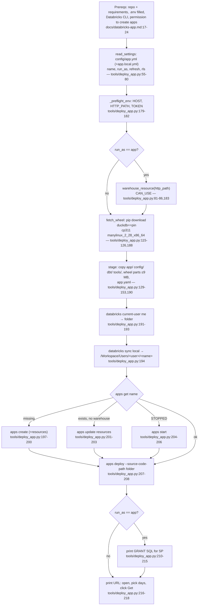

# Process: deploy as a Databricks App

`python tools/deploy_app.py` stages the app with a split DuckDB wheel, syncs it to `/Workspace/Users/<you>/<name>`, creates/updates/starts the app with the Databricks CLI and deploys it; then a viewer clicks "Get" to load data (`docs/databricks-app.md:49-91`, `tools/deploy_app.py:1-11`).



## Steps

1. Pick `run_as` in `config/app.yml` (`user` default, or `app`); `name` 2-30 lowercase/digits/dashes (`config/app.yml:4-10`, `tools/deploy_app.py:36-39`, `docs/databricks-app.md:26-47`). Overrides go in git-ignored `config/app.local.yml`, which wins (`config/app.yml:2`, `tools/deploy_app.py:59-60`).
2. Optional row-level access: `rls:` block (`enabled`, `table`, `columns`, `apply`), validated by `rls.validate` and carried into the staged `config/app.yml`, with `refresh.admins` (who may run Refresh when rls is on) (`config/app.yml:12-26`, `tools/deploy_app.py:69-77`, `tools/deploy_app.py:142-143`).
3. Run `python tools/deploy_app.py` from the repo root (`docs/databricks-app.md:51-55`).
4. Credentials come from `.env`/env through the export's `_preflight_env`; a token is always required to deploy (`tools/deploy_app.py:179-182`). The CLI gets `DATABRICKS_HOST=https://<host>` and `DATABRICKS_TOKEN`; `DATABRICKS_CONFIG_PROFILE` is removed (`tools/deploy_app.py:184-185`). No `databricks auth login` needed (`docs/databricks-app.md:23`).
5. DuckDB wheel downloaded once to `<data>/app-deploy/wheels` for Python 3.11 / Linux x86_64, pin from `requirements.txt` (`tools/deploy_app.py:44-46`, `tools/deploy_app.py:108-126`, `tools/deploy_app.py:186-188`). Other packages are pre-installed in Databricks Apps (`docs/databricks-app.md:59-61`).
6. Stage `<data>/app-deploy/<name>`: clears all but `.databricks`, copies `app config dbt tools` (skips `__pycache__`, `*.duckdb`, `target`, `logs`, `app.local.yml`), splits the wheel into `wheels/<wheel>.partNN` of ≤ 9 MB, writes `app.yaml` (`tools/deploy_app.py:33-35`, `tools/deploy_app.py:48`, `tools/deploy_app.py:129-153`).
7. Sync to `/Workspace/Users/<userName>/<name>` (`tools/deploy_app.py:191-194`).
8. Create the app if missing (with the warehouse resource for `run_as: app`), or add the warehouse, or start it when STOPPED (`tools/deploy_app.py:196-206`).
9. Deploy from the workspace folder (`tools/deploy_app.py:207-208`).
10. `run_as: app` only: a metastore admin runs the printed grants once — `USE CATALOG` on `system`, `USE SCHEMA, SELECT` on `access, billing, compute, lakeflow, query, serving, storage, data_classification, ai_gateway`, and the entitlements table when rls is on (`tools/deploy_app.py:41-43`, `tools/deploy_app.py:94-105`, `docs/databricks-app.md:70-84`).
11. Open the printed URL (or Compute › Apps), pick days, click **Get**; share via the app's Permissions › Can use (`docs/databricks-app.md:86-91`, `tools/deploy_app.py:216-217`). Runtime behaviour: `flows/databricks_app.md`.

## Update

- `git pull`, `python tools/deploy_app.py` again, then click **Get** — a redeploy wipes the disk (`docs/databricks-app.md:93-97`).

## Example (from tests)

- `tests/test_deploy_app.py:141-155`: the warehouse id is taken from the HTTP path; `grant_sql` covers every system schema for the principal.
- `tests/test_deploy_app.py:157-171`: the `rls` block merges key by key into the staged config; a bad block stops the deploy.
- Illustrative grant output (`tools/deploy_app.py:97-99`; principal id is a placeholder):

```sql
GRANT USE CATALOG ON CATALOG system TO `<service principal id>`;
GRANT USE SCHEMA, SELECT ON SCHEMA system.billing TO `<service principal id>`;
```

## Errors

| Message | Cause | Evidence |
|---|---|---|
| `config/app.yml is missing` | file removed | `tools/deploy_app.py:56-57` |
| `name in config/app.yml: 2-30 …` | bad name | `tools/deploy_app.py:63-64` |
| `run_as in config/app.yml: user … or app …` | other value | `tools/deploy_app.py:66-67` |
| `deploying needs DATABRICKS_TOKEN …` | no token | `tools/deploy_app.py:181-182` |
| `run_as: app needs a SQL warehouse HTTP path` | cluster path given | `tools/deploy_app.py:83-85` |
| `the Databricks CLI is not installed` | no `databricks` on PATH | `tools/deploy_app.py:156-158` |
| `databricks <cmd> failed: …` (token redacted) | CLI error | `tools/deploy_app.py:159-162` |

All errors exit 2 (`tools/deploy_app.py:219-221`).

## Security notes

- `run_as: user` stores the token in `app.yaml` in the workspace folder; anyone who can read that folder can read it (`docs/databricks-app.md:132-133`, `tools/deploy_app.py:150-151`).
- Without rls, every viewer sees everything the app's principal can read (`docs/databricks-app.md:130-131`).
- The export folder `results/<stamp>` on the app disk is unfiltered even with rls on (`docs/databricks-app.md:125-126`).
