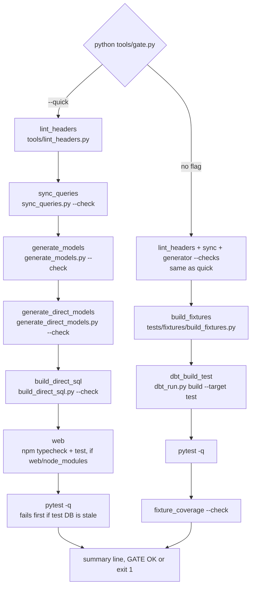

# Process: the gate (tools/gate.py)

`tools/gate.py` runs the repo's checks in two modes: `--quick` (lint, generated-file sync, web, pytest against the existing test DB) and full (the same lint and sync checks, then fixtures, dbt test build, pytest, fixture coverage); it prints a summary and exits 0 only when every step passed or was skipped.

## Steps

| Step | Mode | Command | Skips when | Evidence |
|---|---|---|---|---|
| `lint_headers` | both | `python tools/lint_headers.py` | never | `tools/gate.py:58-62` |
| `sync_queries` | both | `python tools/sync_queries.py --check` | `tools/sync_queries.py` missing | `tools/gate.py:65-74` |
| `generate_models` | both | `python tools/generate_models.py --check` | script missing | `tools/gate.py:77-86` |
| `generate_direct_models` | both | `python tools/generate_direct_models.py --check` | script missing | `tools/gate.py:89-98` |
| `build_direct_sql` | both | `python tools/build_direct_sql.py --check` | never | `tools/gate.py:101-104` |
| `web` | quick | `npm --prefix web run typecheck` then `npm --prefix web test` | no `npm` or no `web/node_modules` | `tools/gate.py:107-117` |
| `pytest` | both | `python -m pytest -q`; exit 5 (no tests) counts as ok; in `--quick`, fails up front with "stale test DB" when `tests/db_audit_test.duckdb` is older than its sources (`_stale_test_db` reuses `tests/conftest.py` `_stale_sources`) | never | `tools/gate.py:120-126`, `tools/gate.py:120-147` |
| `build_fixtures` | full | `python tests/fixtures/build_fixtures.py` | builder script missing | `tools/gate.py:150-159` |
| `dbt_build_test` | full | `python tools/dbt_run.py build --target test` | `dbt/dbt_project.yml` missing | `tools/gate.py:162-176` |
| `fixture_coverage` | full | `python tools/fixture_coverage.py --check` | script missing | `tools/gate.py:179-190` |

- Order and modes: `quick()` `tools/gate.py:202-212`, `full()` `tools/gate.py:215-227`, arg parsing `tools/gate.py:230-238`.
- Every step runs even after a failure (`ok &= ...`); result printed as `gate summary: name=status ...` then `GATE OK` or exit 1 (`tools/gate.py:193-199`).
- Commands stream live from the repo root (`tools/gate.py:51-55`).

## What each check proves

- Headers valid and app manifest in sync (`tools/lint_headers.py:4-11`).
- Vendored tree matches `config/vendored.lock` (`tools/sync_queries.py:58-63`).
- dbt `f_`/`d_` models and `app/direct_sql` match their sources (`tools/generate_models.py:7`, `tools/generate_direct_models.py:7-8`, `tools/build_direct_sql.py:3`).
- Built test DB matches fixtures and every executable check has a grain and a test (`tools/fixture_coverage.py:1-30`).
- pytest covers dashboards, web dist, API, tags, etc. (see `processes/tests.md`).

## Notes

- `--quick` needs `tests/db_audit_test.duckdb` from a full run (`README.md:752`); full takes about 30 min (`README.md:748`).
- The existence probes (`skip: ... not present yet`) date from the build-up phase; all probed files exist now, so they never skip in this checkout (inferred; the 2026-11-10 review calls them dead, `reviews/review-2026-11-10-repo.html:114`).
