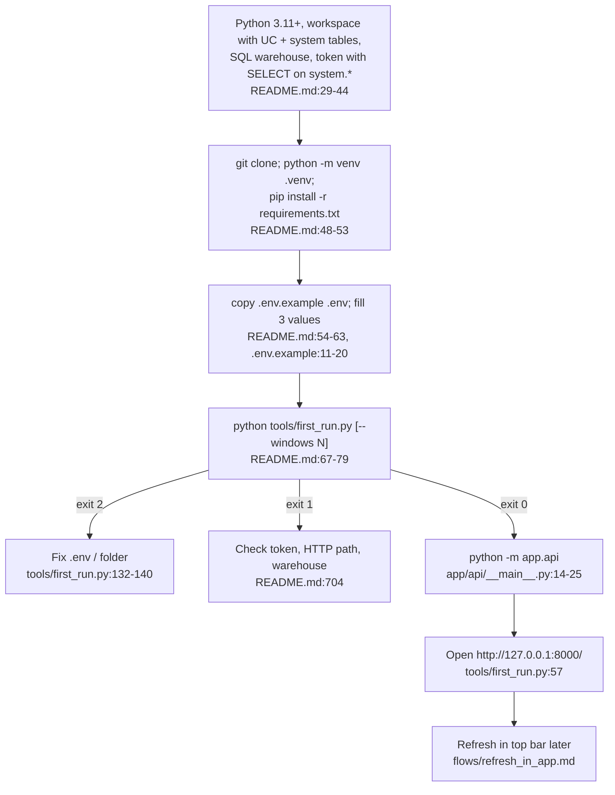

# Process: run the app locally

Set up once (venv, `pip install -r requirements.txt`, `.env`), then `python tools/first_run.py` and `python -m app.api`, open `http://127.0.0.1:8000/` (`README.md:46-72`).

## Steps

1. Prerequisites: Python 3.11+ (tested 3.12), Unity Catalog with system tables, a SQL warehouse HTTP path, a token that can `SELECT` `billing, compute, lakeflow, query, access, serving, storage, information_schema` (+ `data_classification`, `ai_gateway`) (`README.md:29-42`). Node not needed — UI is prebuilt in `app/web/dist` (`README.md:44`).
2. Set up: clone, venv, `pip install -r requirements.txt`, `copy .env.example .env` (`README.md:48-55`).
3. Fill `.env` (git-ignored; never commit): `DATABRICKS_SERVER_HOSTNAME` (no `https://`), `DATABRICKS_HTTP_PATH`, `DATABRICKS_TOKEN` (`.env.example:1-20`, `README.md:57-63`). Env vars with the same names also work and win over `.env` (`tools/export_direct_results.py:816-849`).
4. Export + load: `python tools/first_run.py` (30 days by default = `default_window`; `--windows 90` for 90) (`README.md:67-79`, `config/settings.yml:18`). Details: `flows/export_load_serve.md`.
5. Start the app: `python -m app.api`; first line prints the db it opened (`app/api/__main__.py:18`, `README.md:200`). Port busy → `AUDIT_API_PORT` (`README.md:717`).
6. Open `http://127.0.0.1:8000/`; stop with Ctrl+C (`README.md:72`).
7. Re-run `first_run.py` only with the app stopped on Windows, or use Refresh in the app (`README.md:80-81`, `README.md:95-103`).

## Variants

- Hand-run steps with more options: `python tools/export_direct_results.py --out <folder> [options]` then `python tools/load_direct_results.py <folder>` (`README.md:105-124`, `tools/export_direct_results.py:1416-1454`).
- Load without a folder → newest export in the data folder; `--db PATH` writes elsewhere (`README.md:174-175`, `tools/load_direct_results.py:908-911`).
- Point the app at a specific db: `AUDIT_DB=<path>` (`README.md:193-198`, `tools/load_direct_results.py:974-977`). Test fixture: `AUDIT_DB=tests/db_audit_test.duckdb` (`app/api/__main__.py:3`).
- Different data folder: `AUDIT_DATA_DIR` (must be outside the repo) (`README.md:187`, `app/core/datasource.py:29-31`).
- dbt dev path (older): `python tools/snapshot.py --out snapshot` then `python tools/dbt_run.py build --target dev` → `data/db_audit.duckdb` (`tools/snapshot.py:8-10`, `tools/dbt_run.py:4`, `tools/dbt_run.py:369-373`).

## Where things land

| Item | Location | Evidence |
|---|---|---|
| Data folder | Windows `%LOCALAPPDATA%\databricks-audit`, macOS `~/Library/Application Support/databricks-audit`, Linux `~/.local/share/databricks-audit` | `app/core/datasource.py:14-26`, `README.md:181-185` |
| Export | `<data>/results/<stamp>/` | `tools/first_run.py:102-106` |
| Db | `<data>/audit.duckdb` + `audit.run_results.json` | `app/core/datasource.py:43-48`, `tools/load_direct_results.py:863` |
| Current db pointer | `<data>/current_db.txt` | `app/core/datasource.py:51-62` |

## Troubleshooting (from README)

| Symptom | Fix | Evidence |
|---|---|---|
| Step 1 exits 2, missing credential | Fill `.env` | `README.md:703`, `tools/first_run.py:133-140` |
| Step 1 exits 1 | Token, HTTP path, warehouse | `README.md:704` |
| `ImportError` / DLL load failed | `python -m pip install -r requirements.txt` with the same python | `README.md:705`, `tools/first_run.py:146-147` |
| "N failed" | Read `results/<time>/report.md` | `README.md:706` |
| Step 2 fails / Windows permission error | Stop the app, rerun the load | `README.md:708-709`, `tools/first_run.py:151-156` |
| Out of Memory in load | Lower `load.threads` / `load.top_tag_keys` | `README.md:710` |
| Folder refused (exit 2) | Pick a folder outside the repo | `README.md:711`, `tools/export_direct_results.py:1125-1129` |
| "config/settings.yml needs a fix" | Fix the named key/line | `README.md:713`, `app/api/app.py:348-376` |
| Git Bash rewrites `/sql/1.0/...` | Use PowerShell or `.env` | `README.md:718`, `tools/snapshot.py:526-530` |
