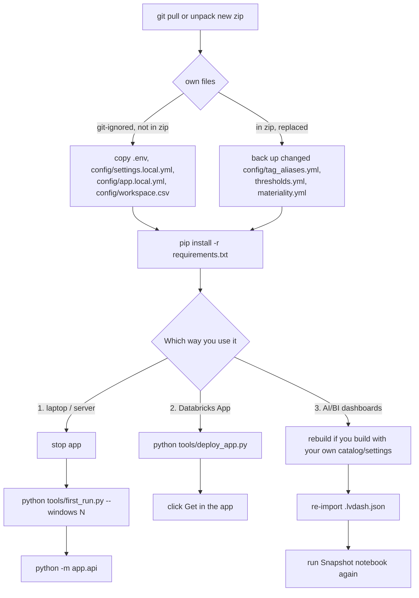

# Process: update to a new version

Get the new code, keep your own git-ignored files, reinstall, re-export, restart; for the Databricks App redeploy and click Get; for the dashboards rebuild, re-import and rerun the notebook.

## Way 1: run anywhere

From `README.md:246-258`:

1. Download the new zip or `git pull` (`README.md:248`).
2. Keep `.env` and `config/settings.local.yml` (not in the zip); back up `config/tag_aliases.yml`, `thresholds.yml`, `materiality.yml` if you changed them, they are replaced (`README.md:249-252`).
3. `pip install -r requirements.txt` (`README.md:253`).
4. Stop the app, then `python tools/first_run.py --windows <days>`; new or changed checks show only after a new export (`README.md:254-255`). On Windows the load cannot replace `audit.duckdb` while the app has it open (`README.md:80-81`).
5. `python -m app.api` (`README.md:256`).

- The data folder is outside the repo, so an update never touches it (`README.md:258`).
- If `config/thresholds.yml` differs from the baked SQL the export stops; run `python tools/build_direct_sql.py` (`README.md:389-392`, `tools/export_direct_results.py:357-358`).
- Git-ignored own files: `.gitignore:2-5`, `21`.

## Way 2: Databricks App

From `docs/databricks-app.md:93-97`:

1. `git pull` or unpack the zip.
2. `python tools/deploy_app.py` again; a changed `run_as` applies from this deploy.
3. Click **Get**: a redeploy wipes the app's disk.

- `config/app.local.yml` wins over `config/app.yml` and survives an update (`docs/databricks-app.md:46-47`).

## Way 3: AI/BI dashboards

- New numbers: rerun the notebook (`databricks_dashboards/README.md:98-102`).
- New version: the repo ships rebuilt files in `databricks_dashboards/`; with your own catalog, rebuild with `python tools/build_databricks_dashboards.py --catalog <c> --out-dir <folder>` (`databricks_dashboards/README.md:72-77`). Re-import each `.lvdash.json` (`databricks_dashboards/README.md:65-70`) and re-import/run the new `Lakehouse Health 00 - Snapshot.py` so new checks get tables (inferred: the dashboards read only tables the notebook made, `tools/build_databricks_dashboards.py:3-6`).
- Direct dashboards: rebuild with `python tools/build_direct_dashboards.py` if you use custom tags, classes or sizes schema (`README.md:484-485`); after an upgrade run the `data_usage_sizes.py` job once before opening Data usage (`databricks_dashboards/system_tables_direct/README.md:33-35`).
